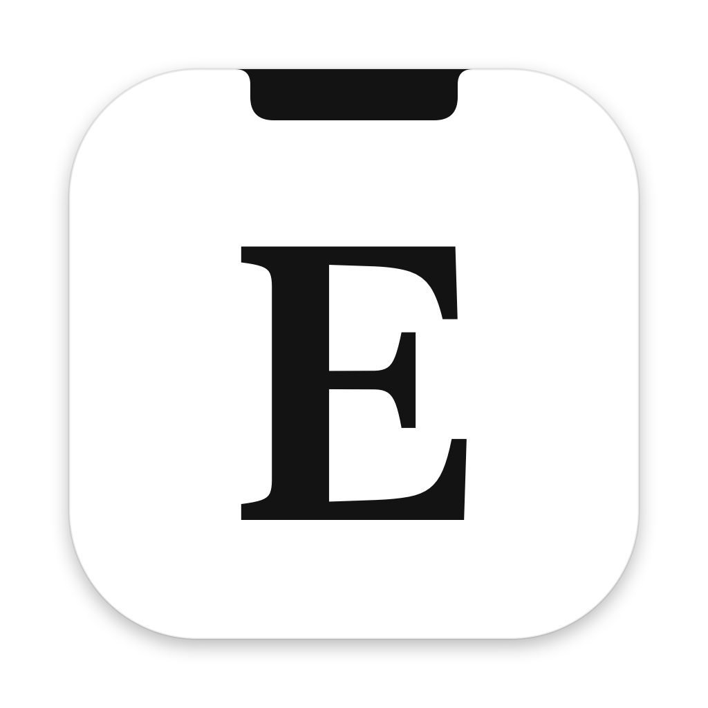

<p align="center">
  
</p>

# Englishwords

一个「刘海查词 + 翻译」的 macOS 应用。参照 **Dipword 0.8.3** 的产品形态自主实现，
代码与素材均未复用；词库使用 ECDICT（MIT），词根词缀数据由本项目整理（CC BY-SA 4.0）。

当前实现覆盖设计文档 [0001-Englishwords-M0至M5实施方案](docs/design/0001-Englishwords-M0至M5实施方案.md)
的 M0—M5：真实词库、多源查词、刘海面板、悬停/划词取词、本地与联网翻译。

```
Englishwords/
├── docs/
│   ├── ARCHITECTURE.md          ← 架构与逆向分析
│   ├── design/                  ← 设计文档（M0—M5 实施、商业化与授权）
│   ├── dipword-analysis/        ← 独立复核报告
│   └── images/
├── demo/                        ← 交互原型（HTML，仅演示）
└── macos-starter/               ← 原生应用
    ├── Package.swift
    ├── build.sh                 ← Universal 打包
    ├── test.sh                  ← 核心逻辑测试
    ├── data/                    ← 词素源数据 + 来源说明
    ├── scripts/                 ← 数据库生成脚本
    └── Sources/Englishwords/
        ├── App/                 ← 入口、菜单栏、资源定位
        ├── Lookup/              ← 分类、AX 取词、协调器、悬停/划词
        ├── Dictionary/          ← SQLite 词库、词素、系统词典桥
        ├── Notch/               ← 几何、面板状态机、结果视图
        ├── Translate/           ← Apple 本地 / 联网 / 缓存
        ├── Settings/            ← 偏好与设置窗口
        └── Support/             ← 热键、权限、钥匙串、日志
```

---

## 1. 它现在能做什么

| 能力 | 状态 |
|---|---|
| 菜单栏常驻、无 Dock 图标、Carbon 全局热键 | ✅ |
| `⌥D` 查词（词典优先）、`⌥T` 直接翻译选中内容 | ✅ |
| 菜单里「自动取词」可分别开关悬停 / 划词 | ✅ |
| 内置词库查词（4.3 万词条）与屈折还原（`abandoned → abandon`） | ✅ |
| 词根词缀拆解 + 词源，三色渲染（`un / believ / able`） | ✅（147 词覆盖） |
| 未命中时回落 macOS 系统词典 | ✅ |
| 单词/短句翻译：Apple 本地优先，联网可选降级 | ✅（需准备语言包 / 配置服务） |
| 刘海面板：紧凑态、悬停展开、离开收起、Esc 关闭、不抢焦点 | ✅ |
| 悬停取词：鼠标停在单词上 0.35s 自动出结果（需辅助功能） | ✅ |
| 划词取词：拖选后自动出结果（AX 读不到时模拟 ⌘C 再还原剪贴板） | ✅ |
| 区域取词（默认 `⌥R`） | 已实现，需屏幕录制权限 |
| 字幕查询、上下句导航、字幕点词与双语显示 | 已接入，默认关闭，真实站点待验收 |
| 笔记本（收藏、历史、近七天与常查词统计） | 已实现，数据保存在本机 |
| StarDict 导入、词典启用与排序 | 已实现，支持文本释义及压缩正文 |
| 分页设置、快捷键录制、权限中心、翻译服务预设和诊断导出 | 已实现，权限与联网服务待实机验收 |

查词顺序是 **内置词库 → 系统词典 → 翻译**；词素查询独立执行，释义未命中也会显示。
数据库故障与「正常未命中」严格区分：前者在面板上标注降级原因，不会伪装成未收录。

---

## 2. 构建与运行

需要 macOS 15+ 和 Xcode Command Line Tools（本机未装完整 Xcode）。

```bash
cd macos-starter
./build.sh                 # Universal (arm64 + x86_64) + 随包词库
open build/Englishwords.app
```

`build.sh` 会做三件额外的事：检查产物同时包含两种架构、把 SwiftPM 资源包放进
`Contents/Resources`、清空 `EW_DICT/EW_PARTS` 后跑一次真实查词自检。

开发时直接跑：

```bash
swift build --disable-sandbox
.build/out/Products/Debug/Englishwords
```

> `--disable-sandbox` 只是绕开本机受限环境里 SwiftPM 清单沙箱的限制；普通终端可省略。

### 自检命令

```bash
# 取词诊断：授权状态、前台应用、选区可读性、指针取词
.build/out/Products/Debug/Englishwords --diagnose

# 词库是否随包可用（退出码 0 命中 / 2 未命中 / 3 词库错误）
.build/out/Products/Debug/Englishwords --check-word unbelievable

# 指针位置能否取到词（AX 坐标，左上原点）
.build/out/Products/Debug/Englishwords --pick-word 240 116

# 真实 Apple 本地翻译
.build/out/Products/Debug/Englishwords --translate "The quick brown fox."

# 离屏渲染面板（word / sentence / loading / miss / failure）
.build/out/Products/Debug/Englishwords --render-preview /tmp/panel.png word

# 启动后立即展示一次查询 / 打开设置窗口，便于截图核对布局
.build/out/Products/Debug/Englishwords --demo-lookup unbelievable
.build/out/Products/Debug/Englishwords --demo-settings
```

### 测试

```bash
cd macos-starter
./test.sh
```

测试还覆盖查询取消与超时、字幕断句和中文轨对齐、笔记本持久化、StarDict 来源排序及翻译协议解析。
在同一目录可运行 `PYTHONDONTWRITEBYTECODE=1 python3 -m unittest discover -s scripts/tests -v`，验证词素构建和抽取。

Sparkle 构建可以用 `EW_ENABLE_SPARKLE=1 ./build.sh` 在本机验证。正式 DMG 和 appcast 条目由
`release.sh` 生成，需先配置稳定签名身份和 EdDSA 更新密钥。见 [发布签名准备](macos-starter/scripts/make_signing_cert.md)。

---

## 3. 权限与配置

| 项 | 说明 |
|---|---|
| 辅助功能 | 悬停、划词、读取选中文字需要。入口随系统版本变化：**macOS 26 起是「隐私与安全性 → 设备控制和数据访问」**，更早是「隐私与安全性 → 辅助功能」。打开 Englishwords 开关后**退出并重开应用**。未授权时 ⌥D/⌥T 仍可用，但只能读剪贴板，面板会注明「已改用剪贴板」。 |
| 语言包 | Apple 本地翻译需要系统语言包。设置 → 翻译 → 「准备语言包」，在弹出窗口点「开始准备」，由系统下载。 |
| 屏幕录制与自动化 | 区域取词和屏幕字幕需要录屏权限。启用浏览器字幕后，浏览器直读还需要允许 Apple 事件及其 JavaScript。可在设置 → 通用查看状态。 |
| 联网翻译 | 默认关闭。开启后仅在本地不可用或失败时，才把待翻译文本发送到所配置的服务。服务地址、模型存 UserDefaults，密钥只进 Keychain。 |
| 日志 | 只写诊断信息，不包含查询正文、翻译请求内容或密钥。 |

---

## 4. 数据

两个 SQLite 随包分发，也可从公开输入重建（详见 `data/SOURCES.md`）：

| 文件 | 内容 | 来源与许可 |
|---|---|---|
| `dictionary.sqlite` | 43,330 词条 / 29,519 屈折形式 | ECDICT，MIT |
| `wordparts.sqlite` | 170 个语素 / 147 个词的拆分与词源 | 本项目整理，CC BY-SA 4.0 |

```bash
cd macos-starter
python3 scripts/build_dictionary.py --input scripts/.cache/ecdict.csv \
  --output Sources/Englishwords/Resources/dictionary.sqlite
python3 scripts/build_wordparts.py
```

脚本会校验完整性、`forms.lemma` 可回溯、`segments` 能拼回原词、语素引用有效；
任一失败非零退出且不覆盖已有文件。**词素覆盖有限，没有拆分的词如实缺省，不做猜测。**

---

## 5. 取不到词时怎么排查

菜单栏图标 → **取词诊断…**（或 `--diagnose`）会逐项告诉你卡在哪：

| 输出 | 含义与处理 |
|---|---|
| 辅助功能：未授权 | 系统设置 → 隐私与安全性 → **设备控制和数据访问**（macOS 15 及更早叫「辅助功能」），把 Englishwords 的开关打开；不在列表里就点 `+` 选 `.app`，然后**退出重开** |
| 上次取词：未读到选区 | 当前控件不暴露选区。换到可选中文本的应用，或直接用 ⌥T 读剪贴板 |
| 上次取词：未授权…改用剪贴板 | 同上，先授权 |
| 指针处取词：取不到 | 该控件不支持按字符定位（部分 Electron / 画布应用）；用划词或 ⌥T |
| 前台应用：…（被动取词已排除） | 密码管理器等应用在排除名单内，被动取词不生效 |

面板底部的橙色小字也会说明降级原因，例如「没有读到选中文字，已改用剪贴板」。

> 注意：`--diagnose` 从终端运行时，辅助功能状态会**继承终端的授权**，可能显示「已授权」但应用本身其实没有权限。
> 以菜单里的「取词诊断…」（应用自己进程）为准。运行日志在 `~/Library/Logs/Englishwords/app.log`，只记录来源与降级原因，不含查询内容。

---

## 6. 已知边界与未验证项

诚实标注，避免把「能编译」当成「验收通过」：

- **联网翻译未用真实密钥验证**：只验证了请求构造与响应解析逻辑，没有可用凭据，因此没有真实调用记录。
- 本地翻译需要系统语言包；未安装时 `--translate` 会明确提示去「设置 → 翻译 → 准备语言包」，不会伪装成功。
- **多屏 / 无刘海 / Intel 未实机覆盖**：只在当前内置刘海屏（1470×956，刘海 179×32）验证；
  外接屏的模拟刘海与 Intel 架构仅保证构建通过。
- **Esc 关闭依赖辅助功能**：全局键盘监听沿用同一授权；未授权时 Esc 不生效。
- **换位置运行要重新授权**：辅助功能授权按应用路径生效。把 `.app` 挪到别处或换一份产物，
  都要在系统设置里重新勾选一次。
- **词素覆盖有限**：147 个词有拆分，其余只显示释义。
- **字幕与发布验收**：真实视频站点、双版本升级及签名身份对系统权限的影响待实机验证。
- 面板不做毛玻璃，纯黑底以适配任意壁纸。

---

## 7. 许可

本仓库代码由本项目编写。第三方数据与许可见
[THIRD-PARTY-NOTICES.md](macos-starter/Sources/Englishwords/Resources/THIRD-PARTY-NOTICES.md)。

| 数据 / 组件 | 许可 |
|---|---|
| ECDICT | MIT |
| 词根词缀整理数据 | CC BY-SA 4.0 |

Dipword 本体是专有软件，其代码、UI 素材、图标均**未**用于本工程。
