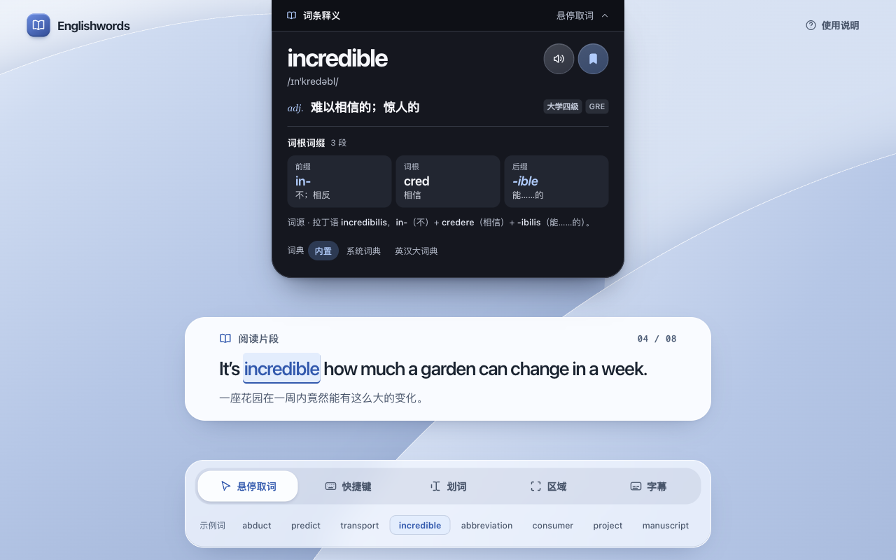

# Englishwords 交互演示

双击 [notch-demo.html](notch-demo.html) 即可离线体验。

- **查词**　点选英文例句中标出的单词，或将鼠标移到顶部刘海，即可查看音标、释义、词根和词源。底部可切换 8 个示例词及取词方式。
- **字幕**　点底部「字幕」，再选择任一句，阅读区的中英文和时间会随之更新。
- **键盘**　按 H 展开或收起，Esc 收起。Tab 可以依次访问面板和工具栏，Enter 或空格可操作当前按钮。
- **朗读与收藏**　朗读调用浏览器语音，收藏按单词记录到当前页面，刷新后清空。

页面跟随系统明暗外观、减少动态效果和降低透明度偏好。可在文件地址末尾添加 `?open=1` 直接展开查词面板，或添加 `?mode=subs&open=1` 打开字幕示例。

示例词、句子和字幕随页面提供。词典和取词方式切换用于体验界面，跨应用取词和实时字幕由原生客户端提供。

