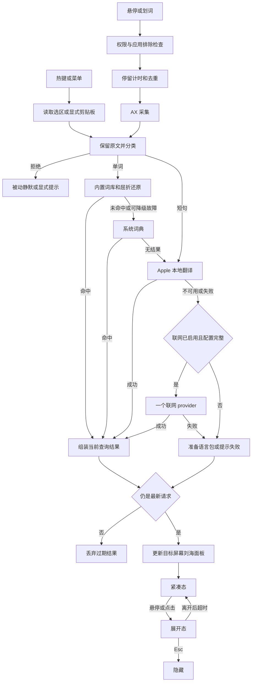

# 设计文档：Englishwords M0—M5 实施方案

- RFC：0001
- 日期：2026-11-03
- 状态：草稿
- 架构基准：[ARCHITECTURE.md](../ARCHITECTURE.md)，重点为第 5—9、12—14 节。
- 实施仓库：`Englishwords`（仓库根目录）
- 本次交付仅为设计文档；以下改动与验收均未实施。

## 1. 需求理解

在现有原生骨架上，一次推进到架构文档定义的 M5，补齐 M0—M4 的实际缺口。
用户可以通过热键、悬停和划词查询真实词典，看到词根词缀，并通过刘海面板阅读结果。
单词未命中或选择短句时，支持 Apple 本地翻译和一个联网服务；默认本地处理。
应用打包后可以双击运行，不依赖终端环境变量；面板不打断原应用输入。
范围止于 M5，不包含字幕、区域 OCR 和完整收藏系统。

### 1.1 已核对的现状

本节路径相对仓库根目录；后文 `Sources/Englishwords/` 路径均相对 `macos-starter/`。

| 已核对文件 | 当前职责与证据 |
|---|---|
| `README.md`、`docs/ARCHITECTURE.md` | README 描述骨架；架构第 14 节定义 M0 数据、M1 热键查词、M2 多源词典、M3 刘海、M4 悬停划词、M5 翻译 |
| `macos-starter/Sources/Englishwords/AppDelegate.swift` | 菜单、AX 选中文字、剪贴板兜底、同步调用词库及面板 |
| `macos-starter/Sources/Englishwords/Dictionary.swift` | `Entry`、`Segment`、SQLite 查询、屈折还原及六个演示词；真实数据库只从环境变量读取 |
| `macos-starter/Sources/Englishwords/PanelController.swift` | 非激活 NSPanel，固定宽度，使用 `NSScreen.main`，显示七秒后隐藏 |
| `macos-starter/Sources/Englishwords/ResultView.swift` | 释义、标签、词素、词源及朗读 UI；星标仅为临时状态 |
| `macos-starter/Sources/Englishwords/HotKey.swift` | Carbon 热键注册与注销，可直接复用 |
| `macos-starter/Sources/Englishwords/main.swift`、`PreviewRenderer.swift` | AppKit 入口与离屏预览；后者实际位于同一源码目录 |
| `macos-starter/Package.swift`、`build.sh`、`Resources/Info.plist` | macOS 15、SwiftPM、Swift 5 语言模式、临时签名打包；无数据库资源声明，未显式构建双架构 |
| `demo/README.md` | 原型交互属于演示；文末架构链接指向不存在的旧路径 |

文档与代码差异以代码为准：

1. 架构要求用 `segments` 内的实际拼写显示拆分；`parseSegments` 当前使用 `parts.label`，例如会混淆 `believ` 与 `believe`。
2. `morphology(for:)` 查询 `origin`，但只返回片段数组，未向真实词条传递词源。
3. `normalize` 删除空格和标点，会把句子拼成一个字符串；必须与翻译原文处理分离。
4. `lookup` 对未知词返回翻译占位 `Entry`，不是真实未命中，尚不能作为多源降级依据。
5. 面板没有架构所述的紧凑/展开状态机和离开后计时；UI 显示 Esc 提示，但已核对代码无对应处理。
6. README 中关于 CLT 和 SwiftUI 宏的说明属于已有项目记录；当前工具链兼容性尚未在本次验证，不能据此直接判定 Apple Translation 可用。

### 1.2 假设与待确认事项

- 假设：首期以英译中为主；联网只接入一个 OpenAI-compatible provider，具体服务由配置指定，不实现供应商列表。
- 假设：热键保留现有选区优先、剪贴板兜底行为；悬停和自动划词不读取剪贴板。
- 待确认：Apple Translation 在现有工具链中的编译条件、会话托管方式、语言包准备流程和目标硬件支持，实施第一阶段验证。
- 待确认：公开词素数据的具体来源、版本、可构建覆盖率与许可。不得把参考产品的记录数或许可声明直接当作新数据集的事实。
- 待确认：真实刘海屏、外接屏、Intel 设备的可用测试条件，以及实际联网服务凭据。

## 2. 接口改动

本项目没有需要变更的 HTTP 服务端接口。下列新增类型、方法及路径均为**拟议设计，尚不存在**；现有方法明确注明。错误采用 Swift 类型，不引入 HTTP 错误码。

### 2.1 查询与词典接口

| 路径与改动 | 入参与出参 | 错误及兼容性影响 |
|---|---|---|
| 修改 `AppDelegate.swift` 的 `triggerLookup(source:preferClipboard:)` | 保持菜单/热键入口；读取原文后提交统一协调器 | 不再同步串接词库与面板；空输入只在显式操作时提示 |
| 新增 `Lookup/LookupCoordinator.swift` 的 `submit(_:)`、`cancel()` | 输入拟新增 `LookupRequest`：原文、来源、触发位置；输出可观察的 `LookupState` | 状态包括加载、结果、未命中、失败；取消不展示错误。每次请求带标识，只允许最新请求更新 UI |
| 新增 `Lookup/TextFilter.swift` 的 `classify(_:)` | 原文和来源 → 单词、短句或拒绝；原文始终保留，单词才生成规范化查询词 | 被动入口过滤 URL、邮箱、数字等；不再复用现有 `normalize` 清洗整句 |
| 新增 `Lookup/AXPicker.swift` 的 `selectedText()`、`word(at:)` | 选区或指针坐标 → 文本及来源位置，可为空 | 从 `AppDelegate.selectedText()` 提取复用；区分未授权与无文本。指针范围无法可靠定位时不提交整段内容 |
| 修改 `Dictionary.swift` 的 `DictionaryStore.lookup(_:)` | 单词查询键 → `Entry?`；拟改为可抛出数据库错误 | `nil` 表示真实未命中，打开/查询失败用 `DictionaryError` 表达；移除未知词占位，同步更新调用方和预览 |
| 修改 `Dictionary.swift` 的词素查询及 `parseSegments` | 返回词素片段和词源；`Segment.label` 使用编码中的实际拼写 | 保留 `Entry` 与三色渲染；元数据缓存按语素 ID 访问。词典形态仅在 UI 确有使用时增加独立字段 |
| 新增 `Dictionary/SystemDictionaryBridge.swift` 的 `lookup(_:)` | 单词 → 系统词典条目或无结果 | 系统词典不可用/未安装时允许继续翻译；不保证系统释义为中文 |

协调器中的单词顺序为内置词库 → 系统词典 → 翻译；短句直接翻译。沿用现有屈折还原逻辑，并在结果中区分输入词与词典词头。词素作为补充查询独立执行，不因释义未命中而丢弃。数据库故障与正常未命中必须保留区分；前者可降级，但不能伪装成正常数据库命中。

新增协调器、系统词典桥和文本分类的原因是现有代码没有这些职责；从既有代码提取功能后删除原位置的重复逻辑，不保留第二条查询链路。

### 2.2 触发与面板接口

- 新增 `Lookup/HoverMonitor.swift` 和 `Lookup/SelectionMonitor.swift`，提供 `start/stop`，输出统一 `LookupRequest`。悬停采用停留计时、节流、去重；划词在选择结束后采集。权限丢失、关闭开关或指针移开时取消待处理任务。
- 复用 `HotKey.swift` 的 `HotKeyCenter.register`，增加注册结果或类型化错误反馈，不替换 Carbon 注册机制。
- 扩展 `PanelController.swift`：将现有 `show(_:trigger:)` 收敛到接收统一结果状态和目标屏幕的入口，保留 `hide()`。管理隐藏、紧凑、展开及唯一收起计时器；指针进入停止计时，离开重新计时。
- 新增 `Notch/NotchGeometry.swift`，输入屏幕参数及内容尺寸，输出紧凑/展开布局。真实刘海使用系统可用区域；无刘海采用模拟形态；显示器变化时重新定位。禁止把缺失的刘海区域简单当成整屏宽度的刘海。
- 修改 `ResultView.swift`：复用现有词条、标签、三色词素组件，增加加载、译文、失败状态和长文本滚动；首次点击直接生效，普通结果面板不激活应用。补齐不吞掉原应用正常按键的 Esc 收起行为。
- 朗读对象由稳定生命周期对象持有，以实际完成回调更新状态；M5 隐藏尚未持久化的收藏按钮。
- `PreviewRenderer.swift` 改用显式演示数据和状态输入，保留 `--render-preview`，不把演示数据作为正式查询失败兜底。

### 2.3 翻译与配置接口

- 新增 `Translate/TranslationCoordinator.swift`：`translate(_ request: TranslationRequest) async throws -> TranslationResult`。请求包含原文、源语言和目标语言；结果包含译文及实际服务来源。错误区分语言不可用、需要准备语言包、配置缺失、超时、服务失败与取消。
- 新增 `Translate/AppleTranslate.swift` 和 `Translate/OpenAICompatProvider.swift`，共用最小 `translate` 契约。现有实现仅有翻译占位，无法复用为真实服务；不新增多供应商注册体系。
- 默认使用 Apple 本地翻译。联网开关默认关闭；开启且配置完整后，本地不可用或失败可降级到联网。语言包准备通过用户主动打开的窗口完成，不能假设普通非激活面板能够承担系统授权交互。
- 缓存键包括原文、语言对及服务配置；缓存仅驻留内存，限制并发，替换请求时取消旧任务，不无限重试。
- 新增 `Settings/Preferences.swift`、`Settings/SettingsWindow.swift`，只提供悬停/划词开关、必要时长及联网配置。使用 UserDefaults 保存非敏感配置；语言准备和设置窗口可由用户主动激活。
- 新增 `Support/SecretStore.swift` 的读写/删除接口，服务标识为输入，密钥读写结果为输出；Keychain 错误映射为可理解的配置失败。配置界面不回显完整密钥，日志不得包含密钥或请求正文。

### 2.4 构建与资源接口

- 拟新增 `macos-starter/scripts/build_dictionary.py`、`build_wordparts.py`：输入固定版本的公开源文件，输出两个 SQLite 文件及来源说明；输入格式、许可或引用校验失败时非零退出，不覆盖已验收资源。
- 修改 `Package.swift`、`build.sh`，声明并打包数据库和许可；资源加载适配实际 SwiftPM 资源包位置，并验证打包后加载方式。开发环境变量覆盖保留，正式默认读取随包资源。
- 显式构建 arm64/x86_64，合并并检查 Universal 产物；临时签名仍用于本机交付，正式签名、公证不属于本 RFC。

## 3. 数据库改动

### 3.1 Schema 与资源

复用 README 与现有 SQL 所约定的 schema，不改变既有列含义。当前仓库尚未提供可重建的正式数据资源，本次补充生成流程及随包数据库，而不是迁移已存在的用户业务数据库。

| 数据库 | 复用/构建的表 | 用途 |
|---|---|---|
| `dictionary.sqlite` | `words(word PRIMARY KEY, phonetic, translation NOT NULL, pos, tag, frq)` | 词条 |
| `dictionary.sqlite` | `forms(form PRIMARY KEY, lemma NOT NULL)` | 屈折还原 |
| `wordparts.sqlite` | `parts(id INTEGER PRIMARY KEY, role NOT NULL, label NOT NULL, zh NOT NULL, en NOT NULL, lemma)` | 词素元数据 |
| `wordparts.sqlite` | `words(word PRIMARY KEY, segments NOT NULL, origin)` | 拆分及词源 |
| `wordparts.sqlite` | `meta(key PRIMARY KEY, value NOT NULL)` | 按架构已有设计保存版本、来源与许可信息；具体键在选定数据源后确定 |

除 `parts` 的整数 ID 外，各列沿用架构的 TEXT/INTEGER 类型定义；字符串主键表沿用 `WITHOUT ROWID`。本次不新增词频排序或原形反查功能，因此不新增 `words(frq)`、`forms(lemma)` 索引；精确查询复用主键索引。

生成时验证 SQLite 完整性、`forms.lemma` 可解析、`segments` 编码合法及语素引用有效。词素覆盖不足时如实缺省，不杜撰拆分。分别保留源数据版本、转换规则和许可声明；不要求与参考产品条目数完全一致。

### 3.2 迁移与回滚 DDL

- 迁移：无用户表迁移；应用运行时只读资源数据库，生成完成后随新应用版本整体交付。
- 回滚 DDL：无。本次不对用户现有数据库执行 `ALTER`、`UPDATE` 或 `DROP`；回滚使用上一版配套的数据库资源和应用。
- 环境变量指定的外部数据库保持只读，若 schema 不符合约定，提示配置问题，不自动重写。
- 用户配置使用 UserDefaults、密钥使用 Keychain；不为 M5 新建收藏、历史或统计表。

## 4. 流程图

词素补充查询与释义来源无关，在组装单词结果时合并。图中的故障降级仍保留诊断原因，不把数据库故障记为普通未命中。

## 5. 范围边界

### 5.1 本次做与实施顺序

| 顺序 | 阶段 | 具体交付与依赖 |
|---|---|---|
| 1 | 查询基础与技术验证 | 提取统一协调器及文本分类，保留热键链路；验证 Apple 翻译工具链、会话和语言准备条件，尽早解决 M5 阻塞 |
| 2 | M0 数据 | 选定可追溯公开源，生成两个数据库及许可，接入应用资源加载 |
| 3 | M1—M2 查词 | 移除占位未命中，修正词素及词源，接入系统词典，明确数据库错误与无结果区别 |
| 4 | M3 面板 | 在现有 NSPanel 上补状态机、屏幕几何、悬停展开、离开后收起、Esc 与长文本展示 |
| 5 | M4 自动入口 | 新增悬停/划词监听，复用 AX 与协调器，完成过滤、去重、权限与应用排除 |
| 6 | M5 翻译 | 接入本地和一个联网服务、取消与缓存、最小配置窗口和 Keychain |
| 7 | 集成交付 | 验证资源随包加载、双架构产物和核心实机交互；更新 README 并修复原型说明的旧架构链接 |

这是一次目标明确的交付，阶段顺序用于控制依赖，不代表 M1—M4 可只保留演示实现。

### 5.2 明确不做

- M6 字幕采集、浏览器注入、双语对齐；区域框选、屏幕 OCR。
- StarDict、MDict、自定义语言包导入和可拖动词典排序。
- M7 完整引导、收藏、历史、统计；只提前提供 M5 必需的配置与权限入口。
- 多供应商目录、账户系统、商业授权、自动更新、正式签名公证。
- 重建 HTML 原型或另起第二套原生工程；不使用参考产品的专有代码、素材和提取数据库。

### 5.3 后续开发原则

1. 优先复用：动手前检索已有代码；接口、模型、工具函数能满足需求时一律复用或最小扩展，新增实现必须说明不可复用原因。
2. 保持整洁：原文、规范化词、原形、词素拼写分别表达；命名清晰、职责单一，不遗留死代码、重复入口、冗余字段和临时补丁。
3. 架构清晰、拒绝过度设计：只实现当前 M5 需要的直接方案，不为未来字幕或插件系统预留复杂抽象。
4. 测试克制：只覆盖核心逻辑和关键路径，不堆砌防御性检查、异常探测或极端边界用例。
5. 调研有据：同时核对相关文档和实际代码；不一致时以代码为准并更新说明，未验证条件明确记录。

## 6. 验收标准

以下均为待执行验收，不代表已经通过。

- [ ] **数据可重建**：给定记录版本的公开输入，运行构建脚本可生成两个可读取数据库；完整性、原形引用与词素引用检查通过，随包包含对应许可。
- [ ] **正式资源加载**：清除 `EW_DICT/EW_PARTS` 后双击打包应用，可查询真实词条；词库缺失或损坏不会静默退回演示词。
- [ ] **词素正确**：以包含 `un:… believ:… able:…` 的确定样例查询，显示实际片段 `un / believ / able`，并展示数据中已有词源；无词素记录不影响释义。
- [ ] **分类正确**：单词进入查词；带空格和标点的短句原样进入翻译；悬停 URL/邮箱不会触发翻译。
- [ ] **多源链路正确**：用固定样例分别覆盖内置命中、系统词典命中和均未命中，顺序正确且仅最后一种进入翻译；数据库故障可与未命中区分。
- [ ] **并发结果正确**：请求 A 后立即请求 B，使 A 较晚返回；面板最终仅显示 B。关闭入口会取消其待触发任务。
- [ ] **真实本地翻译**：准备支持的语言包后断网，对未缓存短句完成 Apple 本地翻译；需要语言包时有可操作入口；硬件或系统不支持须明确标注，不能用联网冒充本地通过。
- [ ] **真实联网翻译**：配置一个真实服务并开启联网，在本地无法完成时得到译文和来源；关闭联网后不发送翻译请求，缺失密钥与超时有明确反馈。
- [ ] **自动取词**：在支持 AX 的文本应用中，悬停和划词分别触发正确查询；快速移开取消，重复候选不连续弹窗，被动取词失败不读剪贴板。
- [ ] **面板与权限**：编辑文本时触发查询，原应用仍保持输入焦点；进入面板保持展开，离开后收起，Esc 正确关闭。未授权 AX 时显式剪贴板查询仍可用。
- [ ] **屏幕与构建**：Universal 产物包含 arm64/x86_64；在可用的刘海屏和外接屏验证定位及长译文布局，无物理刘海遮挡正文。未实机覆盖的平台明确列出，不以构建成功代替运行验证。
- [ ] **范围与文档一致**：无假收藏按钮和翻译占位结果；README 写明实际能力、工具链、权限及语言准备步骤。

测试实现优先使用少量固定数据和可替换服务覆盖分类、降级、词素与过期结果；TCC、焦点、多屏和真实翻译采用实机验收，不编写重复实现逻辑的测试。

## 7. 影响面

- **工程范围**：仅当前仓库 `macos-starter` 和相关说明文档；不修改其他仓库，不改参考分析产物。
- **调用方**：`AppDelegate` 与 `PreviewRenderer` 必须随 `DictionaryStore`、面板入口同步调整；`main.swift` 保留现有应用入口和预览参数。
- **性能**：数据库在受控串行执行环境访问，AX 设置有限等待并节流，UI 在主线程更新；语素元数据缓存避免 N+1 查询，翻译限制并发和缓存容量。具体时长、上限属于实施调优值，不声称已测量。
- **交互**：固定七秒隐藏改为状态机与指针离开计时；保持非激活面板，只有用户主动打开的配置/语言准备窗口可以获得焦点。
- **隐私与权限**：默认本地，无正文日志；联网启用后只向所配置服务发送待翻译内容。密钥存入 Keychain。M5 不申请屏幕录制和 Apple Events；按实际 API 与分发方式核对必要声明，不照抄参考产品的权限矩阵。
- **兼容性**：继续以 macOS 15 为最低目标；Apple 翻译及双架构的实际支持以实施验证为准。保留开发用数据库环境变量，不承诺任意外部 schema 可用。
- **数据来源**：以独立公开数据构建，许可与覆盖率在 M0 固定；不能通过复制提取数据库消除数据准备工作。
- **复盘**：实施后如解决可复用问题，按用户错题本规则先检索再追加，记录实际修复和验证。本次仅设计，尚不记录为已解决错误。

## 8. 回滚方案

- **触发条件**：新版本导致取词持续阻塞、面板抢焦点、自动入口反复误触、资源不可读取或翻译请求违反联网开关时，停止对应能力并回退。
- **功能降级**：优先关闭悬停/划词，保留显式热键和剪贴板；翻译问题关闭联网或暂时禁用翻译，保留真实词典查询，不恢复伪成功占位文本。
- **代码回滚**：实施时按查询基础、数据、多源词典、面板、自动入口和翻译保留可回退提交。跨接口变更必须连同调用方一起回退，或直接恢复上一份已验收应用产物；不单独回退接口文件造成编译不一致。
- **数据回滚**：恢复与旧应用版本配套的只读数据库资源。无用户数据库 DDL 回滚，不删除用户指定的外部词库；生成脚本失败保留上一版资源。
- **配置与密钥**：旧版本忽略新增配置即可；停用服务不自动删除 Keychain 密钥，删除密钥由用户明确操作。不得清空整个偏好域或其他服务凭据。
- **回滚验证**：验证显式热键/剪贴板查词、资源加载和非激活面板；确认被关闭的自动入口与联网翻译不再运行。
