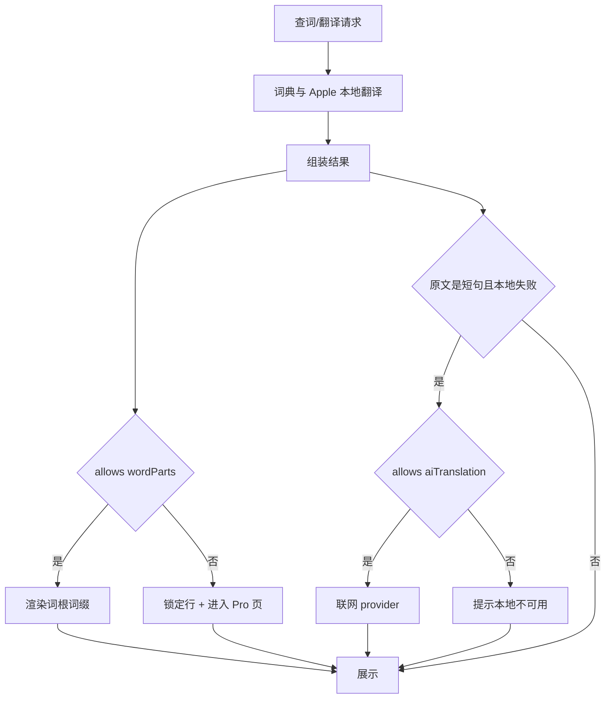
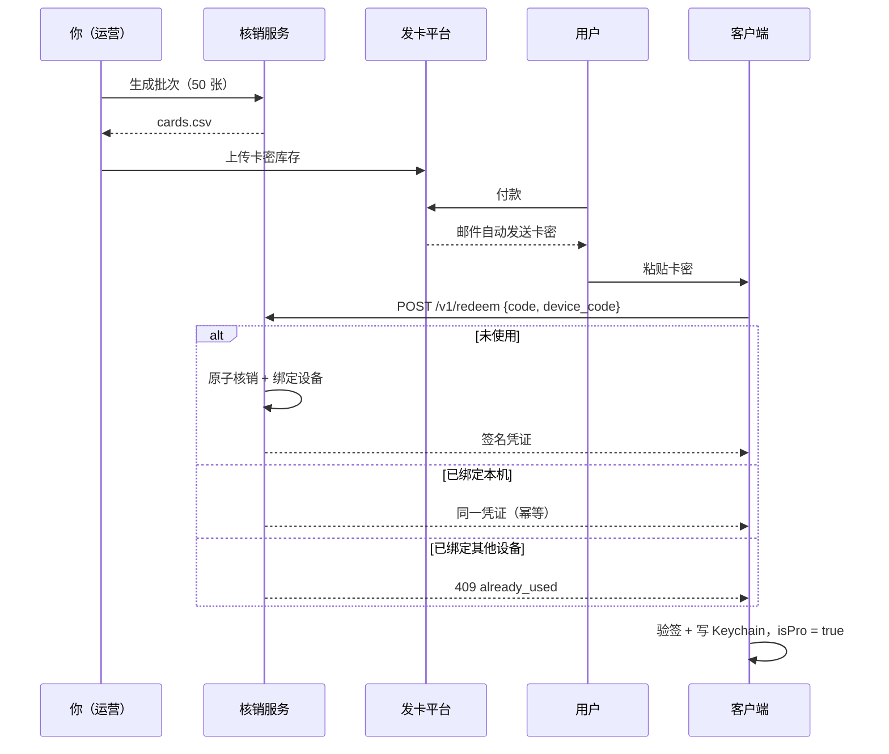
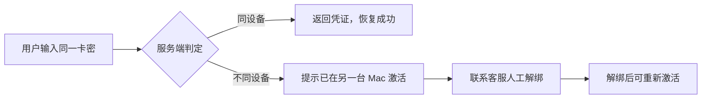

# 设计文档：Englishwords 商业化与授权实施方案

- RFC：0002（**v2，改为卡密方案**）
- 日期：2026-11-03
- 状态：草稿（定价、发卡平台、部署选型未定）
- 架构基准：[ARCHITECTURE.md](../ARCHITECTURE.md)，重点为第 2、9、12、14 节
- 前置文档：[0001 M0—M5 实施方案](0001-Englishwords-M0至M5实施方案.md)
- 实施仓库：`/Users/ziggy/Documents/projects/Myworkspace/Englishwords`
- 本次交付仅为设计文档；除已标注"已落地"的判断缝外，其余改动与验收均未实施。

> **v2 变更说明**：v1 采用「官网自建支付 + 服务端签发许可证」。
> v2 改为**卡密 + 自动发货 + 一次性核销**：支付与发货交给发卡平台，
> 自建服务端只保留核销一件事，工作量从 2–3 周降到 2–3 天。

## 1. 需求理解

把付费能力放到**最后一个里程碑（M8）**实现，在 M6 字幕、M7 设置/引导/收藏 全部完成之后再接。

本期固定五件事：

1. **Pro 的范围是三项**：字幕查询、词根词缀拆分、接入自己的 AI 翻译。其余全部免费。
2. **没有试用期**。免费用户点开这三项只能看到演示内容，功能本身不可用；不存在"剩余 N 天""内测到期"。
3. **不上架 Mac App Store**：只走官网 DMG 分发（Developer ID 签名 + 公证）。
4. **首个公开版本不预锁**：这三项在 M8 上线之前的版本里照常可用；收费开关到 M8 才生效。
5. **售卖方式为卡密**：用户在发卡平台付款后**自动**收到卡密邮件，在 App 内兑换。
   **一张卡密只能激活一次**；同一台 Mac 重装后可用同一张卡密恢复。

### 1.1 为什么必须有服务端

"只能激活一次"要求存在一份**全局记录**，而纯离线校验的卡密做不到这件事：
客户端无法得知同一张码是否已在另一台机器用过。

因此服务端不取消，只**砍到只剩核销**：

| 职责 | 归属 |
|---|---|
| 收款、退款、发票、商户资质 | 发卡平台 |
| 自动发货（邮件卡密） | 发卡平台 |
| 卡密生成与库存 | 自建服务端（导出 CSV 上传平台） |
| **核销 + 设备绑定 + 签发激活凭证** | **自建服务端（唯一自研部分）** |
| 离线验签、本地许可 | 客户端 |

### 1.2 免费 / Pro 能力矩阵（本期唯一定义）

| 能力 | 免费 | Pro | 免费用户看到什么 |
|---|:---:|:---:|---|
| 悬停取词、快捷键查词、划词查询、区域取词 | ✅ | | 完整可用 |
| 内置词库、系统词典、导入词典与排序 | ✅ | | 完整可用 |
| Apple 本地整句翻译 | ✅ | | 完整可用 |
| 朗读、收藏、笔记本、统计、设置 | ✅ | | 完整可用 |
| **字幕查询**（浏览器直读 / 屏幕 OCR） | | ✅ | **一段演示视频**，真实采集不启动 |
| **拆分词根词缀** | | ✅ | 固定示例（如 `un / believ / able`），不拆当前词 |
| **接入自己的 AI 翻译** | | ✅ | provider 列表可见，不能存密钥、不能发请求 |

> "预览视频"只针对字幕；另两项用**静态示例 + 锁定入口**表达同一含义。
> 此处理为设计选择，若要求三项统一用视频，需补充素材。

### 1.3 已核对的现状

- 工程已按 `App/`、`Lookup/`、`Dictionary/`、`Notch/`、`Settings/`、`Support/`、`Translate/` 拆分，M0—M5 已在实施中。
- **判断缝已落地**：`Support/Entitlements.swift`（`ProFeature` 三项、`allows(_:)` 恒 true、`isEnforced` 恒 false）
  与 `Tests/EnglishwordsTests/EntitlementsTests.swift`（3 条守卫用例）。调用点尚未接入。
- 除上述文件外，代码中没有任何 `License` / `CardKey` / 付费墙实现。

### 1.4 假设与待确认事项

- 待确认：**定价**（建议一次买断，不订阅）。
- 待确认：**发卡平台**选型（需支持自动发货到邮箱、支持导入卡密库存、费率与资质须自行核对）。
- 待确认：服务端部署形态（建议 Cloudflare Workers + D1，或任意可跑单表应用的小主机）。
- 待确认：是否允许同一张卡密自助解绑（建议第一版不开放，走客服人工）。
- 假设：卡密由服务端生成、导出 CSV、人工/脚本上传到平台；平台负责发货。
- 假设：客户端首次兑换时需要联网；此后完全离线可用。

### 1.5 支付与发货的信任边界（"服务器怎么知道付款成功"）

**结论：自建核销服务不感知支付，也不需要感知。**

因为"钱 → 码"的交换发生在**发卡平台内部**，与自建服务无关：

```text
用户付款 ──▶ 发卡平台（掌握支付结果）
                 │ 只有支付成功，才从库存扣一张码
                 ▼
              邮件发货（卡密）
                 │
用户粘贴卡密 ──▶ 自建核销服务（只知道"这张码被兑换了"）
```

自建服务端的视角里只有两件事：**码是否存在**、**码是否已被绑走**。
它不知道这张码是卖出去的、赠送的、还是平台误发的——**这在设计上是刻意的**，
因为一旦让自建服务参与支付判定，就必须承担商户资质、回调验签、幂等与对账。

这个模型的成立依赖一个前提：**平台是"支付成功才发货"，而不是"先发后付/先发后审"**。
选型时必须确认这一点。

它带来的风险与缓解：

| 风险 | 具体表现 | 缓解 |
|---|---|---|
| **库存泄露** | 平台侧拿到码的人不付钱也能兑换 | 批次可整批作废（未使用的 `DELETE`）；兑换限流；同一 IP/设备短时大量兑换告警 |
| **对不上账** | 平台显示卖了 100 张，你库里只兑换了 60 张 | 见下方"每日对账"，差异超阈值就查 |
| **平台跑路/改政策** | 码发不出去，或历史订单查不到 | 码本身不依赖平台，可换平台继续卖；自己保留批次与销售导出 |
| **超卖/漏发** | 库存与订单不同步 | 平台后台的销售流水与 `cards.used_at` 定期比对 |

**每日对账（建议，成本很低）**

拉平台订单导出（订单号 / 支付时间 / 卡密），与 `cards` 表比对，检查三件事：

1. 卖出的码是否都在库里（防平台发了不存在的码）
2. 已售卡密中有多少已兑换（正常应逐日接近销量）
3. 未售卡密是否被兑换（**这一条最重要：说明库存泄露**）

出现"未售但已兑换"就是泄露信号，立刻作废该批次剩余库存。

**如果确实要让服务器感知支付（模式 B）**

只有当你想自己做收款时才需要，代价：

| 要做的事 | 说明 |
|---|---|
| 商户资质 | 微信/支付宝经营类收款，个人号有合规风险 |
| 支付回调验签 | 必须验证渠道签名，否则可被伪造回调刷码 |
| 幂等 | 同一笔回调重复到达时不能重复发码 |
| 金额核对 | 回调金额必须等于商品价格，防改价 |
| 对账与退款 | 退款要回收或作废对应的码 |

折中方案：若平台提供**发货 Webhook**，接一个只做记录的端点，
把「订单号 + 卡密 + 时间」落到自己的流水表，既有销售流水又不承担支付判定。
此项为可选增强，不阻塞 M8。

### 1.6 平台侧是怎么知道"支付成功"的（选型时必须核实）

自动发货不是"用户点一下我已付款"，而是**支付渠道主动把结果告诉平台**。
常见三种实现，可靠性差别很大：

| 实现 | 原理 | 可靠性 | 需要商户资质 |
|---|---|---|---|
| **A. 官方商户异步回调** | 下单时提交 `notify_url`；用户支付成功，微信/支付宝 POST 一条**带签名**的结果到该地址；平台验签后发货；回调丢失时用同一订单号调「查单接口」兜底 | 高 | 需要 |
| **B. 第三方聚合支付** | 平台用 Stripe / PayPal / Lemon Squeezy / 各聚合服务商；支付成功由对方 Webhook 通知 | 高 | 不需要（用第三方的） |
| **C. 个人收款监控（"免签支付"）** | 监听手机上的支付宝/微信到账通知（通知栏、播报），或让用户回填交易号人工核对 | **低**：漏单、伪造截图、封号风险 | 不需要（但有合规风险） |

判断依据：**A/B 一定有"验签"和"主动查单"两个动作**；C 没有验签，因为压根没有签名。

发货延迟几秒是正常的——平台通常在等回调，或在轮询查单。

**选型时用这四个动作实测，比看宣传页可靠：**

1. **不付款下单**：把订单停在支付页，等几分钟，确认**没有**收到卡密（验证不是"先发后付"）。
2. **付一笔最小金额**：记录支付时间与收到卡密的时间差；超过 1 分钟要问清是回调还是人工。
3. **重复回调**：这条测不了，直接问平台"同一笔回调重复到达会不会重复发码/重复扣库存"。
4. **问清掉单处理**：回过调丢失时是否有主动查单；用户付了钱没收到码怎么补发。

若平台答不上来第 3、4 条，说明它没做幂等或没有查单兜底，**换一家**。

## 2. 接口改动

### 2.1 客户端接口

| 路径与改动 | 入参与出参 | 错误及兼容性影响 |
|---|---|---|
| 新增 `Support/Entitlements.swift` 的 `allows(_:)`、`isEnforced` | `ProFeature` → `Bool` | ✅ **已落地**，当前恒 `true` / 恒 `false` |
| 新增 `Support/CardKey.swift` 的 `redeem(_:)`、`verifyReceipt(_:)`、`deviceCode` | 卡密字符串 → `Result<Receipt, RedeemError>` | 错误：`malformed` / `notFound` / `alreadyUsed` / `network` / `badReceipt`。**没有** `expired` / `trialDaysLeft` |
| 新增 `Settings/ProView.swift` | 付费墙页：三项说明 + 购买入口 + 卡密输入 + 已激活状态 | 只在用户主动进入时展示 |
| 新增 `Settings/ProPreviewView.swift` | 演示视频播放器（`AVKit`）+ 两项静态示例 | 视频缺失降级为静态图 |
| 修改 `Translate/TranslationCoordinator.swift` | 联网分支加 `allows(.aiTranslation)` | 未付费只拦联网，Apple 本地翻译不受影响 |
| 修改 `Notch/ResultView.swift`（词素区） | 渲染前判断 `allows(.wordParts)` | 未付费隐藏拆分区或显示锁定行，释义照常 |
| 修改 `App/AppDelegate.swift` | 菜单入口「Pro…」 | 无旧版本兼容问题 |

`Entitlements` 保持**纯函数、无副作用**：不联网、不抛错、不阻塞。
联网只发生在显式兑换动作里，绝不在启动或查询链路中触发。

### 2.2 服务端接口（唯一自研的 HTTP 面）

| 端点 | 入参 | 出参 | 说明 |
|---|---|---|---|
| `POST /v1/redeem` | `{code, device_code}` | `{receipt}` | 原子核销 + 绑定设备 + 签凭证。同一设备重复调用幂等 |
| `POST /v1/receipt` | `{code, device_code}` | `{receipt}` | 恢复：已绑定的同一设备重新取回凭证（与上一行可合并） |
| *(内部)* `POST /v1/admin/unbind` | `{code}` | `{ok}` | 客服解绑（建议先直接用 SQL，不做后台 UI） |

约束：

- **不需要**支付回调、订单表、对账、发票；这些都在发卡平台。
- `redeem` 必须原子：单条 `UPDATE ... WHERE used_at IS NULL OR device_code = ?`，影响 1 行才算成功。
- 限流：按 IP 与按卡密双维度；防止撞库与暴力猜码。
- 卡密生成不放 `redeem` 里：由离线命令/批次任务生成，导出 CSV 上传平台。

### 2.3 卡密与激活凭证格式

**卡密（用户手里的码）**

```text
EW-7K3M-2QX9-8HTF          12 位 Crockford Base32（去掉 I/L/O/U），约 60 bit 随机
```

- **不做离线签名**：短码 + 服务端核销即可。用户可手动输入，也可粘贴。
- 生成时保证唯一（数据库主键约束）。
- 卡密本身不含功能信息；功能由服务端记录与凭证决定。

**激活凭证（服务端返回，客户端存 Keychain）**

```text
EWR1.<base64url(payload)>.<base64url(signature)>

payload = { "v":1, "code":"EW-7K3M-2QX9-8HTF", "device":"A1B2C3D4E5F6",
            "issued":1793587200, "features":["wordParts","aiTranslation","subtitles"] }
signature = Ed25519(payload)      // 私钥仅在服务端
```

- 客户端内置**公钥**验签；凭证是自包含、永久有效、可离线校验的。
- 凭证里带 `device`，客户端启动时比对本机 `deviceCode`；不一致即视为无效。
- 为什么不直接存一个 `activated = true`：签名凭证能挡住"改 UserDefaults 就解锁"，
  提高门槛；但**不承诺**能对抗二进制补丁（见 7.2）。

**deviceCode**

- 取硬件标识（如 `IOPlatformUUID`）做 SHA256，取前 12 位十六进制。
- 不可逆、不含个人信息；需在隐私说明中写明"用于设备绑定"。

## 3. 数据库改动

### 3.1 客户端

**不新增任何数据库**。`dictionary.sqlite` 与 `wordparts.sqlite` 不变。

| 存储位置 | 内容 | 理由 |
|---|---|---|
| Keychain（`com.example.englishwords.license`） | 激活凭证字符串 | 重装 App 后仍在，等价"恢复购买" |
| `UserDefaults` | `pro.enforced`（默认 false）、`pro.dismissedAt` | 本地开关与提示节流；**不存**凭证本体 |

> **删除**参考产品使用过的 `trial.json` 一类安装锚点：本方案没有试用期。

### 3.2 服务端（新建，两张表）

```sql
CREATE TABLE cards (
    code        TEXT PRIMARY KEY,     -- EW-7K3M-2QX9-8HTF
    batch       TEXT NOT NULL,        -- 批次标识，便于整批作废
    created_at  INTEGER NOT NULL,
    used_at     INTEGER,              -- NULL = 未使用
    device_code TEXT UNIQUE,          -- 绑定设备；NULL = 未绑定
    note        TEXT
);

CREATE TABLE redeem_log (
    id          INTEGER PRIMARY KEY AUTOINCREMENT,
    code        TEXT NOT NULL,
    device_code TEXT NOT NULL,
    at          INTEGER NOT NULL,
    result      TEXT NOT NULL         -- ok / already_used / not_found
);
```

- `device_code UNIQUE`：一张码只能绑一台设备，由数据库约束兜底。
- 无用户表、无订单表：不存任何个人身份信息。

### 3.3 迁移与回滚

- 首次引入无需迁移；无历史卡密需要兼容。
- 回滚：`pro.enforced` 置 false 即恢复全功能；服务端数据保留不动。
- 作废某批次：`DELETE FROM cards WHERE batch = ? AND used_at IS NULL`（已激活的不回收）。

## 4. 流程图

### 4.1 功能判断（查询链路里只有一次判断）



关键约束：**付费判断永远在结果组装之后**。任何 not-allowed 分支都不得影响查词、释义与本地翻译。

### 4.2 生成 → 发货 → 兑换



### 4.3 重装 / 换机



## 5. 范围边界

### 5.1 本次做与实施顺序

| 顺序 | 阶段 | 具体交付与依赖 |
|---|---|---|
| 1 | 判断缝 | ✅ **已落地（2026-11-03）**：`Support/Entitlements.swift` + 3 条守卫用例。调用点随 M2/M5/M6 接入 |
| 2 | 核销服务 | 两张表 + `redeem` + 限流 + 批次生成与 CSV 导出（约 2–3 天） |
| 3 | 客户端兑换 | `CardKey`（deviceCode、redeem、验签）+ Keychain + 「Pro…」入口（约 2 天） |
| 4 | 付费墙 UI | `ProView` + 三项预览（视频 + 两个静态示例）（约 2 天） |
| 5 | 收尾 | 公证分发、错误文案、退款与解绑客服流程、支持文档 |

第 1 步已完成；**第 2 步是关键路径**，其余可并行。

第 1 步的调用点（**尚未接入**）：

| 接入位置 | 判断 | 未付费时的表现 |
|---|---|---|
| `Notch/ResultView.swift` 词素区 | `allows(.wordParts)` | 隐藏拆分区或显示锁定行，释义照常 |
| `Translate/TranslationCoordinator.swift` 联网分支 | `allows(.aiTranslation)` | 只拦联网 provider，Apple 本地翻译不受影响 |
| M6 字幕采集入口 | `allows(.subtitles)` | 播放演示视频，不启动 ScreenCaptureKit / Apple Events |

### 5.2 明确不做

- 不做试用期、内测到期、剩余天数、最后一天提醒。
- 不做订阅、自动续费、优惠码、多人拼团、企业授权。
- 不做支付：收款、退款、发票、商户资质全部由发卡平台承担。
- 不做管理后台 UI：解绑用一条 SQL；量大了再说。
- 不做 Mac App Store 版本（已决定，理由见 7.3）。
- 不做重度反破解（混淆、完整性校验、心跳上报）。

### 5.3 后续开发原则

1. 判断唯一：所有 gating 只走 `Entitlements.allows(_:)`，禁止视图直接读许可状态。
2. 降级安全：任何凭证异常一律按"不阻断免费功能"处理。
3. 可关闭：`pro.enforced` 必须能在不发新版的情况下关掉整套收费。
4. 离线优先：已激活的 Pro 在断网、服务端宕机时照常可用；**只有兑换那一次需要联网**。
5. 不复制参考产品：不使用其许可证格式、设备码算法、trial 锚点或付费墙文案。

## 6. 验收标准

以下均为待执行验收，不代表已经通过。

- [ ] **无试用**：全新安装后界面与代码中不存在"试用""剩余 N 天""到期"字样或计时逻辑。
- [ ] **三项锁定**：未付费时字幕只播演示视频且不启动 ScreenCaptureKit / Apple Events；词素区显示锁定行；联网 provider 不能保存密钥或发请求。
- [ ] **免费不受损**：未付费时查词、释义、音标、标签、收藏、朗读、Apple 本地翻译、导入词典全部正常。
- [ ] **判断在结果之后**：注入"凭证读取抛错"场景，查词仍能出结果。
- [ ] **真实兑换**：从平台买一张真实卡密，粘贴后无需重启即解锁三项；断网重启仍为 Pro。
- [ ] **只能激活一次**：同一张卡密在第二台 Mac 上兑换被拒绝，并给出"已在另一台 Mac 激活"的提示。
- [ ] **同机幂等**：清空 Keychain（模拟重装）后在同一台 Mac 重新兑换，成功且不消耗第二张码。
- [ ] **并发安全**：两张请求同时核销同一张码，只有一张成功；另一张得到 `already_used`，不产生两条绑定。
- [ ] **伪造失败**：手改 Keychain 凭证、篡改 payload、把凭证换到另一台设备，均判为无效且不落库。
- [ ] **网络失败可重试**：兑换时断网或服务端 5xx，给出明确提示；恢复网络后同一张码仍可成功（未被误核销）。
- [ ] **分发**：Developer ID 签名 + 公证后的 DMG 在另一台 Mac 可双击运行，无 Gatekeeper 阻断。
- [ ] **范围一致**：README 与设置页文案与实际收费范围一致。

## 7. 影响面与风险

### 7.1 影响面

- **客户端**：新增 `Support/CardKey.swift`、`Settings/ProView.swift`、`Settings/ProPreviewView.swift`；
  修改 `Translate/TranslationCoordinator.swift`、`Notch/ResultView.swift`、`App/AppDelegate.swift`、`Resources/Info.plist`（如走 URL scheme）。
- **服务端**：新建极小服务（1 端点 + 2 表 + 批次脚本），建议 Cloudflare Workers + D1 或等价方案。
- **运营**：发卡平台选型、CSV 上传、客服解绑、退款处理。
- **性能**：启动只做本地验签（亚毫秒）；兑换时一次 HTTP。
- **隐私**：向服务端发送的只有「卡密 + 设备码」，设备码不可逆、不含个人信息。
- **文档**：README 与 ARCHITECTURE 第 14 节需同步本方案。

### 7.2 风险

| 风险 | 影响 | 缓解 |
|---|---|---|
| 服务端单点 | 新用户暂时无法激活 | 老用户离线可用；托管服务基本免运维；兑换失败不消耗卡密，可重试 |
| 卡密被猜/撞库 | 盗用他人卡密 | 60 bit 随机 + IP/卡密双维度限流 + 失败审计日志 |
| 卡密在多台机器循环使用 | 收入损失 | 核销 + 设备唯一约束从根上挡住 |
| 用户换机后无法自助 | 客诉 | 同一卡密同设备幂等；换机走人工解绑；购买邮件长期可查 |
| 邮件进垃圾箱 | 用户收不到码 | 平台侧同时提供"订单页查看卡密"；邮件之外必须有一条取码路径 |
| 客户端被 patch | 收入损失 | 接受；签名凭证只提高门槛，不作为对抗手段 |
| 平台跑路/政策变化 | 无法发货 | 保留自有批次数据；可换平台继续发货（卡密不依赖平台） |

### 7.3 分发方式：只走官网（已决定，不做 App Store）

- 必须做 **Developer ID 签名 + notarization**，否则另一台 Mac 会被 Gatekeeper 拦。
- 没有 App Store 曝光与自动更新渠道，更新依赖应用内更新（Sparkle 或自建）与官网公告。
- **以后也不能"补上架"**：审核指南 3.1.1 要求应用内数字功能走 IAP，不允许引导站外购买或引导兑换站外购买的卡密。
  要上架就必须改成 StoreKit，等于重做授权层。

## 8. 回滚方案

- **触发条件**：核销服务长时间不可用、出现重复扣码（一码多绑）、凭证验签大面积失败、客服无法解绑。
- **一级降级（客户端）**：`pro.enforced = false`，三项全部放开、付费墙入口隐藏，不发新版。
- **二级降级（服务端）**：停止签发新批次，保留已发卡密的核销；必要时临时关闭设备校验，只做一次性标记。
- **代码回滚**：`Entitlements` 与 UI 保留，只关开关；彻底回退时连同 `CardKey` 与入口一起回退。
- **数据回滚**：`cards` 保留；已核销记录不删，避免同一张码被重复使用。误绑可人工清空 `device_code` 与 `used_at`。
- **回滚验证**：免费功能全绿、三项可用、无残留付费提示；已激活用户的 Pro 不被收回；未使用的卡密仍可在恢复后正常核销。
