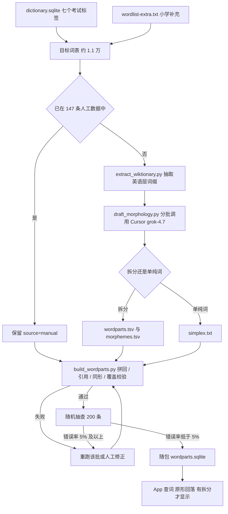

# 设计文档：内置词根词缀词典（中考—托福约 1.1 万词）

- 日期：2026-11-04
- 状态：草稿
- 前置文档：[0001 M0—M5 实施方案](0001-Englishwords-M0至M5实施方案.md)、[0002 商业化与授权](0002-商业化与授权实施方案.md)、[架构文档 §5.2 / §14](../ARCHITECTURE.md)

## 1. 需求理解

词根词缀拆解是三项 Pro 之一，但随包的 `wordparts.sqlite` 只有手工整理的 147 个词（`macos-starter/data/wordparts.tsv`），
用户日常查词几乎看不到拆分。Apple 翻译框架只返回译文，系统词典只返回纯文本释义，**都不提供结构化的词素拆分**，所以只能自建数据。

本次目标：内置一套词根词缀数据，覆盖内置词库中带下列考试标签的全部单词——
中考 `zk`、高考 `gk`、四级 `cet4`、六级 `cet6`、考研 `ky`、雅思 `ielts`、托福 `toefl`。
2026-11-04 对随包 `dictionary.sqlite` 实测：七个标签去重后 **11,441 词**（不含托福时为 8,685）。

预期行为变化：

- 目标词表内**每个词都被处理过**，结果只有两种：给出拆分（每段带中文含义，附中文词源），或判定为**单纯词**（如 `cat`、`girl`）。
- 单纯词在面板上**不显示**词根词缀区，与当前"无数据不显示"的行为一致，不新增任何 UI。
- 屈折形（`transported`）沿用现有的 `forms` 原形回落逻辑，能显示原形的拆分。
- 修复：单词在内置词库和系统词典都未命中、最终走翻译时，已查到的拆分不再被丢弃。

已确认的决定（2026-11-04 用户确认）：

1. 范围包含托福。
2. 单纯词不显示。
3. AI 起草使用 **Cursor CLI 的 grok-4.7 模型**（`delegate-cli` 解析为 `grok-4.7-medium`），真实调用，不做 mock。

关键假设与待确认事项：

- **小学词汇**：ECDICT 没有小学标签，假设小学约 800 词基本被中考词表包含；实施时抽查一份公开小学词表的交集，缺口单独补入目标词表。
- **可拆比例**：预计约一半到六成能拆，**仅为估计**，以实施产出为准；验收只看"全部处理"，不看可拆比例。
- **Wiktionary 抽取**：使用 kaikki.org 发布的英文 Wiktionary 结构化数据（wiktextract JSONL），取 `etymology_templates` 中的 `af/affix/prefix/suffix/confix/compound` 模板。下载日期与 SHA-256 在实施时固定写入 `SOURCES.md`；字段名以实际下载文件为准（**待确认**）。
- **Cursor CLI 无头调用参数**：以 `delegate-cli` 的 `references/cursor.md` 和本机 `cursor-agent --help` 为准（**待确认**），本文不写死命令行。
- 参考产品 Dipword 的 `wordparts.sqlite` 受 EULA 约束，**不得读取、对照或复制**其内容。

## 2. 接口改动

App 侧无对外接口；以下为内部 Swift 接口与构建脚本、数据文件格式的改动。

### 2.1 Swift（最小扩展）

| 位置 | 改动 | 兼容性 |
|---|---|---|
| `Lookup/LookupTypes.swift` `LookupResult.translated(...)` | 新增参数 `morphology: Morphology?`，填充 `segments` / `origin`（与 `.word(...)` 相同写法） | 仅内部调用方 `LookupCoordinator`、`PreviewRenderer` 需同步 |
| `Lookup/LookupCoordinator.swift` `resolveWord` / `translate` | 单词走翻译时把已查到的 `morphology` 传入；短句与 `⌥T` 短句不查词素 | 行为修复，无破坏 |

复用：`DictionaryStore.morphology` / `resolveMorphology`（含原形回落）、`parseSegments`、`ResultView.morphology` 全部不改。

### 2.2 数据文件格式（`macos-starter/data/`）

| 文件 | 改动 |
|---|---|
| `morphemes.tsv` | 表头不变（`key role label forms zh en lemma`）。**允许同一 `forms` 拼写属于多个语素**（同形词素，如 `in`=不 / `in`=向内，`er`=人 / `er`=比较级）。`key` 仍唯一，同形时用后缀区分，如 `in_not`、`in_into` |
| `wordparts.tsv` | 表头改为 `word segments origin source`。`segments` 片段语法：`拼写` 或 `拼写@语素key`；拼写只对应一个语素时可省略 `@key`，对应多个时**必须**写明。`source` 取 `manual`（现有 147 条）/ `wiktionary` / `ai` |
| `simplex.txt`（新增） | 每行一个判定为单纯词的目标词，只用于覆盖校验，不进 SQLite |
| `wordlist-extra.txt`（新增，可为空） | 小学词表交集抽查后补入的词 |

不复用 `wordparts.tsv` 记录单纯词的原因：单纯词没有 `segments`，混入会破坏"每行拼回等于原词"的既有校验。

### 2.3 构建脚本

| 脚本 | 改动 |
|---|---|
| `scripts/build_wordparts.py` | ① 解析 `拼写@key`；② 同形校验改为"拼写对应多个语素时必须显式写 key"；③ 新增 `--coverage-db <dictionary.sqlite> --tags zk,gk,cet4,cet6,ky,ielts,toefl --simplex data/simplex.txt --extra data/wordlist-extra.txt`：目标词必须全部落在 `wordparts ∪ simplex`，否则列出缺失并非零退出；④ `meta` 增加覆盖统计 |
| `scripts/extract_wiktionary.py`（新增） | 读 wiktextract JSONL + 目标词表，递归展开英语层面的词缀模板（`unbelievable → un- + believable → un + believ + able`），输出候选 `segments`；拼写变化（`believe→believ`）只在拼回校验通过时采用 |
| `scripts/draft_morphology.py`（新增） | 按批（建议每批 150—200 词）调用 Cursor CLI grok-4.7，输入目标词 + Wiktionary 候选 + 当前语素表，要求**严格 TSV** 输出：拆分行或 `SIMPLEX` 标记；新语素同时起草 `zh/en/lemma`。输出先过 `build_wordparts.py` 同一套校验，不合格的批次重跑或人工处理，不静默丢弃 |

新增两个脚本而非扩展 `build_wordparts.py` 的原因：构建脚本只做"确定性输入 → SQLite"，抽取与 AI 起草是一次性数据生产流程，混在一起会让可重建构建依赖网络和模型。

## 3. 数据库改动

`wordparts.sqlite` **表结构不变**（`meta` / `parts` / `words`，`schema_version` 仍为 `1`），App 读取代码无需改动：

- `parts`：行数由 170 增至预计 1,500—2,500（估计）；同形词素以不同 `id` 存在，`label` 可重复。
- `words`：行数由 147 增至可拆词数；`segments` 编码仍为 `拼写:语素id`，`@key` 只存在于 TSV，构建时解析为 id。
- `meta` 新增键（仅新增行，不改 DDL）：

| key | 值 |
|---|---|
| `coverage_tags` | `zk gk cet4 cet6 ky ielts toefl` |
| `coverage_target` | 目标词数 |
| `simplex_count` | 单纯词数 |
| `source_counts` | 如 `manual=147 wiktionary=… ai=…` |
| `morphemes_source` / `wordparts_source` | 改为"本项目整理，依据维基词典（kaikki.org 快照 <日期>）与 AI 起草（Cursor grok-4.7）并经校验" |

体积预计由 36 KB 增至 1—2 MB（估计）。

回滚：只读资源文件，无用户数据、无迁移。回滚即用 Git 恢复上一版 `wordparts.sqlite` 与 `data/*.tsv`，无需 DDL。

## 4. 流程图

## 5. 范围边界

- 本次做：
  - 目标词表 = 七个考试标签并集（约 11,441）+ 小学补充，全部判定为"拆分"或"单纯词"。
  - Wiktionary 抽取 + Cursor grok-4.7 起草 + 构建校验 + 抽查的完整数据流程，输入快照与生成参数写入 `data/SOURCES.md`，可追溯可重跑。
  - 新增语素的中文含义、英文含义、来源词形。
  - `build_wordparts.py` 支持同形语素与覆盖校验；翻译路径保留拆分的修复。
  - 更新 README 能力表（覆盖数）、`SOURCES.md`、`THIRD-PARTY-NOTICES.md` 署名，以及架构文档 §14。
- 明确不做：
  - 目标词表以外的词（如 GRE 独有词、生僻词）；它们查不到拆分时照常不显示。
  - 面板 UI 改动、"单纯词"提示、拆分来源标识。
  - 运行时调用 AI 实时拆词；App 只读随包数据。
  - 授权判断 `allows(.wordParts)` 的接入（归 M8）。
  - 读取或对照参考产品的词素数据库。

## 6. 验收标准

- [ ] **覆盖完整**：`build_wordparts.py --coverage-db …` 退出码为 0，目标词表每个词都在 `wordparts` 或 `simplex.txt` 中，输出覆盖统计（目标数 / 拆分数 / 单纯词数 / 各 source 数）。
- [ ] **校验通过**：所有拆分拼回等于原词；每个片段引用的语素存在；拼写对应多个语素的片段都显式写了 key；`integrity_check = ok`。
- [ ] **人工数据不被覆盖**：原 147 条 `source=manual` 行内容与改动前一致。
- [ ] **质量抽查**：从 `source≠manual` 中按固定随机种子抽 200 条（拆分与单纯词按实际比例），错误（拆分错误、语素含义错误、可拆词误判为单纯词或反之）少于 10 条；抽查清单与结论随 PR 提交。
- [ ] **同形语素**：至少一组同形语素（如 `in-` 不 / 向内）在两个词中分别解析到不同含义，并在面板上显示正确含义。
- [ ] **App 显示**：在 Mac 上用打包产物查询 `unbelievable`、`transportation`、`international`、`environment`，显示拆分；查询 `cat`、`girl` 不显示词根词缀区；查询屈折形 `transported` 显示原形拆分。
- [ ] **翻译路径保留拆分**：对一个有拆分、但不在内置词库且系统词典也无释义的词（实施时选定样例；若找不到天然样例，用测试替换词库服务构造），结果为翻译时仍带拆分；短句翻译不带拆分。对应 1 条单元测试。
- [ ] **可追溯**：`SOURCES.md` 写明 Wiktionary 快照日期与 SHA-256、模型名与版本、批大小与提示词文件位置；许可为 CC BY-SA 4.0，`THIRD-PARTY-NOTICES.md` 含 Wiktionary 署名。
- [ ] **构建**：`./build.sh` 成功，产物自检通过；`./test.sh` 全部通过。

## 7. 影响面

- **代码**：`LookupTypes.swift`、`LookupCoordinator.swift`、`PreviewRenderer.swift`（调用方同步）；`scripts/` 新增两个、修改一个；`data/` 格式变更与新增两个文件。词典读取、面板渲染不改。
- **性能**：`DictionaryStore` 首次查词素时把 `parts` 全表载入内存，行数增至约 2,000 级仍为毫秒级；`words` 按主键查询不受行数影响。安装包增大约 1—2 MB。
- **成本**：Cursor grok-4.7 真实调用，约 60—80 批（1.1 万词 ÷ 150—200）+ 语素释义批次 + 失败重跑；计入 Cursor 账户额度，实施前确认额度充足。
- **质量风险**：AI 起草可能把民间词源当真、或对拉丁词根过度拆分。缓解：Wiktionary 结果优先；提示词要求不确定时判为单纯词；拼回与引用校验；200 条抽查。
- **许可**：Wiktionary 内容为 CC BY-SA 4.0，与现有词素数据许可一致；`wordparts.sqlite` 随包分发需保留署名与同许可声明。AI 生成内容的权属按 Cursor 服务条款，**待确认**无限制条款。
- **商业化**：该数据是 Pro 能力的实际内容，M8 接入 `allows(.wordParts)` 后免费用户只看固定示例，与 0002 §1.2 一致。
- **隐私**：只向模型发送公开单词与词源文本，不含用户数据。

## 8. 回滚方案

- **触发条件**：抽查错误率不达标且短期无法修正；新数据导致构建失败或查词明显变慢；发现许可问题。
- **数据回滚**：`git revert` 本次数据提交，恢复上一版 `wordparts.sqlite`、`morphemes.tsv`、`wordparts.tsv`（147 词版本）；无用户数据、无迁移，App 代码无需配合。
- **代码回滚**：翻译路径保留拆分的修复与数据独立，可单独保留；如需回退，连同 `LookupTypes`、`LookupCoordinator`、`PreviewRenderer` 一起回退，避免签名不一致。
- **降级手段**：设置中「词根词缀」开关（`trigger.wordParts`）已存在，可让用户关闭显示；数据问题局限在个别词时，直接从 TSV 删除该行或移入 `simplex.txt` 后重建。
- **分阶段提交**：脚本改造、Wiktionary 抽取结果、AI 起草结果、抽查修正分别提交，便于只回退某一来源的数据。
