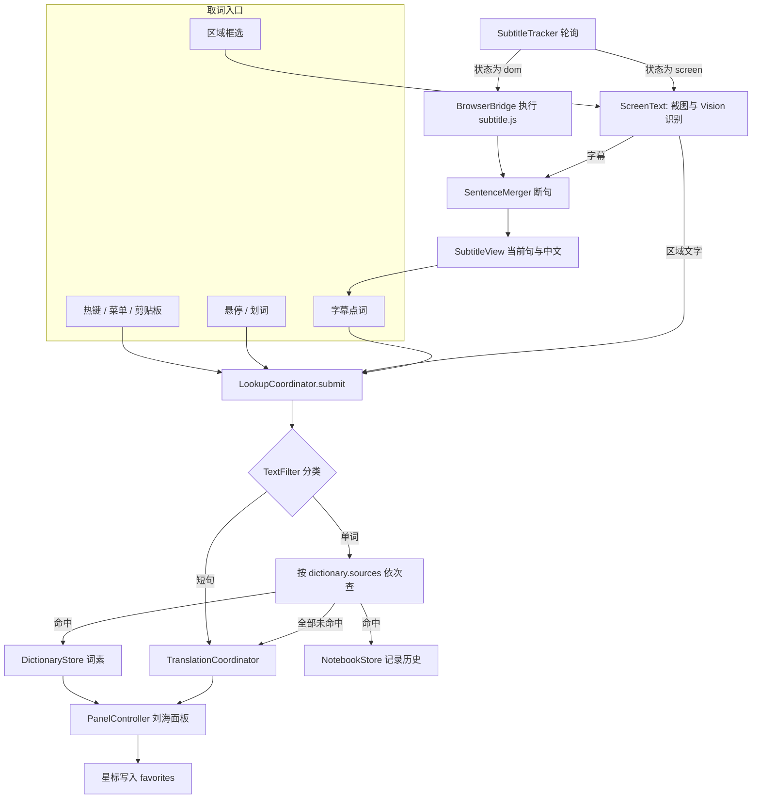
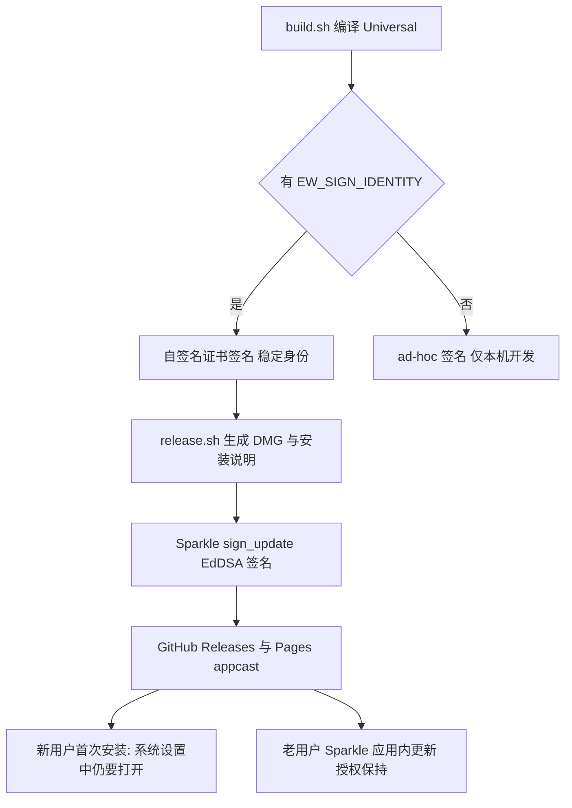

# 设计文档：M5.5—M7 macOS 实施方案（零付费分发）

- 日期：2026-11-04
- 状态：草稿
- 前置文档：[架构文档 §14](../ARCHITECTURE.md)、[0001 M0—M5](0001-Englishwords-M0至M5实施方案.md)、[0002 商业化](0002-商业化与授权实施方案.md)、[0003 词根词缀词典](0003-内置词根词缀词典.md)

## 1. 需求理解

把架构文档 §14.1 中归属 M5.5、M6、M7 的功能全部做完，并对外发布首个公开版本（免费、不加锁），使 M8 只剩授权与付费墙。
**只做 macOS**，Windows 端待功能完善后另行立项。

本次关键约束（2026-11-04 用户决定）：**不走 Apple Developer Program 付费线路**，即不申请 Apple 开发者账号、不使用 Developer ID 证书、不做 Apple 公证。

由此带来的设计变化：

- 签名改用**免费的自签名代码签名证书**（钥匙串访问 → 证书助理 → 创建证书，类型选"代码签名"）。
  目的不是通过 Gatekeeper，而是让应用的签名身份在每次构建、每次更新之间**保持不变**——辅助功能、屏幕录制、自动化（Apple Events）授权和钥匙串访问权限都按签名身份记忆。
  现状是 ad-hoc 签名（`build.sh` 用 `codesign --sign -`），身份随每次构建变化，**每次更新后用户都要重新授权**，对外发布不可接受。
- 首次安装会被 Gatekeeper 拦截。macOS 15 起不能再右键"打开"绕过，用户需在「系统设置 → 隐私与安全性」点「仍要打开」；需写进安装说明和 DMG 内的说明。
- 后续更新由 Sparkle 在应用内下载安装。Sparkle 只依赖免费的 EdDSA 更新签名，不需要 Developer ID；更新包由应用自身下载，**预期**不再触发 Gatekeeper 拦截（待实机验证）。
- 发布托管使用免费的 GitHub Releases（DMG）与 GitHub Pages（appcast.xml）。

关键假设与待确认事项：

1. **Bundle ID 不收费**：它只是一个反向域名字符串，不需要开发者账号。发布前标识为 `com.example.englishwords`，已迁到 `io.github.shenziggy0.notchword`（`Resources/Info.plist`、`Support/SecretStore.swift`，见 §2.5）。
   发布后再改会导致用户设置、钥匙串密钥、系统授权全部失效。**已确认（2026-11-04）：`io.github.shenziggy0.notchword`**。
2. 双语字幕首版中文由 `TranslationCoordinator` 按句翻译；用站点中文轨按时间对齐（架构 §10.5）为 M6 末尾可选项。**已确认（2026-11-04）**。
3. 字幕首版浏览器：Chrome 系（Chrome / Edge / Brave / Arc）与 Safari，需用户开启"允许 Apple 事件中的 JavaScript"；Firefox 只走 OCR。站点：YouTube、Netflix、Bilibili、Prime Video + 原生字幕轨 + 通用兜底；YouTube 读页面字幕，不做 timedtext 抓取。
4. Sparkle 以 SwiftPM 二进制包在仅有 Command Line Tools 的环境下能否构建并嵌入 `Contents/Frameworks`：**待验证**，阶段 6 第一步先做技术验证。
5. `SMAppService.mainApp`（开机启动）在自签名应用上是否可用：**待验证**；不可用时开机启动开关不显示，不做 LaunchAgent 等替代实现。
6. 自签名证书私钥丢失意味着签名身份变化（用户需重新授权），证书需离线备份；证书有效期建议设 20 年。

### 文档与代码差异

1. **冲突位置**：`docs/ARCHITECTURE.md` §14.1「翻译」行（把剥离 `<think>` 列为 M7 待做） ↔ `macos-starter/Sources/Englishwords/Translate/OpenAICompatProvider.swift` `clean(_:)`（已用 `(?s)<think>.*?</think>` 剥离）。
   **具体差异**：文档称待做，代码已实现。
   **来源提交**：代码由 `b697112`（shenziggy0，2026-11-03，初始提交）引入；文档该行为 2026-11-04 未提交的工作区改动，来源提交未查到（尚未提交）。
   **类型**：文档过期。本方案以代码为准，M7 不再包含此项，并同步修正 §14.1。
2. **冲突位置**：`docs/ARCHITECTURE.md` §13 工程结构（`DictionaryLookup.swift`、`HotKeyCenter.swift`、`PermissionCenter.swift`、`EventLog.swift` 等） ↔ 实际文件 `Dictionary/DictionaryStore.swift`、`Support/HotKey.swift`（类型名 `HotKeyCenter`）、`Support/Permissions.swift`、`Support/FileLog.swift`。
   **具体差异**：文件划分与命名不同。
   **来源提交**：两者均在 `b697112`（shenziggy0，2026-11-03）同一初始提交中引入，初始提交即已不一致。
   **类型**：待实施设计（§13 标注为 `[设计]` 建议结构）。本方案沿用实际文件，不按 §13 重组。
3. **冲突位置**：[0002](0002-商业化与授权实施方案.md) §1 第 3 条与 §5.1 第 5 步（"Developer ID 签名 + 公证"分发） ↔ 本方案的零付费分发决定。
   **具体差异**：非代码冲突，是分发方式决策变更。
   **来源提交**：`b697112`（shenziggy0，2026-11-03）。
   **类型**：待实施设计。M8 开工前需重新评估是否转 Developer ID；本方案不修改 0002。

## 2. 接口改动

App 无对外网络接口；以下为内部 Swift 类型、偏好键、资源与脚本的改动。均为新增或最小扩展。

### 2.1 查询主链路（扩展）

| 位置 | 改动 | 说明 |
|---|---|---|
| `Lookup/LookupTypes.swift` `LookupTrigger` | 新增 `.region`、`.subtitle`；`isPassive` 两者均为 `false` | 新入口统一走 `LookupCoordinator.submit`，不另起链路 |
| `LookupResult.translated(...)` | 新增 `morphology` 参数 | 0003 已定义 |
| `Lookup/LookupCoordinator.swift` `resolveWord` | 固定的"内置 → 系统"改为按 `DictionarySources` 有序列表依次查 | 来源：导入 StarDict、内置词库、系统词典 |
| `LookupCoordinator.onState` 消费方 | 单词查词成功时追加写 `NotebookStore.recordLookup` | 写失败只记日志 |

### 2.2 新增模块（不可复用原因）

| 新增 | 职责 | 为什么不能复用现有实现 |
|---|---|---|
| `Support/SQLite.swift` | 从 `DictionaryStore` 抽出 `prepare` / `querySingle` / 绑定辅助 | 现有方法是 `DictionaryStore` 私有方法；笔记本和 StarDict 无需复制一份 |
| `Capture/ScreenText.swift` | `func recognize(rect: CGRect, on: NSScreen) async throws -> String`：ScreenCaptureKit 截图 → Vision 识别（先快速后准确）→ 按 y 聚行 | 现有取词全基于 AX，没有屏幕识别能力；区域取词与字幕 OCR 共用这一个 |
| `Capture/RegionPicker.swift` | 全屏透明框选窗，Esc 取消，产出矩形 | 无现成框选 UI |
| `Subtitle/BrowserBridge.swift` | `func run(_ js: String, in bundleID: String) async throws -> String`；错误分为 未授权 / 未开启 JS / 无窗口 / 不支持的浏览器 | 无现成 Apple Events 能力 |
| `Resources/subtitle.js` | 自研页面脚本：找视频 → 判 `drm/ad/dom/screen` → 原生轨 / 站点选择器 / 通用兜底 → 返回 JSON 状态；支持 pause/play | 不得复制参考产品脚本 |
| `Subtitle/SubtitleTracker.swift` | 约 2Hz 轮询；`screen` 时调 `ScreenText`；变化才推送；只在开关开启且前台为支持浏览器时运行 | — |
| `Subtitle/SentenceMerger.swift` | 纯函数：碎片 → 句子（句末标点 / 间隔 > 1s / 说话人标记 / 已满 3 条） | — |
| `Notch/SubtitleView.swift` | 当前句可点击取词 + 中文；点词提交 `LookupRequest(trigger: .subtitle)` | `ResultView` 是单条释义布局，字幕需按词点击 |
| `Notebook/NotebookStore.swift`、`Notebook/NotebookWindow.swift` | 历史、收藏、统计 | 现无用户数据存储 |
| `Dictionary/StarDictStore.swift` | 解析 `.ifo/.idx/.dict(.dz)`，返回 `Entry`（`dictionary` 填词典名） | `DictionaryStore` 绑定内置 SQLite schema |
| `Translate/AnthropicProvider.swift` | 实现现有 `TranslationProviding`，调 `POST /v1/messages` | 协议与 OpenAI 兼容格式不同 |
| `Translate/ProviderPresets.swift` | 静态预设表：`id / 名称 / baseURL / 默认模型 / 协议` | — |
| `Settings/HotKeySpec.swift` + 录制控件 | 键码 + 修饰键，可持久化 | `HotKeyCenter` 只有注册能力，无配置模型 |
| `Onboarding/OnboardingWindow.swift` | 首次运行分步引导与权限说明 | — |

### 2.3 扩展现有模块

- `Support/Permissions.swift`：新增屏幕录制 `CGPreflightScreenCaptureAccess` / `CGRequestScreenCaptureAccess` 与设置页跳转；新增 Apple Events 状态（`AEDeterminePermissionToAutomateTarget`）。`AppRules` 合并"默认排除名单 + 用户名单"。
- `Translate/OpenAICompatProvider.swift`：新增 `fetchModels() async throws -> [String]`（`GET {base}/models`）；`account` 改为按预设 id 区分。
- `Translate/TranslationCoordinator.swift`：`makeOnlineProvider` 按当前预设构造 OpenAI 兼容或 Anthropic；联网分支前置 `Entitlements.allows(.aiTranslation)`（恒放行）。
- `Notch/ResultView.swift`：恢复收藏星标；词素区前置 `Entitlements.allows(.wordParts)`（恒放行）。`Speaker` 读取声音与语速偏好。
- `Notch/PanelController.swift`：展开时按偏好调用 `NSHapticFeedbackManager`。
- `Settings/SettingsWindow.swift`：单页改为 `TabView`：通用 / 取词 / 词典 / 翻译 / 字幕 / 朗读 / 关于（含"目前免费、正式版将收费"预告与安装说明链接）。
- `App/AppDelegate.swift`：热键改为读取 `HotKeySpec` 注册；新增区域取词、字幕、上下句热键与菜单项；"检查更新"菜单；首次启动改为打开引导窗口，**删除** `permission.prompted` 旧逻辑。

### 2.4 偏好键（UserDefaults，新增；已有键不改名）

| 键 | 类型 / 默认 |
|---|---|
| `trigger.regionLookupEnabled` | Bool / true |
| `trigger.videoSubtitles` · `trigger.screenSubtitles` | Bool / true |
| `trigger.pausesVideoOnPeek` · `trigger.resumesVideoAfterPeek` | Bool / true |
| `hotkey.lookup` · `hotkey.translate` · `hotkey.region` · `hotkey.subtitle` · `hotkey.previousSubtitle` · `hotkey.nextSubtitle` | `HotKeySpec` 编码；默认 `⌥D` `⌥T` `⌥R` `⌥S` `⌥[` `⌥]` |
| `dictionary.sources` | 有序数组：`{id, kind: stardict/builtin/system, enabled}` |
| `translation.preset` | String / `custom`（迁移后承接现有 baseURL/model） |
| `speech.voice` · `speech.rate` | String / `en-US` 默认声音；Double / 0.48 |
| `panel.hapticOnExpand` | Bool / true |
| `apprules.userExcluded` | [String] / [] |
| `firstRun.sawOnboarding` | Bool / false |

### 2.5 钥匙串

- account 由固定 `openai-compatible` 改为预设 id（如 `deepseek`、`anthropic`、`custom`）。启动时一次性把 `openai-compatible` 迁到 `custom`，成功后删除旧项。
- Bundle ID 改为 `io.github.shenziggy0.notchword`：`Info.plist` 的 `CFBundleIdentifier` 与 `SecretStore.service`（改为 `io.github.shenziggy0.notchword.translation`）同步改名；启动时把旧 service `com.example.englishwords.translation` 下的全部条目迁到新 service，UserDefaults 由旧域 `com.example.englishwords` 一次性复制到新域，迁移完成记 `migration.bundleID = 1`，不重复执行。

### 2.6 构建与发布脚本

| 文件 | 改动 |
|---|---|
| `build.sh` | 读取环境变量 `EW_SIGN_IDENTITY`（自签名证书名）：存在则用它签名（内层 Sparkle.framework 与资源包先签，`.app` 后签），不存在则保持 ad-hoc；不启用 hardened runtime（无公证需求，避免额外 entitlements） |
| `scripts/make_signing_cert.md`（新增，说明文档） | 创建自签名代码签名证书、导出备份 `.p12` 的步骤 |
| `release.sh`（新增） | `build.sh` → `hdiutil` 生成 DMG（含"安装说明.txt"）→ Sparkle `sign_update` 生成 EdDSA 签名 → 输出 appcast 条目；**不调用** `notarytool` / `stapler` |
| `Resources/Info.plist` | 新增 `NSAppleEventsUsageDescription`、`SUFeedURL`、`SUPublicEDKey`；版本号发布时改为 `1.0.0` |
| `Package.swift` | 新增 Sparkle 依赖；链接 `z`（解压 `.dict.dz`）、`ScreenCaptureKit`、`Vision`、`ServiceManagement` |

## 3. 数据库改动

### 3.1 随包 `wordparts.sqlite`

结构不变，数据按 [0003](0003-内置词根词缀词典.md) 扩充。

### 3.2 新增用户库 `~/Library/Application Support/Englishwords/user.sqlite`

首次使用时创建；`PRAGMA user_version = 1` 标识版本。

```sql
CREATE TABLE lookups (
    id         INTEGER PRIMARY KEY,
    word       TEXT    NOT NULL,      -- 规范化后的查询词（小写原形优先）
    source     TEXT    NOT NULL,      -- 释义来源词典名
    trigger    TEXT    NOT NULL,      -- hotkey / hover / selection / region / subtitle ...
    created_at INTEGER NOT NULL       -- Unix 秒
);
CREATE INDEX lookups_created_at ON lookups(created_at);
CREATE INDEX lookups_word ON lookups(word);

CREATE TABLE favorites (
    word       TEXT    PRIMARY KEY,
    note       TEXT,
    created_at INTEGER NOT NULL
) WITHOUT ROWID;
```

- 只记录单词查词成功的结果，不记录短句与翻译正文。
- 统计直接由 `lookups` 聚合（总次数、近 7 天每日次数、高频词），不建统计表。
- 回滚 DDL：

```sql
DROP INDEX IF EXISTS lookups_word;
DROP INDEX IF EXISTS lookups_created_at;
DROP TABLE IF EXISTS lookups;
DROP TABLE IF EXISTS favorites;
```

### 3.3 导入词典文件

复制到 `~/Library/Application Support/Englishwords/Dictionaries/<名称>/`，不写数据库；顺序与启用状态存 `dictionary.sources`。

## 4. 流程图





## 5. 范围边界

- 本次做（按顺序）：
  > 2026-11-04 调整：M5 实机验收不再前置，**M1—M7 全部实现后统一验收**（见 §6）。阶段顺序与任务拆分以 [0005 实施任务书](0005-M5.5至M7实施任务书.md) 为准：热键配置、SQLite 抽取、Bundle ID 迁移与 Sparkle 技术验证前移到开发起点，避免 M6 写死热键后在 M7 返工。
  1. **基础**（1.5 天）：Bundle ID 迁移、钥匙串 account 迁移、`HotKeySpec`、`SQLite.swift` 抽取、Sparkle 构建可行性验证。
  2. **M5.5 词根词缀词典**（3—4 天）：按 0003 执行。
  3. **M6 区域取词**（2 天）：屏幕录制权限、`ScreenText`、`RegionPicker`、`⌥R`。
  4. **M6 字幕**（5 天）：`BrowserBridge`、`subtitle.js`、`SubtitleTracker`、`SentenceMerger`、`SubtitleView`、上下句热键、暂停 / 继续；可选中文轨对齐。
  5. **M7 功能**（6 天）：`NotebookStore` 与笔记本窗口、星标、分页设置、热键录制、应用排除、开机启动、触觉、引导与权限中心、StarDict 导入与排序、翻译预设 + 模型列表 + Anthropic、三处 `Entitlements.allows` 预留。
  6. **M7 零付费发布准备**（1.5 天）：Sparkle 接入、自签名证书、`build.sh` / `release.sh`、DMG 安装说明、README / 架构文档 / 第三方声明更新，版本 `1.0.0`。
  7. **M1—M7 统一验收**：合并 0001 §6、0003 §6、本文 §6 为一份清单在 Mac 上执行；通过后再上传 GitHub Releases 对外发布。
- 明确不做：
  - Apple Developer Program、Developer ID、公证、`stapler`、hardened runtime。
  - Windows 端及任何跨平台抽象。
  - Homebrew Cask 等其他分发渠道。
  - 剥离 `<think>`（已实现）。
  - 架构 §14.3 所列：MDict、DWDICT、传统机翻 API、URL Scheme、更新日志窗口、App Store。
  - M8 授权、付费墙；任何 Pro / 升级 / 购买文案。
  - 字幕 Firefox 的 DOM 通路、YouTube timedtext 抓取。

开发约束（所有阶段遵守）：

1. **优先复用**：新入口一律经 `LookupCoordinator.submit` 与 `PanelController`；翻译一律经 `TranslationCoordinator`；新增模块须说明不可复用原因（见 §2.2）。
2. **保持整洁**：沿用现有文件与命名（不按架构 §13 重组）；删除被替代的 `permission.prompted` 逻辑与固定热键代码，不留死代码。
3. **拒绝过度设计**：不建统计表、不做插件式词典 / 服务注册、不为 Windows 预留接口。
4. **测试克制**：只测纯逻辑与关键路径（见 §6），TCC、浏览器、签名、更新走实机。
5. **调研有据**：站点选择器以实际页面核对，不抄参考产品；文档与代码不一致时以代码为准。

## 6. 验收标准

单元测试（`./test.sh`，少量固定数据）：

- [ ] **断句**：输入片段 `"so we"`、`"went home."`（间隔 0.2s）、`"Then"`（间隔 1.5s），`SentenceMerger` 输出两句 `"so we went home."`、`"Then"`。
- [ ] **OCR 聚行**：给定三个识别框（y = 0.80 / 0.81 / 0.60），合并为两行，行内按 x 排序。
- [ ] **StarDict**：读取仓库内自造的三词 `.ifo/.idx/.dict` 测试文件，三词命中、其他词未命中。
- [ ] **来源顺序**：来源为 [StarDict, 内置] 且都含该词时返回 StarDict 释义；停用 StarDict 后返回内置释义。
- [ ] **笔记本**：写入 3 次查词与 1 次收藏后，历史 3 条、近 7 天统计正确、收藏 1 条。
- [ ] **模型列表**：解析 OpenAI 风格 `/models` 响应得到模型 id 列表。
- [ ] **热键配置**：`HotKeySpec` 编码后解码与原值相等。

真实计费测试：

- [ ] DeepSeek 预设与 Anthropic 预设各用真实密钥翻译一句，得到译文并显示来源；关闭联网后不发出请求。

Mac 实机验收（M1—M7 全部实现后统一执行）：

- [ ] **区域取词**：在图片 / PDF 中框选单词显示释义，框选句子显示译文；首次使用引导屏幕录制授权；Esc 取消不产生查询。
- [ ] **字幕**：Chrome 与 Safari 各至少一个站点（YouTube / Netflix / Bilibili 任选）显示当前句与中文，点词可查，上下句热键可用，暂停 / 继续与设置一致；DRM 与广告期间有明确提示；Firefox 走 OCR 可显示字幕。
- [ ] **笔记本与设置**：星标写入收藏并在笔记本可见；热键录制后新键立即生效、旧键失效，冲突时提示并恢复原键；用户新增的排除应用中不触发被动取词。
- [ ] **引导**：全新用户首次启动只出现引导；未授权时显式热键 + 剪贴板查词仍可用。
- [ ] **签名身份稳定**：用自签名证书构建版本 A 并授予辅助功能与屏幕录制，再构建版本 B 覆盖安装，两项授权仍有效，钥匙串密钥读取不弹出访问确认。
- [ ] **首次安装**：在另一台未安装过的 Mac 上从 GitHub Releases 下载 DMG，按安装说明经「仍要打开」后可正常运行。
- [ ] **应用内更新**：版本 A 通过 Sparkle 从 appcast 检测并安装版本 B，安装后无 Gatekeeper 拦截、授权保持（若出现拦截，记录现象并在安装说明中补充步骤）。
- [ ] **开机启动**：开关打开后重启 Mac 应用自动运行；若 `SMAppService` 在自签名下不可用，开关不显示且记录结论。

完成条件：

- [ ] 统一验收：0001 §6、0003 §6 与本节条目合并执行，均有记录结论，阻塞问题已修复。
- [ ] 架构 §14.1 中 M5.5 / M6 / M7 各项状态更新为完成并附证据（测试或实机记录）；§14.1「发布」行改为零付费方案。
- [ ] 代码中无 Pro / 升级 / 购买文案；三处 `Entitlements.allows` 调用已预留且恒放行。
- [ ] GitHub Releases 有 `1.0.0` DMG，appcast 可访问，README 写明安装步骤与"目前免费、正式版将收费"。

## 7. 影响面

- **代码**：`App/`、`Lookup/`、`Notch/`、`Settings/`、`Support/`、`Translate/` 均有扩展；新增 `Capture/`、`Subtitle/`、`Notebook/`、`Onboarding/` 与 `Dictionary/StarDictStore.swift`。`DictionaryStore` 仅抽出 SQLite 工具，查词行为不变。
- **依赖**：首次引入外部依赖 Sparkle（MIT）；新增系统框架 ScreenCaptureKit、Vision、ServiceManagement 与系统库 libz。
- **权限**：新增屏幕录制（区域取词 / 字幕 OCR）与 Apple Events（字幕），均在首次使用时申请；辅助功能不变。
- **用户体验（零付费代价）**：
  - 首次安装需手动「仍要打开」，部分用户会因此放弃；以 DMG 内说明与 README 图文步骤缓解。
  - 无公证意味着无法消除首装警告；如后续用户量证明值得，再评估购买 Developer ID（届时签名身份变化，用户需重新授权一次）。
  - 自签名证书私钥是长期资产，丢失将导致所有用户更新后需重新授权；必须离线备份。
- **安全与隐私**：截图只在内存识别、不落盘；日志不含查询与字幕正文；笔记本仅存本机；`subtitle.js` 只读取页面字幕与视频状态，不读取 Cookie、表单与账号信息；EdDSA 私钥不进仓库。
- **性能**：字幕轮询约 2Hz 且仅在开关开启、前台为支持浏览器时运行；OCR 仅在 `screen` 状态且字幕区域变化时触发；`user.sqlite` 写入在后台队列。
- **兼容性**：最低 macOS 15 不变；已有偏好键不改名；钥匙串 account 迁移一次性完成；Bundle ID 更换后旧设置与密钥一次性迁移；已授予旧 ID 的系统授权需用户重新授予一次（发布前仅影响开发机）。
- **商业化**：0002 的"Developer ID + 公证"分发假设失效，M8 开工前需重新评估；卡密核销设计本身不依赖签名方式。

## 8. 回滚方案

- **触发条件**：字幕或区域取词导致浏览器卡顿 / 误暂停 / 权限反复弹出；StarDict 来源导致查词变慢或错误；自签名或 Sparkle 更新后授权丢失、更新失败；笔记本写入影响查词。
- **功能降级**：字幕、区域取词、各 StarDict 来源、联网翻译、触觉、开机启动均有独立开关，可单独关闭而不影响热键查词与内置词库。
- **代码回滚**：按阶段分别提交，可 `git revert` 单个阶段；跨类型签名变更（`LookupTrigger`、`LookupResult.translated`、`TranslationCoordinator` 构造）与其调用方同一提交回退。
- **数据回滚**：`user.sqlite` 为新建文件，回滚时可保留不读或执行 §3.2 回滚 DDL；导入词典目录不自动删除，由用户在设置中移除；钥匙串迁移不删除迁移成功前的旧条目，回滚版本可继续读旧 account。
- **发布回滚**：appcast 撤回问题版本条目，GitHub Releases 标记为预发布；已更新用户通过下一版本修复（Sparkle 不支持降级推送）。
- **签名回滚**：自签名出问题时退回 ad-hoc 仅限开发构建，不对外发布 ad-hoc 版本。
