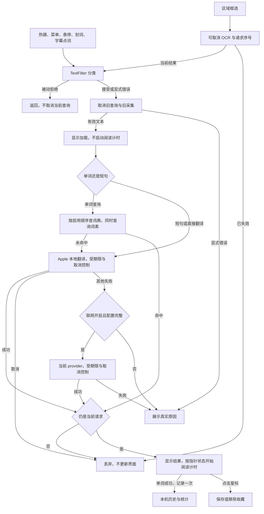
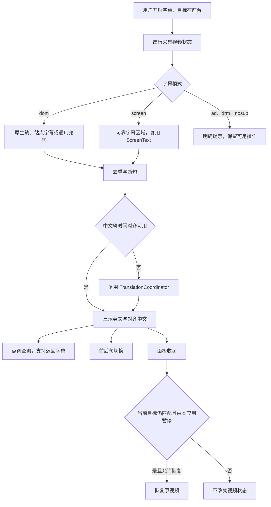

# 设计文档：完整功能收尾与缺陷修复方案

- 日期：2026-11-15
- 状态：已实施（待实机/CI 补验项见正文）
- 核对基线：本机 `main`，提交 `5d384f4`；工作区已有的 `wordparts.sqlite` 差异须保留。
- 需求决定：商业化暂缓，完成其余既定功能及发布能力；本次交付仅为设计文档。
- 前置文档：[0001 基础功能](0001-Englishwords-M0至M5实施方案.md)、[0003 词素数据](0003-内置词根词缀词典.md)、[0004 M5.5—M7](0004-M5.5至M7-macOS实施方案.md)、[0005 实施任务书](0005-M5.5至M7实施任务书.md)。
- 本文覆盖上述文档中与最新需求冲突的范围和执行顺序；未改动的技术细节继续复用原方案。代码路径除特别注明外相对 `macos-starter/`；标为“拟新增”的文件、接口当前尚不存在。

## 1. 需求理解

修复现有查词、翻译、面板、密钥配置和区域 OCR 的实际缺陷。
完成 M5.5 词素数据、M6 字幕与区域取词、M7 学习记录、设置、词典与翻译扩展，以及安装和更新能力。
所有功能在本期直接可用，不接入商业授权、激活、付费墙或收费预告。
继续只做 macOS 15+，保留 Universal 构建、现有 Bundle ID、本地优先和用户主动开启联网的行为。
完成标准包括代码、数据质量、关键回归和真实使用验收；不能仅凭编译成功或按钮存在标记完成。

### 1.1 已核对的现状

| 模块 | 实际状态 | 依据 |
|---|---|---|
| 基础工程 | Bundle ID 迁移、快捷键配置模型、SQLite 辅助、基础查词和设置已有代码 | `App/AppDelegate.swift`、`Settings/HotKeySpec.swift`、`Support/SecretStore.swift`、`Support/SQLite.swift` |
| 词素 | 同形语素、来源列、覆盖检查、翻译保留拆分已实现；数据未扩充 | `scripts/build_wordparts.py`、`data/wordparts.tsv`、`Lookup/LookupCoordinator.swift` |
| 区域取词 | 框选、截图、识别和权限入口已有代码，识别任务缺少统一取消控制 | `Capture/RegionPicker.swift`、`Capture/ScreenText.swift`、`App/AppDelegate.swift` |
| 字幕 | 尚无字幕模块、页面脚本和字幕视图；只有部分热键默认值与自动化权限查询 | `Settings/HotKeySpec.swift`、`Support/Permissions.swift`、实际源码目录清单 |
| 学习记录 | 尚无笔记本模块和用户数据库实现 | 实际源码目录清单、`LookupCoordinator.onState` 的现有消费方 |
| 词典与翻译扩展 | 内置和系统词典、单个 OpenAI 兼容端点已有实现；导入、排序、预设、模型列表、Anthropic 尚无实现 | `Dictionary/`、`Translate/`、`Settings/SettingsWindow.swift` |
| 发布 | 本机 `.app` 打包已实现；尚无 Sparkle 依赖、DMG 发布脚本和稳定签名配置 | `Package.swift`、`build.sh`、`Resources/Info.plist` |

2026-11-15 审查基线：内置词库 43,330 词条、29,519 屈折形式；词素库 170 个语素、147 个拆分词。七类考试标签的目标并集为 **11,441 词**，其中 **136 词**已有拆分，`simplex.txt` 和小学补充表为空，尚缺 **11,305 词**。这是目标覆盖缺口，不代表其余词都应被拆分。

前序审查中，17 项 Swift 测试、2 项 Python 测试、Universal 打包、随包查词及数据库完整性检查通过；Apple 本地单句翻译成功。覆盖检查失败，部分缺陷由隔离依赖复现。以上只说明基线，不是本 RFC 的验收结论。

### 1.2 必须修复的问题

| 编号 | 问题及触发条件 | 已核对位置 |
|---|---|---|
| F1 | 四秒内改选另一个词，被提前写入的 `lastSelection` 误判为重复；轮询与拖选路径均已复现 | `Lookup/SelectionMonitor.swift`：`tick`、`captureAfterDrag`、`submit` |
| F2 | `withTimeout` 取消任务组后仍等待不响应取消的操作；宿主 continuation 也不处理调用者取消 | `Translate/TranslationTypes.swift`、`Translate/TranslationSessionHost.swift` |
| F3 | 加载状态启动默认五秒隐藏计时，隐藏又取消查询，慢翻译无法展示 | `Notch/PanelController.swift`：`show`、`restartHideTimer`；`AppDelegate.setupLookup` |
| F4 | 本地框架抛出非自定义错误时，不进入联网降级 | `Translate/TranslationCoordinator.swift`：`translate` |
| F5 | 单词翻译缺少语言包时被映射为“未收录”，掩盖真实原因 | `Lookup/LookupCoordinator.swift`：`translate` |
| F6 | 密钥输入为空时点保存会删除已有密钥，却提示保存成功 | `Settings/SettingsWindow.swift`：`saveKey`；`Support/SecretStore.swift`：`save` |
| F7 | 先框选 A 再查询 B，A 识别晚返回可覆盖 B；关闭界面也不能使识别任务失效 | `App/AppDelegate.swift`：`recognizeRegion` |
| F8 | 被过滤的被动请求先取消当前有效查询，再静默返回 | `Lookup/LookupCoordinator.swift`：`submit` |
| F9 | 代码过滤缺失，赋值语句、函数调用可进入翻译或被截成单词 | `Lookup/TextFilter.swift`：`classify`、`isSingleWord` |
| F10 | 修改联网配置后状态提示不及时刷新；结果面板仍写死快捷键提示 | `Settings/SettingsWindow.swift`、`Notch/ResultView.swift` |

### 1.3 与原文档的差异及本次决定

- README 仍把区域 OCR 列为待办；0005 全文标“待执行”，但 B1—B3、W1、R1—R3 已有主体实现。后续只修复和补验，不重写这些模块。
- 架构文档称超时、取消已完成，但存在 F2、F3、F7、F8；修复前应标记为“有实现，存在待修缺陷”。
- `data/SOURCES.md` 仍写“语素形态不得重复映射”，与实际 `拼写@key` 同形消歧能力不符，实施时同步修正。
- **暂缓 0005 的 E1 及整个 M8**。不新增 `Entitlements.allows` 调用点，不新增许可证、核销服务、激活、购买、升级或“正式版将收费”文案。现有恒放行的 `Entitlements.swift` 与测试无需为此删除或扩展。
- 按“其他全部完成”，将原可选 **S5 中文字幕轨对齐纳入必做项**；无可用中文轨时仍使用现有翻译管线。
- “全部”指本项目既定的非商业功能范围。Windows、MDict、DWDICT、传统机翻专有 API、App Store 等原本明确排除的方向不因此加入。
- 延续 0004 的零付费分发路线：稳定自签名、DMG、Sparkle，不申请 Developer ID 或公证。自签名能否保持具体系统版本上的权限、更新后是否受拦截，必须验证，不能将旧文档的推断作为保证。

### 1.4 关键假设与待确认事项

- 假设产品继续以英文查词、英译中为主；没有真实依据的词素不显示，缺失字幕不伪装成成功。
- 需要先验证：仅 CLT 环境下 Sparkle 的构建、嵌入与更新；自签名下开机启动和两版本间权限保持。这些是发布前置条件，失败应记录具体原因和需要调整的方案，不把功能静默删掉后称为全部完成。
- 2026-11-16 用户决定将词素起草器改为本机 Pi。用 `deepseek-flash` / `high` 做真实试跑，保留 Wiktionary 来源、续跑及抽查要求。
- 第三方真实调用仍可能计费，与本项目暂不商业化是两回事。先用小样本估算成本；全量数据生产沿用原任务书的预算确认要求。本轮只写方案，不发起计费调用。
- 浏览器站点账号、付费视频访问条件、外接屏与 Intel 实机条件待实施时盘点；缺少条件的项目标记“待验收”，不能标记通过。

## 2. 接口改动

本期没有自建 HTTP 服务端。复用当前 `LookupRequest`、`LookupResult`、`Entry`、`Morphology`、`TranslationProviding`、`PanelController`、`HotKeyCenter` 和 SQLite 辅助；所有新增接口均为内部接口。

### 2.1 取词与请求生命周期：F1、F8、F9

| 路径与接口 | 设计 | 入出参与兼容性 |
|---|---|---|
| `Lookup/SelectionMonitor.swift`：`tick/fire/captureAfterDrag/submit/stop` | 将当前 `lastSelection` 拆为“最近观察到的选区”和“最近实际发出的选区”；只有发出请求后更新去重词与时间。不同词不受四秒同词去重限制；两种入口共用提交逻辑 | 对外 `onSubmit` 不变；停用时取消待处理任务，触发前复核开关与应用排除规则 |
| `Lookup/TextFilter.swift`：`classify(_:)`、`RejectReason` | 在单词清洗前识别明确的代码形态：代码围栏、声明赋值、整段函数调用；新增 `.code` 及明确提示。保留英语缩写、连字符和普通带括号句子 | 入参、返回类型不变；代码与现有 URL 规则一致，显式入口提示，被动入口静默丢弃；不引入语言解析器或模型分类 |
| `Lookup/LookupCoordinator.swift`：`submit(_:)` | 先分类，被动拒绝直接返回；只有接受新查询或显式错误展示时才取消旧任务、递增 generation | 拟改为 `@discardableResult -> Bool`：`false` 表示被动拒绝且无副作用，`true` 表示本次提交接管当前查询；现有忽略返回值的调用可兼容 |
| 同文件内部 `resolve/resolveWord/translate` | 取消通过抛错向提交任务传播，提交任务静默结束；正常失败继续产生 `.failure`。结束前复核 generation 与取消状态 | 只调整私有方法；删除把语言包错误转成 `.miss` 的特殊分支；不新增“取消”界面状态 |
| `App/AppDelegate.swift`：拟新增私有 `submitLookup(_:)`、`cancelActiveLookup()` | 热键、菜单、悬停、划词、OCR、字幕点词均经同一个入口接线；接受新请求时使旧 OCR 失效。隐藏面板和退出应用统一取消当前查询与采集 | 复用协调器，不新增查询调度模块；被动拒绝不能误取消 OCR |

代码过滤只针对可客观识别的代码结构，不能因为有括号、引号或分号就拒绝所有英文。规则及正反例放在现有 `CoreTests.swift` 的参数化用例中。

### 2.2 翻译期限、取消与错误：F2、F4、F5

1. **修正 `Translate/TranslationTypes.swift` 的 `withTimeout`**：保留“秒数 + 异步操作 → 值或错误”的接口语义，改为由一个私有、主线程隔离的完成状态协调操作任务与计时任务，不再用退出时必须等待所有子任务的任务组实现硬期限。首个完成者只恢复一次 continuation，并取消、释放另一个任务的持有引用；计时器被取消应直接退出，不能伪装成超时。外部取消返回 `.cancelled`，到期返回 `.timedOut`。这个小型私有状态仅用于完成竞速，不做通用任务框架。
2. **修正 `TranslationSessionHost.translate/serve`**：每个请求带内部 ID，continuation 由宿主集中持有；通过 `withTaskCancellationHandler` 在调用者取消时移除请求并恢复 `.cancelled`。队列消费者跳过失效 ID；晚到结果找不到有效请求时丢弃，不能再次恢复。正在执行的框架任务尽力取消；最多保留一个执行任务和一个最新等待请求，替换等待请求时必须完成被替换者的 continuation。语言对变更或宿主终止时清理旧请求。
3. **期限与底层取消分开保证**：即使 Apple 框架暂不响应取消，调用者也须按期限结束，旧结果不得展示或写缓存；不得反复创建无上限的新会话绕过阻塞。下一请求独立计时，必要时进入联网降级或明确失败。实际框架释放资源的行为列入实机验证。
4. **`AppleTranslate.translate`**：语言可用性检查与宿主调用共同受本地二十秒期限约束。保留已安装语言包优先和主动准备入口，不自动下载。
5. **`TranslationCoordinator.translate`**：捕获所有本地错误；先识别 `CancellationError`、`.cancelled`、`URLError.cancelled` 及任务取消状态，取消不降级。其他错误在联网开启且配置完整时降级；关闭联网保留本地原因，已开启但配置不完整返回现有 `.configurationMissing`。开始请求、降级前和缓存写入前检查取消状态。
6. **`OpenAICompatProvider.translate` 及后续 Anthropic**：复用修正后的期限处理，并保留 URLSession 请求超时；正确归一化 URLSession 取消。二十秒为每个服务阶段的期限，不声称“本地失败后再联网”总耗时也必定小于二十秒。
7. **错误展示**：语言包缺失、配置缺失、服务失败、超时在词查询和短句查询中均保留真实提示；不因输入是单词就变成“未收录”。失败不清除已经保存的密钥。

测试复用现有 `TranslationProviding`：允许给 `TranslationCoordinator` 的内部初始化方法注入本地 provider 和在线 provider 构造闭包，生产默认仍用现有实现。这样可以验证错误降级与取消，不建立供应商注册框架，也不把测试替身当成真实服务验收。

### 2.3 面板与区域 OCR：F3、F7

- `Notch/PanelController.swift`：`.loading` 不启动阅读隐藏计时；结果、失败或真实未命中展示后才开始计时。指针在面板内时不计时，离开后重新计时；状态更新也重新检查指针位置，避免结果到达时仍在面板内却自动隐藏。Esc 仍立即结束当前查询。
- 拟新增 `PanelController.refreshPreferences()`，只刷新当前内容和计时策略，不发起查询、不记录历史；用于设置变更。
- `AppDelegate` 持有 `regionTask` 和单调递增的区域请求序号。开始框选前结束旧查询；框选期间暂停被动入口提交，避免选框操作自身触发查词。识别开始后复用 `.loading` 展示等待状态；空白占位仅用于显示，不送入翻译。
- 新的有效查询、再次区域查询、Esc、关闭区域功能或退出应用均取消旧 `regionTask` 并使序号失效。识别成功和失败后都先校验序号及取消状态；只有当前请求可展示结果或错误。
- 识别完成后先清除自身任务持有，再通过 `submitLookup` 提交识别文字，避免统一入口把刚完成的任务误当成旧任务。当前区域无文字仍提示“未识别到文字”。
- `Capture/ScreenText.swift` 保留 `recognize(rect:on:) async throws -> String`；在截图、快速识别、准确识别之间检查取消。Vision 同步识别不能立即停止时，保证其返回值不再被消费。截图继续只在内存中处理。
- `Capture/RegionPicker.swift` 保留框选及取消接口；关闭覆盖窗后才截图。区域坐标、多屏和缩放比例通过真实图片/PDF 用例验收。

### 2.4 密钥、设置状态与基础界面：F6、F10

| 路径与接口 | 改动与错误 | 兼容性 |
|---|---|---|
| `Support/SecretStore.swift`：`save(_:account:)`、`SecretStoreError` | 拟新增 `.emptyValue`；空白保存返回失败，不调用删除；删除仅经现有 `delete(account:)` | 保持 `Result<Void, SecretStoreError>`、service、account 及迁移标记；检查所有保存调用方，不依赖空字符串删除 |
| `Settings/SettingsWindow.swift`：`SettingsModel.saveKey/clearKey/refresh` | 空白时禁用保存，方法内部同样验证；成功保存才清空输入。抽出联网状态刷新方法，在配置提交或失焦、开关切换、密钥操作成功后调用 | 复用 `onlineAvailability()`，不复制校验规则，不每次击键读取钥匙串；未写入成功不显示成功提示 |
| `Notch/ResultView.swift`、`PanelController.makeView`、`PreviewRenderer.swift` | 快捷键提示取自 `Preferences.lookupHotKey.display`；朗读和后续收藏按钮增加可访问名称；必要的小字颜色调整限于可读性 | 复用现有布局与颜色体系，不进行整套视觉重做；预览显式传入默认快捷键 |

### 2.5 M5.5：完成词素数据生产

复用现有构建脚本及 schema，执行 0003、0005 的 W2—W4；不重复实现 W1。

| 拟新增或修改的位置 | 输入与输出 | 失败处理及复用理由 |
|---|---|---|
| 拟新增 `scripts/extract_wiktionary.py` | 固定快照 JSONL、当前目标词表 → 候选 TSV、命中统计 | 按实际字段展开词缀/复合模板，候选必须能拼回原词；原脚本仅负责确定性构建，不承担网络抽取 |
| 拟新增 `scripts/draft_morphology.py`、`scripts/prompts/morphology.md` | 未处理词、候选、语素表 → 拆分、新语素或有依据的 `SIMPLEX` 判定 | 每批 150—200 词，校验失败最多重试两次，仍失败进入待处理清单；支持断点续跑，不覆盖既有 `manual` 行 |
| `data/morphemes.tsv`、`wordparts.tsv`、`simplex.txt`、`wordlist-extra.txt` | 合并已校验数据及小学词表缺口 | 未处理、调用失败和无法判定不能直接填为单纯词凑覆盖；原 147 条人工数据保持不变 |
| `scripts/build_wordparts.py`、`data/SOURCES.md`、资源声明 | 确定性本地输入 → SQLite、完整覆盖统计、来源记录 | 复用拼回、同形和引用检查；先构建临时库，校验通过才替换正式库；快照日期、哈希、模型与提示词版本可追溯 |
| 拟新增 `docs/review/wordparts-sample-200.md`（仓库根目录） | 固定种子抽取的新数据样本 → 判定与修正记录 | 抽查包含拆分和单纯词；失败后修正并重新抽查，不以结构校验替代词源正确性判断 |

当前缺口对应首轮约 **57—76 批**，未含小学补充、重试及新增语素处理；此数字是工作量估算，不是费用报价。先做一批贯通抽取、起草、校验和复核，再运行全量。数据快照及许可在实际获取时核对，构建不依赖联网或实时模型调用。

### 2.6 M6：字幕、双语对齐与视频交互

以下模块目前不存在，按职责拟新增；屏幕识别、查词、翻译、面板与热键均复用已有实现。

| 拟新增路径与接口 | 输入 → 输出 | 错误和不可复用原因 |
|---|---|---|
| `Subtitle/BrowserBridge.swift`：`run(_:in:) async throws -> String` | 自有脚本命令、浏览器标识 → JSON 字符串 | 未授权自动化、未开启 JS、无窗口、不支持浏览器分别报错；现有 AX 取词不提供 Apple Events 执行能力 |
| `Resources/subtitle.js` | `state/pause/play` → 视频身份、模式、字幕条、播放状态、时间和视频区域 | 自研脚本，不复制参考产品；安装幂等，只读字幕/播放状态，不读账号、表单或 Cookie |
| `Subtitle/SubtitleTracker.swift`：`start/stop` 与状态回调 | 浏览器状态、偏好、屏幕区域 → 当前句、历史和提示 | 前台切走或开关关闭立即停止轮询与在途处理；每轮最多一个采集请求，不积压任务 |
| `Subtitle/SentenceMerger.swift`：纯合并函数 | 带时间的碎片 → 句子 | 复用原方案的句末标点、时间间隔、说话人和片段数规则，去除滚动字幕重叠文本 |
| 拟新增 `Subtitle/SubtitleAligner.swift`：纯对齐函数 | 中英文字幕时间区间 → 可用中文或无匹配 | 本次新增职责是站点中文轨对齐；无交集或覆盖不足时明确回落到翻译，不另建翻译器 |
| `Notch/SubtitleView.swift` | 当前句、中文、历史索引与状态 → 点词/前后句/返回操作 | 单词释义视图不能承载逐词交互；由同一个 `PanelController` 宿主显示 |

行为约定：

1. 支持 Chrome、Edge、Brave、Arc、Safari 的浏览器直读；Firefox 只走屏幕 OCR。直接适配 YouTube、Netflix、Bilibili、Prime Video，另保留原生字幕轨与通用兜底。选择器在真实页面核对后集中维护，注明日期。
2. 统一 JSON 中的 `mode` 为 `dom/screen/ad/drm/nosub`；不沿用旧任务书里 `note` 同时表示状态与错误原因的混用。字幕条至少包含文本及起止时间，字幕语言与视频身份明确关联；缺少时间的 DOM 文本不能假装具备精确中文轨对齐条件。
3. 视频区域相对网页视口返回；转换到屏幕坐标必须考虑浏览器内容区、工具栏、多屏与缩放，不能直接乘整屏尺寸。无法可靠定位时复用 `RegionPicker` 让用户确定字幕区；Firefox 采用此路径，不加入 Firefox DOM 桥。
4. 约 2Hz 采集，前台视频目标不变且内容变化时才更新；OCR 同时最多一个任务。截图不落盘，历史保留最近 80 条，不持续写入用户数据库。
5. `⌥S` 展示当前句，`⌥[` / `⌥]` 切换历史；英文逐词点击经 `LookupCoordinator.submit` 查询，提供返回当前字幕入口。字幕中文优先采用有效站点中文轨，否则按句复用 `TranslationCoordinator`，旧句的晚到译文不得覆盖新句。
6. 中文轨对齐采用时间区间交集归组；低于原方案 20% 覆盖阈值时放弃匹配并翻译。没有中文轨不影响英文字幕与点词。
7. 暂停/恢复记录“本应用是否暂停过当前视频”及目标身份。原本已暂停、用户自行改变播放状态、切换标签或视频后，不能自动播放其他目标；面板收起仅按偏好恢复本应用暂停且仍匹配的目标。
8. 广告、受保护内容、无字幕、授权失败显示明确状态，不规避站点限制。字幕翻译失败保留英文，不阻断单词查询。

`Lookup/LookupTypes.swift` 新增 `.subtitle`；`PanelController` 用一个内部内容枚举区分查询与字幕，并新增 `showSubtitle(...)`，继续共用窗口、几何、Esc 和收起逻辑，不维护第二套悬浮窗。

### 2.7 M7：笔记本、完整设置与引导

| 路径与接口 | 设计及数据流 | 错误与兼容性 |
|---|---|---|
| 拟新增 `Notebook/NotebookStore.swift` | `recordLookup`、`setFavorite(word:on:)`、`isFavorite`、`history(limit:)`、`favorites()`、`stats()`；后台串行读写 §3 用户库 | 写入失败不影响查词；界面操作失败可见且可重试；不记录短句、字幕正文、密钥 |
| 拟新增 `Notebook/NotebookWindow.swift`；修改 `ResultView` | 收藏搜索/删除，最近 200 条历史，总次数/近七天/Top 20 统计；单词结果提供收藏星标，点击记录可重新查询 | 只有首次收到一次查询的 `.result` 时记录历史；重绘、展开、收藏操作不重复计数；不为统计建冗余表 |
| `Settings/SettingsWindow.swift`、`Preferences.swift` | 分页：通用、取词、词典、翻译、字幕、朗读、应用规则、关于；把现有能力迁入对应页 | 保留已有偏好键与默认值；关于页展示版本、许可和安装说明，不含收费预告 |
| 拟新增 `Settings/HotKeyRecorder.swift`；复用 `HotKeySpec`、`HotKeyCenter` | 录制下一组合键，Esc 取消，验证应用内重复及系统注册结果，成功后保存 | 失败保留原值；调整当前同步回写偏好的回调顺序，避免在绑定的 `inout` 访问期间重入 `bindHotKeys` |
| `Support/Permissions.swift` 的 `AppRules`；应用规则页 | 合并默认密码管理器名单与用户排除名单；添加运行中应用、删除用户项 | 默认名单只读；待处理被动取词在触发前重新检查规则 |
| `ResultView.Speaker`、朗读页、`PanelController` | 声音及语速配置；展开触觉开关 | 保持系统默认声音和现有语速作为迁移默认值；系统不可用时明确禁用对应能力 |
| 拟新增 `Onboarding/OnboardingWindow.swift`；修改 `AppDelegate`、权限区块 | 首次用法说明、辅助功能、按需屏幕录制与浏览器 JS 指引；窗口激活时刷新权限状态 | 替代 `permission.prompted` 旧逻辑；未授予某权限仍可使用不依赖该权限的功能，不循环弹窗 |
| 通用页与 `Package.swift` | `SMAppService.mainApp` 开机启动开关；链接 ServiceManagement | 注册失败显示原因并恢复真实状态；验证不可用时标为阻塞项，不把隐藏开关视为完成，不另做 LaunchAgent 平行方案 |
| `Support/Diagnostics.swift`、`FileLog.swift`、设置入口 | 导出版本、权限、开关、来源状态和有限诊断日志 | 导出不含查询/字幕正文、密钥；不导出笔记本数据库；现有诊断可复用，不新建监控服务 |

偏好新增项沿用 0004 的语义：字幕与播放行为、字幕热键、`dictionary.sources`、`translation.preset`、`speech.voice/rate`、`panel.hapticOnExpand`、`apprules.userExcluded`、`firstRun.sawOnboarding`。已有区域和查词热键键不重复添加。新安装的字幕采集在用户完成引导并主动启用后开始；升级用户不因新增默认值而立即采集浏览器内容。

### 2.8 M7：StarDict 与翻译扩展

**词典：**拟新增 `Dictionary/StarDictStore.swift`，输入词典目录与查询词，输出现有 `Entry?`，错误区分格式不支持、文件缺失、损坏与读取失败。核对 `.ifo` 的版本、数量、索引长度及 `sametypesequence`，读取 `.idx/.dict/.dict.dz`；支持范围在实现时按公开格式确认并写入导入提示，不静默接受无法解释的格式。

导入成功后复制到用户目录内按稳定 ID 命名的子目录，显示名取词典名，重名不覆盖旧词典。列表支持启用、排序和删除。`.dict.dz` 复用 zlib 整体解压，不实现另一套压缩库；导入及加载在后台执行。文本释义直接展示，HTML 释义只提取文本，不执行脚本。

`LookupCoordinator.resolveWord` 按 `dictionary.sources` 遍历已启用来源，默认仍为内置、系统；全部未命中才翻译。来源故障可继续降级，但保留原因；词素独立查询和直接翻译模式保持原有语义。当前 `DictionaryStore` 绑定内置 SQLite，不能承担 StarDict 二进制解析，因此新增专用读取类而不是改造为插件平台。

**翻译：**拟新增 `Translate/ProviderPresets.swift` 静态表和 `Translate/AnthropicProvider.swift`；扩展 `OpenAICompatProvider.fetchModels() async throws -> [String]`。预设覆盖 OpenAI、DeepSeek、Moonshot、SiliconFlow、DashScope、MiniMax、Gemini 兼容端点、Anthropic 和自定义；实施时核对官方地址、模型及协议，旧文档中的模型名不作为当前可用性保证。

OpenAI 兼容服务复用现有实现；Anthropic 使用其原生 messages 协议并映射为 `TranslationResult`，复用取消、期限和清洗逻辑。模型列表失败时提示原因并允许手填模型；不支持列模型的预设直接提供可编辑模型字段，不显示失效按钮。

密钥按预设 ID 存储；当前 `custom` 条目保留，切换预设不会把一家的密钥发给另一家。缓存键包含原文、语言对、预设、地址和模型；密钥或相关配置变更时清理相应内存缓存，不持久化密钥摘要。联网仍是主动开启、本地失败后降级；设置中增加显式“测试当前服务”入口，用固定示例直接验证所选在线 provider，不能因为本地翻译成功而误报在线配置已通过。

### 2.9 安装、更新与文档

- **前置验证**：在临时目录验证 Sparkle 与当前 SwiftPM/CLT 的双架构链接、framework 嵌入和运行时路径；验证稳定自签名下开机启动及两份构建的权限行为。正式代码接入前留下命令、版本与结果记录。
- **修改 `build.sh`**：支持 `EW_SIGN_IDENTITY`，按内层 framework/资源包到 `.app` 的顺序签名并严格校验；缺身份时仅允许开发构建使用 ad-hoc。保留双架构检查和清除资源覆盖变量后的随包查词自检。
- **拟新增 `release.sh` 与 `scripts/make_signing_cert.md`**：生成含应用、Applications 快捷方式、安装说明的 DMG；发布构建必须有稳定签名身份；用 Sparkle EdDSA 签名生成 appcast 条目，私钥不进入仓库。脚本负责生成可检查的产物，不隐式上传。
- **修改 `Package.swift`、`Resources/Info.plist`、`AppDelegate`**：接入 Sparkle、feed URL、公钥和“检查更新”入口。沿用项目 Releases/Pages 方向，实际托管可写权限与地址在实施时验证；测试使用独立 feed，不把测试版本推给正式用户。
- **文档与版本**：README、架构 §14、0005 状态、数据来源、第三方声明和安装说明同步到实际产物；发布候选使用递增 build 号，完整验收后才标 `1.0.0`。原设计保留历史决定，同时注明被本 RFC 覆盖的商业化和 S5 范围。
- **真实发布**：完成安装、更新和功能验收后，核对 DMG、校验值、appcast 与发布说明，再按用户当时的发布指令上传。生成发布能力与执行外部发布分开，本轮方案不执行上传。

## 3. 数据库改动

### 3.1 随包词库

`dictionary.sqlite` 的 `words/forms` 表不改结构。`wordparts.sqlite` 的 `parts/words/meta` 表及 `schema_version = 1` 不变，只扩充数据；沿用现有 `source_counts`，完整构建时写入 `coverage_tags`、`coverage_target`、`simplex_count` 等统计。

单纯词只进入 `simplex.txt`，不制造空拆分 SQLite 行。各版本的 TSV、单纯词清单、来源记录与生成库成套保留。只读资源无用户迁移，回滚恢复上一套资源，**回滚 DDL：无**。

### 3.2 拟新增本机用户库

路径：`~/Library/Application Support/Englishwords/user.sqlite`。当前仓库尚无该存储实现。首次使用在事务内建表，成功后设置 `PRAGMA user_version = 1`；复用 `Support/SQLite.swift`，按需要补充执行与绑定方法。SQLite 查询必须区分正常结束与执行错误；公共辅助的错误由各调用方映射，不能把读写失败当成空历史。

```sql
BEGIN;
CREATE TABLE lookups (
    id         INTEGER PRIMARY KEY,
    word       TEXT NOT NULL,
    source     TEXT NOT NULL,
    trigger    TEXT NOT NULL,
    created_at INTEGER NOT NULL
);
CREATE INDEX lookups_created_at ON lookups(created_at);
CREATE INDEX lookups_word ON lookups(word);
CREATE TABLE favorites (
    word       TEXT PRIMARY KEY,
    created_at INTEGER NOT NULL
) WITHOUT ROWID;
PRAGMA user_version = 1;
COMMIT;
```

- 沿用 0004 的两表设计，去掉没有对应本期交互的 `note` 预留列；不新增统计表。
- 只记录成功的单词查询；优先使用成功词条的规范化词头，无词条时使用规范化输入词。`source` 为实际释义/翻译来源，`trigger` 存稳定内部标识，时间为 Unix 秒。
- 近七天按用户本地日历的七个日期桶统计，避免把“过去 168 小时”当成七个自然日。历史界面取最近 200 条，但不因显示上限删除旧记录。
- 迁移或写入失败时保持查词可用，笔记本显示实际错误；不自动删库重建。
- 回滚旧应用默认保留此库、不读取它。以下 DDL **仅用于已备份且用户明确要求清除新功能数据的场景**，普通版本回滚不得自动执行：

```sql
BEGIN;
DROP INDEX IF EXISTS lookups_word;
DROP INDEX IF EXISTS lookups_created_at;
DROP TABLE IF EXISTS lookups;
DROP TABLE IF EXISTS favorites;
PRAGMA user_version = 0;
COMMIT;
```

### 3.3 配置、密钥和导入文件

- UserDefaults 保留既有键；新增来源有序列表 `{id, kind, enabled}`，导入词典显示名从其元数据取得。默认列表仍为内置、系统。
- 导入文件位于 `~/Library/Application Support/Englishwords/Dictionaries/<id>/`；导入完整成功后才加入来源列表，删除由用户显式操作触发。
- Keychain service 保持 `io.github.shenziggy0.notchword.translation`，现有 `custom` 密钥不重迁移；其他预设使用各自 account。保留现有 Bundle ID 迁移能力，不再次改身份。
- **无商业化数据库、账号表、许可证表、支付记录或云端同步。**

## 4. 流程图





## 5. 范围边界

### 5.1 本次做与实施顺序

本方案的目标是完成全部既定非商业功能，不止修复缺陷。按下列阶段推进，每阶段交付可编译、可检查的结果；既有实现先复用，只有缺陷和缺口进入改动清单。

| 阶段 | 任务 | 主要交付物与退出条件 |
|---|---|---|
| A：验证发布前提并修复底座 | B4、开机启动/签名技术验证；F1—F10 | 记录技术验证结果；连续取词、取消、超时、降级、面板和密钥关键回归通过；区域旧结果不能覆盖新查询 |
| B：词素数据完成 | W2—W4，复核 W1 | 固定快照、可续跑生产脚本、完整数据与 200 条抽查；覆盖缺口为零，质量达标；不能仅交付空脚本 |
| C：字幕与区域取词完成 | R1—R3 补验；S1—S5 | 浏览器直读/OCR、断句、中文轨对齐、翻译、点词、历史与播放控制可用；站点和权限问题有真实验证记录 |
| D：学习、设置及扩展完成 | N1—N2、P1—P3、D1、T1 | 收藏/历史/统计、完整设置、引导、权限中心、开机启动、朗读、触觉、导入排序、全部翻译预设与诊断导出 |
| E：安装与更新完成 | L1—L3，去除商业化内容 | 稳定身份构建、DMG、Sparkle、安装说明、来源与许可、版本与文档；两版本安装更新流程通过 |
| F：整体验收和发布交付 | 合并 0001、0003、0004 及本 RFC 验收项 | 逐项记录通过/失败/未验证，修复阻塞问题；形成可发布 `1.0.0` 产物，获得发布指令后上传 |

A 内优先修 F1/F8/F9 的提交语义，再修 F2/F4/F5，再联调 F3/F7；F6/F10 随设置修复完成。阶段 C 的设置先复用现有模型接线，阶段 D 再统一到分页界面，不另写一套临时偏好。阶段 E 的可行性验证已前置到 A，正式接入仍在功能稳定后完成。

### 5.2 明确不做

- 商业授权、付费墙、卡密、兑换、核销服务器、购买/升级入口、收费预告，以及为这些功能添加新的判断缝。
- Windows、跨平台重构、账号系统、云同步、App Store、MDict、DWDICT、额外传统机翻协议、参考产品私有资源复制。
- Developer ID、公证、hardened runtime；未经验证不能承诺自签名达到同等安装体验。
- 为凑覆盖率编造词源或把失败词统一标成单纯词；运行时自动用 AI 拆词。
- 在写方案阶段实施代码、生成全量数据、签名密钥、提交、推送或发布。

### 5.3 后续开发共同原则

1. **优先复用**：修改前检索已有接口、数据模型、工具函数和模块；能复用就复用或最小扩展。确需新增时说明现有实现不能承接的具体职责，禁止另起平行查询、翻译或面板实现。
2. **保持整洁**：命名、结构、接口和数据设计一致、可读；替换旧逻辑时同时删除废弃代码，不留冗余字段、死代码或临时补丁。
3. **架构清晰、拒绝过度设计**：采用满足本期需求的直接实现，不建插件注册平台、通用工作流引擎或商业化预留层。
4. **测试克制**：只测核心业务和关键路径；取消、密钥保留、数据覆盖、导入和用户库属于本次必要路径，不额外铺设无关极端边界和预警检查。
5. **调研有据**：同时核对文档与代码；站点、模型和框架能力以实施时真实来源为准。测试替身用于证明控制逻辑，不能替代真实服务和实机验收结论。

## 6. 验收标准

以下全部为待执行条件，未勾选不表示已经失败，也不表示已经通过。修复阶段通过只代表阶段 A 完成，不能据此宣布整个项目完成。

### 6.1 核心回归与开发门槛

- [x] **连续划词**：四秒内依次选择 A、B、B，轮询与拖选均各自只发出 A、B；停用后待触发任务不提交。
- [x] **过滤与当前请求**：被动 URL/代码输入不取消正在进行的有效翻译；显式无效输入有说明；普通英文括号句、缩写和连字符仍可查询。
- [x] **超时与取消**：用受控挂起操作验证调用者在期限到达后、底层操作释放前得到 `.timedOut`；外部取消得到取消语义且不触发联网；晚到完成不重复恢复、不显示、不写缓存。用短期限执行，不让回归测试等待真实二十秒。
- [x] **翻译降级与提示**：用同一组参数化用例覆盖本地通用错误、联网关闭、联网配置缺失、语言包缺失；只有符合条件时调用在线 provider，缺语言包不显示“未收录”。保留现有翻译带词素用例。
- [ ] **面板计时**：六秒后返回的受控译文不被默认五秒隐藏计时取消；结果出现后才按阅读时长隐藏；指针在面板内暂停计时，Esc 可立即取消。（核心逻辑已于 `5140bfc` 修复，GUI 指针悬停交互待实机复验）
- [ ] **OCR 顺序**：受控 OCR A 晚于新查询 B 返回时，B 保持；取消框选不查询，取消识别后晚到结果和错误均不弹出。（核心序号逻辑已实现，GUI 连续交互待实机复验）
- [x] **密钥与设置**：使用测试专属 account 验证空值/空白保存保留原密钥，显式清除才删除；测试后清理测试 account，不触碰用户 `custom` 密钥。配置操作后状态及时刷新，热键提示与当前偏好一致。
- [x] **构建与现有回归**：`./build.sh`、`./test.sh` 和 `PYTHONDONTWRITEBYTECODE=1 python3 -m unittest discover -s scripts/tests -v` 成功；双架构、随包资源和签名校验通过。原有工作区数据库改动有备份并经确认保留，不能被测试覆盖。

### 6.2 数据、字幕与扩展逻辑

- [x] **词素完整覆盖**：七类考试词与实际小学补充词全部落入拆分或已判定单纯词清单；带完整覆盖参数运行 `build_wordparts.py` 退出码为零，数据库完整性、拼回、引用、同形消歧通过，原 147 条人工数据不变。
- [x] **词素质量**：固定种子抽查 200 条新判定，拆分/单纯词按实际比例纳入，错误少于 10 条（实测 0 ERROR）；判定与修正记录落盘。失败项清单为空，来源、哈希和模型参数可追溯。
- [x] **字幕合并与对齐**：各用一组固定时间轴验证重叠去重、断句、有效中英文对齐及覆盖不足时回落，不为每个站点复制算法测试。
- [x] **笔记本**：临时用户库写入三次成功单词查询及一次收藏后，历史三条、收藏一条、日期统计正确；重绘不增加次数，短句不入库，重新打开可读取。
- [x] **StarDict**：自造三词词典验证普通与压缩正文读取；同词在导入和内置均存在时按来源顺序返回，停用后回落；格式不支持时导入失败且不产生可选的半成品来源。
- [x] **翻译扩展**：固定响应验证模型列表、Anthropic 译文解析及错误映射；切换预设不串用密钥或缓存。真实服务连通性另按 §6.3 验收。

### 6.3 完整产品实机验收

- [ ] 热键、悬停、划词、剪贴板、区域 OCR、字幕点词均能查询；框选图片/PDF 的单词与短句分别显示释义和译文；焦点留在原应用，多屏与无刘海布局有实际记录。
- [ ] 四个目标站点分别记录直读/OCR/受限状态；Chrome 系与 Safari 有直读成功记录，Firefox 有 OCR 成功记录。没有访问条件的站点单列“未验证”，不以通用兜底替代专门适配验收。
- [ ] 字幕上下句、中文轨对齐、无中文轨翻译、点词与返回均可用；只恢复本应用暂停的同一视频，切换标签、用户自行播放/暂停后不会误控制其他目标。
- [ ] 收藏、历史、统计、搜索、删除、全部设置分页、应用排除、快捷键冲突回退、朗读配置、触觉、开机启动、引导、权限中心与诊断导出均有实际操作记录。
- [ ] Apple 本地翻译在断网且语言包就绪时成功；OpenAI 兼容预设和 Anthropic 原生协议有真实调用证据，全部预设配置按官方资料核对。未拿到凭据的预设连通性标记未验证；关闭联网后不发起在线翻译。
- [ ] 全新安装与已有偏好/密钥升级场景可用；辅助功能、屏幕录制、自动化拒绝后仍可进入设置纠正，不循环弹授权；日志与导出不含正文和密钥。
- [ ] 两个连续版本以同一稳定身份构建，DMG 安装、自检、Sparkle 发现和安装更新通过；记录 Gatekeeper、TCC、Keychain 和开机启动的实际行为，安装说明与之吻合。
- [ ] README、架构、任务状态、数据声明与 `1.0.0` 产物一致；无付费入口、收费预告或新增商业判断；阻塞问题清零。没有验证条件的项目不得被笼统写成“全部完成”。

### 6.4 2026-11-16 至 2026-11-17 实施与复测记录

| 阶段 | 本轮证据 | 剩余验收 |
|---|---|---|
| A 缺陷修复 | 已在 `5140bfc` 提交取词、翻译取消、面板计时、密钥等修复。Sparkle 2.9.6 的 SwiftPM 双架构链接、嵌入和 `@rpath` 已在本机通过 | 稳定签名下的登录项、系统权限与钥匙串保持；GUI 指针悬停暂停计时实机操作 |
| B 词素 | 完整 Kaikki 英语快照已下载并校验；合并 ECDICT `reservior` 至 `reservoir` 后正式 `dictionary.sqlite` 重建完成（43,329 词条、29,601 屈折形式）。经 3 分片 `pi-cli` 与主控复核 `post-bases-review` 200 条样本（0 ERROR），已同步至 `macos-starter/data/` 并生成正式 `wordparts.sqlite`（4,550 个语素、7,757 个拆分词、3,698 个单纯词，100% 覆盖 `11,444` 目标词，原 147 条人工拆分不变）。[最终 200 条抽查清单](../review/wordparts-sample-200.md)与[覆盖证据](../review/wordparts-coverage-2026-11-17.md)已落盘 | 无 |
| C 字幕 | 断句、重叠去重、中文轨覆盖测试通过；脚本模拟原生轨及视频暂停归属通过；Chrome 和 Safari 的 AppleScript 命令编译通过；Vision PNG 英文单词与短句 OCR 识别通过 | 四站实播、Firefox 和外接屏 OCR、自动化授权及真实播放器暂停恢复 |
| D 学习和设置 | 笔记本真实 SQLite、StarDict 普通与压缩正文及来源排序、联网响应解析通过；设置、引导、笔记本窗体均在隔离运行中打开 | 真实联网密钥、系统权限、朗读声音、快捷键和开机启动实机操作 |
| E 构建和发布 | 普通与 Sparkle 双架构构建（`x86_64 arm64`）、`codesign --verify --deep --strict`、随包 `--check-word` 验证新增词素（`corroborate`/`prodigal`/`impassive`/`abduct`/`anchor`/`reservoir`/`reservior`）均通过；临时 DMG 创建、完整性校验和 EdDSA 验签通过 | 本机当前无可用稳定代码签名身份（`0 valid identities found`）；正式 DMG、两版本更新与发布未验收 |

已通过 31 项 Swift 测试（10 个套件）与 10 项 Python 单元测试；正式随包词库、词素库与双架构 `.app` 产物已同步更新并通过自检。GUI 交互、四站实播、外接屏/Intel 与稳定签名更新按 §6.3 待外部条件或人工交互验收。

## 7. 影响面

| 影响面 | 变化与约束 |
|---|---|
| 查询与交互 | `LookupCoordinator` 提交语义、面板计时与 OCR 生命周期共同调整，须同批联调；所有入口共用结果展示，避免某入口仍直接调用旧路径 |
| 翻译 | 取消与期限修复影响 Apple、现有兼容端点和后续 Anthropic；取消不再导致意外联网，真实框架任务释放仍需观察 |
| 用户数据 | 新增本机查词记录和收藏；首次引导说明记录范围，短句/字幕正文不持久化；升级不删除原偏好、密钥或导入文件 |
| 性能 | 字幕前台串行采集，内容变化才翻译；OCR 不并发堆积；词素离线构建，运行时主键查询；笔记本和词典导入不阻塞主线程 |
| 兼容性 | 最低 macOS 15、Bundle ID、Keychain service 保持；已有配置默认落到 custom；Intel 和外接屏需要独立验收，双架构构建不能替代实机结果 |
| 外部依赖 | 新增 Sparkle 和系统 zlib/ServiceManagement 使用；模型调用、站点 DOM、浏览器权限受外部条件影响，配置与选择器集中维护 |
| 数据成本与质量 | 词素批量生产有实际调用成本和人工复核工作；未判定词不能用单纯词标签掩盖，抽查不合格时不能发布新数据 |
| 发布 | 稳定自签名与 EdDSA 密钥需要备份；不保证消除首次安装拦截；发布与更新的真实行为决定安装文档，不依据推测写承诺 |
| 文档 | 0003—0005 保留可复用细节，但商业化、S5 和旧状态须标注本 RFC 的覆盖关系；不修改参考产品分析资料 |

## 8. 回滚方案

- **触发条件**：修复后查词主链路不可用、取消失效或误发请求；字幕误控制视频或持续占用资源；新词素质量不达标；用户库异常影响查词；签名或更新导致应用无法启动、权限不可恢复。
- **代码回滚**：实施按阶段组织可独立回退的变更。查询接口与调用方、超时与宿主取消、面板与 OCR 接线各自成组回退，避免只回退一个方法造成行为不一致；提交及推送按届时用户指令执行。
- **功能降级**：字幕、区域识别、导入词典来源、联网、触觉和开机启动使用各自实际开关；禁用有问题的能力后，保留热键、内置词库及可用的本地翻译。降级记录为遗留问题，不当作全功能验收通过。
- **词素回滚**：恢复上一套 TSV、清单、来源说明与 SQLite，保留采集候选和待复核记录。对无法确认的条目恢复“未判定”，不得为了通过覆盖检查移入单纯词表。
- **用户数据回滚**：优先回退程序并保留 `user.sqlite` 与导入词典目录；数据库升级前备份。仅在明确清除数据且已备份时执行 §3.2 DDL。Keychain 条目不因应用回滚而自动删除，维持当前 Bundle ID/service。
- **发布回滚**：撤回有问题的 appcast 条目并保留上一稳定下载；已经安装新版本的用户通过修复版本前进，不能假设更新器会自动降级。不要为了绕过签名故障把 ad-hoc 产物发到正式渠道。
- **本次文档回滚**：本轮只新增本 RFC；撤销文档不涉及源码或数据库。本机原有 `wordparts.sqlite` 改动保持原状。
