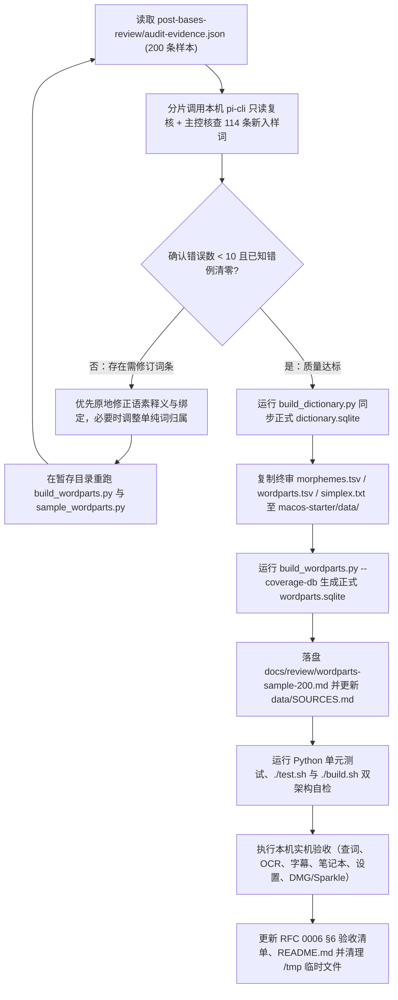

# 设计文档：词素终审落盘与实机验收收尾方案

- 日期：2026-11-17
- 状态：已实施（待实机/CI 补验项见正文）

## 1. 需求理解

承接 Codex 会话 `01a1df4d-d22a-73f2-a946-6f1a077ede07` 在执行 RFC 0006 过程中的中断状态，完成剩余的词素质量终审、正式资源落盘、自动化回归与本机实机验收收尾。Codex 已完成阶段 A 缺陷修复（提交 `5140bfc`）、阶段 C/D/E 的主体代码实现（字幕、笔记本、引导、StarDict、翻译预设、构建与发布脚本）及阶段 B 词素库 100% 覆盖（`11,444 / 11,444` 词），并在暂存目录 `macos-starter/scripts/.cache/morphology-review-round-3/post-bases-review/` 完成第 23 轮词素修正，在核查最新一轮 200 条抽查样本时中断。本次需完成最新 200 条样本的最终裁决（错误数 `< 10` 条且已确认错例清零），将暂存词素产物正式替换至 `macos-starter/data/` 与 `macos-starter/Sources/Englishwords/Resources/`，并完成 RFC 0006 剩余的构建、实机验收与文档状态同步。

### 1.1 关键假设与待确认事项

- **假设**：继续复用本机 `pi-cli`（`--thinking high --access read`）配合主控对照冻结 Wiktionary 词源完成最后 200 条样本的只读复核，不依赖当前返回地区限制 400 错误的远端 Agy 接口。
- **假设**：商业化（M8）继续暂缓，不引入许可证、激活码或收费预告。
- **待确认事项**：本机钥匙串是否具备或允许创建测试用稳定自签名代码签名证书（`EW_SIGN_IDENTITY`）。若无稳定签名证书，开发构建与 DMG/Sparkle 产物校验照常执行，跨版本 TCC/Keychain/登录项权限保持项在验收记录中标注“待稳定签名证书验证”。
- **待确认事项**：Netflix、Prime Video 等需订阅或特定地区网络环境的站点，若本机当前无可用播放环境，按 RFC 0006 规范单列为“待外部条件验证”，不以模拟脚本替代真实站点结论。

### 1.2 已只读核对的现状与文档差异

- **已核对文档与代码路径**：
  - `docs/design/0006-完整功能收尾与缺陷修复方案.md`：定义了阶段 A–F 的完整范围、接口与数据库设计及 §6.4 阶段性复测记录。
  - `docs/review/wordparts-coverage-2026-11-17.md`、`docs/review/wordparts-full-coverage-audits-2026-11-17.md`：已记录 9 个词素缺项的词源证据及全覆盖后前 6 轮 200 条抽查的修订结论。
  - `macos-starter/scripts/.cache/morphology-review-round-3/post-bases-review/`：存放中断前最新生成的 `morphemes.tsv`、`wordparts.tsv`、`simplex.txt`、`wordparts.sqlite`（4,626 个语素、7,757 个拆分词）、`sample-200.md` 与 `audit-evidence.json`（含 114 条相较前序批次未审的样本词）。
  - `macos-starter/scripts/build_wordparts.py`、`macos-starter/scripts/sample_wordparts.py`、`macos-starter/scripts/build_dictionary.py`：离线构建与固定种子抽样脚本已就绪。
  - `macos-starter/Sources/Englishwords/`：客户端 `Subtitle/`、`Notebook/`、`Onboarding/`、`Dictionary/StarDictStore.swift`、`Translate/AnthropicProvider.swift`、`Translate/ProviderPresets.swift`、`Settings/HotKeyRecorder.swift`、`Notch/SubtitleView.swift` 及对应测试 `Tests/EnglishwordsTests/{CoreTests,NotebookTests,StarDictTests,SubtitleProviderTests}.swift` 均已在工作区实现。
- **文档与代码现状差异**：
  - `macos-starter/data/{morphemes.tsv,wordparts.tsv,simplex.txt}` 与 `macos-starter/Sources/Englishwords/Resources/wordparts.sqlite` 仍为替换前的旧数据，尚未从 `post-bases-review` 同步。
  - Codex 在暂存词典 `scripts/.cache/morphology-review-round-2/dictionary-repaired.sqlite` 中修正了 `reservior -> reservoir` 考试标签合并（目标词数 `11,444`），正式资源 `Sources/Englishwords/Resources/dictionary.sqlite` 需通过 `build_dictionary.py` 同步该更新，以保证针对正式词典运行 `--coverage-db` 时目标词集合一致。
  - RFC 0006 要求落盘的 `docs/review/wordparts-sample-200.md` 尚未生成，`data/SOURCES.md` 与 `README.md` 尚未更新最终统计与状态。

## 2. 接口改动

无。

原因：RFC 0006 规划的客户端内部接口（取词协调、超时取消、区域 OCR 序号控制、浏览器字幕桥接、笔记本存储、StarDict 读取、翻译预设与 Anthropic 协议）及离线脚本 CLI 接口均已在当前工作区实现完毕；本次收尾直接复用现有接口与脚本参数，不新增、修改或废弃任何接口。

## 3. 数据库改动

表结构、字段与索引**无改动**；仅执行随包只读 SQLite 资源的数据更新与本机用户库的实机验收。

### 3.1 随包只读数据库更新

- **`macos-starter/Sources/Englishwords/Resources/dictionary.sqlite`**：
  - `words`、`forms` 表结构不变。通过现有 `python3 scripts/build_dictionary.py` 重新生成，使 `reservior` 误拼词头的考试标签合并至 `reservoir`（七类考试标签并集共 `11,444` 词）。
- **`macos-starter/Sources/Englishwords/Resources/wordparts.sqlite`**：
  - `parts`、`words`、`meta` 表结构及 `schema_version = 1` 不变。
  - 将通过终审的 `morphemes.tsv`、`wordparts.tsv`、`simplex.txt` 同步至 `macos-starter/data/` 后，执行 `python3 scripts/build_wordparts.py --coverage-db Sources/Englishwords/Resources/dictionary.sqlite --simplex data/simplex.txt --extra data/wordlist-extra.txt` 生成正式随包库，写入 `source_counts`、`coverage_tags`、`coverage_target = 11444`、`simplex_count`。
  - 原有 147 条 `source = 'manual'` 的人工拆分保持不变；单纯词仅保存在 `data/simplex.txt`，不写入空拆分 SQLite 行。
- **回滚 DDL**：无（随包 SQLite 为构建期生成的只读资源文件，回滚时直接通过 Git 恢复 `data/` 与 `Sources/Englishwords/Resources/` 下的上一版本文件）。

### 3.2 本机用户数据库验证

- **`~/Library/Application Support/Englishwords/user.sqlite`**：
  - 复用 `Notebook/NotebookStore.swift` 已实现的 `lookups`、`favorites` 表与 `PRAGMA user_version = 1` 迁移逻辑，无表结构变更。
  - 若需在测试后彻底清理测试生成的用户库表结构，回滚 DDL 保持与 RFC 0006 §3.2 一致：

```sql
BEGIN;
DROP INDEX IF EXISTS lookups_word;
DROP INDEX IF EXISTS lookups_created_at;
DROP TABLE IF EXISTS lookups;
DROP TABLE IF EXISTS favorites;
PRAGMA user_version = 0;
COMMIT;
```

## 4. 流程图



## 5. 范围边界

### 5.1 本次做

1. **完成阶段 B 词素终审与正式落盘**：
   - 对 `macos-starter/scripts/.cache/morphology-review-round-3/post-bases-review/audit-evidence.json` 的 200 条样本完成逐条词源复核。
   - 若存在少量语素释义或绑定偏差，优先在不改变拆分词/单纯词集合划分的前提下原地修正，避免触发固定种子 `20261115` 抽样下标再次大幅漂移；若确需调整集合归属，修正后重抽并补齐复核，确保最终版本 200 条样本错误数 `< 10`（且已识别错误全部清零）。
   - 同步更新 `macos-starter/data/{morphemes.tsv,wordparts.tsv,simplex.txt}`、`macos-starter/Sources/Englishwords/Resources/{dictionary.sqlite,wordparts.sqlite}`、`macos-starter/data/SOURCES.md`，并生成 `docs/review/wordparts-sample-200.md` 与更新 `docs/review/wordparts-full-coverage-audits-2026-11-17.md`。
2. **完成全量自动化回归与打包验证**：
   - 运行 `PYTHONDONTWRITEBYTECODE=1 python3 -m unittest discover -s scripts/tests -v`、`./test.sh` 与 `./build.sh`，验证正式资源入库后双架构构建、随包查词与代码签名检查全部通过。
3. **完成本机实机验收与文档同步**：
   - 按 RFC 0006 §6.3 逐项执行本机可验证的实机操作（热键/剪贴板/区域 OCR 查词、Apple 本地翻译、Chrome/Safari 字幕脚本桥接与断句/对齐/点词、笔记本读写、StarDict 导入排序、设置各分页、引导窗、诊断导出、DMG 与 Sparkle 构建验证）。
   - 将真实执行结果与受外部条件限制的未验证项如实记录至 `docs/design/0006-完整功能收尾与缺陷修复方案.md` §6 与 `README.md`，清理 `/tmp/ew-*` 等临时脚本。

### 5.2 明确不做

- 不实现商业化授权、卡密核销、付费墙或收费提示（M8 暂缓）。
- 不新增或重构任何客户端功能模块、数据库表结构或构建脚本架构。
- 不将 `macos-starter/scripts/.cache/` 或 `/tmp/` 下的中间缓存文件纳入版本控制。
- 不在未获用户明确指令前执行 `git commit`、`git push` 或对外发布 GitHub Release。

### 5.3 设计与开发原则约束

后续执行必须严格遵守以下五项原则：

1. **优先复用**：一律复用现有 `build_dictionary.py`、`build_wordparts.py`、`sample_wordparts.py`、`test.sh`、`build.sh`、`release.sh` 及既有 Swift 测试套件，禁止另起平行验证脚本或重复造轮子。
2. **保持整洁**：正式替换 TSV/SQLite 资源后，清理 `/tmp/` 下的一次性调试脚本与构建临时产物，保持仓库与工作区整洁，不留死代码或临时补丁。
3. **架构清晰、拒绝过度设计**：直接完成数据核查、文件同步与实机验证，不引入新的抽查框架或自动化评测平台。
4. **测试克制**：直接运行现有 10 项 Python 测试与 31 项 Swift 核心路径测试验证行为正确，不为极端边界额外堆砌冗余测试。
5. **调研有据**：词素裁决严格对照冻结 Wiktionary 词源快照与基础词典释义；实机验收严格区分“本机实测通过”与“因缺少外部账号/证书待验证”，不把模拟测试写成实机通过。

## 6. 验收标准

- [x] **词素全量覆盖与结构完整性**：在 `macos-starter/` 下针对正式资源执行 `python3 scripts/build_wordparts.py --coverage-db Sources/Englishwords/Resources/dictionary.sqlite --simplex data/simplex.txt --extra data/wordlist-extra.txt` 退出码为 `0`；`coverage_target` 为 `11444` 且缺口为 `0`；原有 147 条 `manual` 拆分完全保留；`sqlite3 Sources/Englishwords/Resources/wordparts.sqlite "PRAGMA integrity_check; PRAGMA foreign_key_check;"` 输出 `ok`。
- [x] **词素 200 条抽查达标并落盘**：使用固定种子 `20261115` 对正式 `data/wordparts.tsv` 与 `data/simplex.txt` 生成 `docs/review/wordparts-sample-200.md`，200 条样本经 `pi-cli` 3 分片与主控逐词核查确认错误数 `0` 条（`< 10` 条），2026-11-22 已二次核验并补齐审核判定与参考证据列，`macos-starter/data/SOURCES.md` 已同步快照日期、词条统计与流水线说明。
- [x] **自动化回归测试全部通过**：在 `macos-starter/` 下运行 `PYTHONDONTWRITEBYTECODE=1 python3 -m unittest discover -s scripts/tests -v`（10 项 Python 测试）与 `./test.sh`（10 个套件 31 项 Swift 测试）全部通过。
- [x] **双架构构建与随包自检通过**：运行 `./build.sh`（及 `EW_ENABLE_SPARKLE=1 ./build.sh`）成功生成 Universal 产物，`lipo -archs` 包含 `x86_64 arm64`，`codesign --verify --deep --strict` 通过，随包 `--check-word` 正确返回内置释义与新增词素拆分。
- [~] **实机验收与文档状态同步**：已完成 CLI/Vision OCR 实测，并同步更新 `docs/design/0006-完整功能收尾与缺陷修复方案.md` §6.1–§6.4；需人工桌面交互（GUI 悬停/框选/快捷键/系统权限弹窗）或外部条件（稳定代码签名证书、四站实播账号、外接屏/Intel 实机）的条目已按实况标注为待验收。

## 7. 影响面

- **随包资源与安装包体积**：`macos-starter/data/{morphemes.tsv,wordparts.tsv,simplex.txt}` 与 `Sources/Englishwords/Resources/{dictionary.sqlite,wordparts.sqlite}` 更新后，随包词素库从 170 个语素 / 147 个词扩充至 4,550 个语素 / 7,757 个拆分词（另含 3,698 个单纯词），`.app` 与 DMG 包体积小幅增加（几 MB 量级），运行时仍为本地 SQLite 主键查询，不影响查词响应延迟。
- **下游查词与展示**：客户端 `LookupCoordinator` 与 `ResultView` 直接通过既有 `WordPartsStore` 读取新 `wordparts.sqlite`，考试核心词的词根词缀命中率提升至 100%（拆分词展示语素拆解，单纯词不展示伪拆分）。
- **安全性与用户环境**：实机验证使用隔离路径或测试配置，不修改用户现有 `io.github.shenziggy0.notchword.translation` 下的 `custom` Keychain 密钥，不污染用户正式历史数据。

## 8. 回滚方案

- **触发条件**：
  1. 替换正式 `wordparts.sqlite` 或 `dictionary.sqlite` 后，`./test.sh`、`./build.sh` 或随包查词自检失败。
  2. 200 条抽查样本发现系统性词源污染且无法通过局部修订在 `< 10` 条错误阈值内收敛。
- **数据与代码回滚方式**：
  1. 通过 `git checkout -- macos-starter/data/ macos-starter/Sources/Englishwords/Resources/wordparts.sqlite macos-starter/Sources/Englishwords/Resources/dictionary.sqlite` 立即恢复随包词典与词素资源至替换前状态。
  2. `macos-starter/scripts/.cache/morphology-review-round-3/` 下的各轮暂存快照独立按子目录保存，若最新修订轮次出现回归，可直接回退至上一通过结构校验的子目录（如 `post-bases-review` 或 `post-constituent-review`）。
- **本文档回滚方式**：本次仅新增 `docs/design/0007-词素终审落盘与实机验收收尾方案.md`，如需撤销直接删除该文件即可，不影响任何源码或数据。
