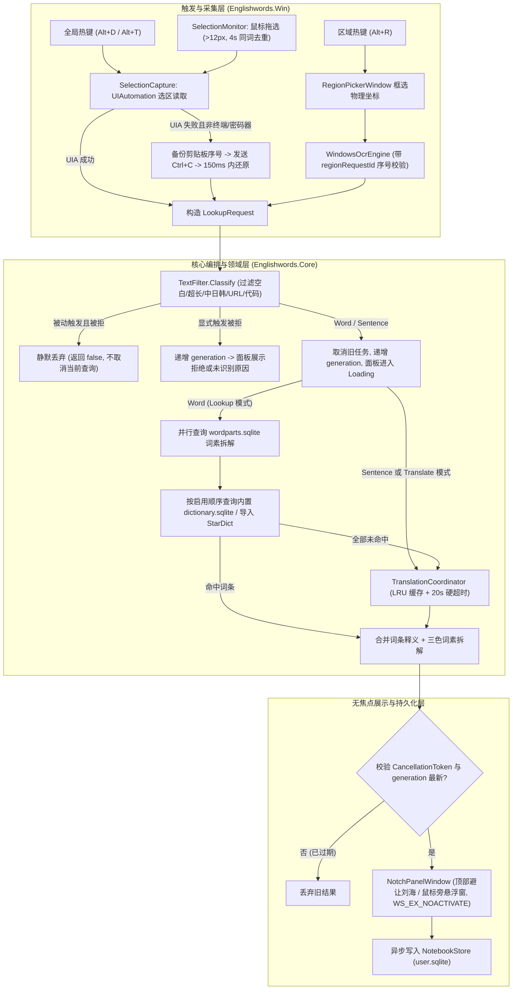

# 设计文档：Windows 版本 MVP 实施方案

- 日期：2026-11-18
- 状态：已实施（待实机/CI 补验项见正文）

## 1. 需求理解

在现有仓库新增 `windows-starter/`（C# / .NET 8 + WPF + Win32/WinRT Interop），直接链接复用 `macos-starter/Sources/Englishwords/Resources/` 已终审落盘的 `dictionary.sqlite`（43,329 词条 / 29,601 屈折形式）与 `wordparts.sqlite`（4,550 语素 / 7,757 拆分词），实现 Windows 10/11 原生运行的查词与翻译客户端。
首版（MVP）覆盖核心查词闭环：系统托盘常驻、全局快捷键（查词/翻译/区域 OCR）、鼠标拖选划词（`UIAutomation` 优先，安全 `Ctrl+C` 剪贴板备份还原降级）、`Windows.Media.Ocr` 屏幕框选识别、内置词库与 StarDict 导入排序、三色词根词缀拆解、9 大联网翻译预设（OpenAI 兼容 / Anthropic）、笔记本（收藏/历史/近七天统计）及语音朗读。
主界面采用“顶部可避让模拟刘海 + 鼠标旁轻量悬浮窗”双形态（`WS_EX_NOACTIVATE` 无焦点置顶），默认顶部刘海在窗口最大化且鼠标移入顶栏非面板热区时自动避让，解决 Windows 无物理刘海遮挡浏览器标签页的问题。

### 1.1 关键假设与待确认事项

- **已确认范围**：首版聚焦核心查词闭环，暂缓鼠标悬停取词（`HoverMonitor`）与视频双语字幕（`SubtitleTracker`）；不内置本地离线翻译大模型，未命中词与长句直接走联网翻译服务；不接入商业化授权（M8）。
- **假设**：目标运行环境为 Windows 10 20H1 (Build 19041) 及以上或 Windows 11（`win-x64`），系统启用英文 OCR 语言包（缺失时面板明确提示引导安装，不伪装成无文字）。
- **待确认事项**：当前开发机为 macOS，本机可通过 `dotnet test` 验证跨平台领域层 `Englishwords.Core`；涉及 WPF/WinRT 的 `Englishwords.Win` 打包与桌面交互需通过 GitHub Actions `windows-latest` 或 Windows 实机/虚拟机验收。

### 1.2 已只读核对的现状与文档差异

- **已核对文档与代码路径**：
  - `macos-starter/Sources/Englishwords/Resources/{dictionary.sqlite,wordparts.sqlite}`：随包只读词库与词素库，表结构与数据完整性已验证，可由 Windows 端只读直连复用。
  - `macos-starter/Sources/Englishwords/Dictionary/{DictionaryStore,StarDictStore,Models}.swift`：定义屈折还原、语素缓存、`segments`（`"un:12 believ:34 able:56"`）解析、八类考试标签映射及 StarDict `.ifo/.idx(.gz)/.dict(.dz)` 解析规则。
  - `macos-starter/Sources/Englishwords/Lookup/{TextFilter,LookupCoordinator,SelectionMonitor,LookupTypes}.swift`：定义单词/短句/拒绝分类（含代码、URL、中日韩过滤）、查询序号 `generation` 取消控制及 4 秒同词去重逻辑。
  - `macos-starter/Sources/Englishwords/Translate/{ProviderPresets,OpenAICompatProvider,AnthropicProvider,TranslationCoordinator,TranslationTypes}.swift`：定义 9 大翻译服务预设、20 秒硬超时与 LRU 缓存。
  - `macos-starter/Sources/Englishwords/Notebook/NotebookStore.swift`：定义 `user.sqlite`（`PRAGMA user_version = 1`）的 `lookups` 与 `favorites` 表结构及统计查询。
  - `.github/workflows/package.yml`：已包含 `build-macos-universal` 与 `build-windows-x64` 两个构建任务。
- **文档与代码现状差异（以实际代码与落盘数据为准）**：
  - `README.md` 仍记载 `dictionary.sqlite` 为 `43,330 词条 / 29,519 屈折形式`、`wordparts.sqlite` 为 `170 个语素 / 147 个词`。实际落盘的 `dictionary.sqlite` 为 **43,329 词条 / 29,601 屈折形式**，`wordparts.sqlite` 为 **4,550 个语素 / 7,757 个拆分词**（配合 `data/simplex.txt` 的 3,698 个单纯词，已完成 11,444 考纲词 100% 覆盖），与 `macos-starter/data/SOURCES.md` 及 RFC 0007 一致。
  - `docs/ARCHITECTURE.md` 记录的是参照对象 Dipword 0.8.3 的逆向结构，实际已实现能力与接口以 `macos-starter/Sources/Englishwords/` 为准。

## 2. 接口改动

本期无自建后端 HTTP 服务。因现有客户端代码为 Swift + AppKit/SwiftUI，无法直接在 Windows 原生进程内编译运行，故在 `windows-starter/` 下按相同领域模型与行为契约新增 C# 内部模块接口与外部协议调用。

### 2.1 领域层核心接口（`windows-starter/src/Englishwords.Core`）

| 拟新增路径与接口 | 入参与出参 | 错误处理与复用/新增说明 |
|---|---|---|
| `Dictionary/DictionaryStore.cs`：`Lookup(string word)`、`Morphology(string word)`、`Lemma(string form)` | 入参：规范化英文词头；出参：`Result<Entry?, DictionaryError>`、`Morphology?`、`string?` | 区分 `Success(null)`（未命中）与 `DictionaryError.Unavailable / Schema / Query`（数据库故障）；复用 `macos-starter` 的 SQL 语句与 `segments` 解析逻辑 |
| `Dictionary/StarDictStore.cs`：`StarDictLibrary.ImportDictionary(string path)`、`Lookup(string word, DictionarySource source)`、`Remove(DictionarySource source)` | 入参：`.ifo` 路径或目录、查询词、词典源描述；出参：`DictionarySource`、`Entry?` | 校验 `2.4.2`/`3.0.0`、`idxoffsetbits`（32/64）、`m/t/h/x` 类型及 `.idx.gz`（≤32MB）/ `.dict.dz`（≤128MB）解压上限；不满足抛 `StarDictError.Invalid` |
| `Lookup/TextFilter.cs`：`Classify(string raw)`、`NormalizeWord(string raw)` | 入参：原始采集文本；出参：`TextClassification`（`Word(string)` / `Sentence(string)` / `Rejected(RejectReason)`） | 1:1 复刻 `TextFilter.swift`：拦截空白、>300 字符、中日韩字符、URL、Email、域名及 `let/const/var` 赋值与函数调用代码 |
| `Lookup/LookupCoordinator.cs`：`Submit(LookupRequest request)`、`Cancel()` | 入参：`LookupRequest(Text, Trigger, Mode, Note)`；出参：`bool`（`false` 表示被动触发被拒绝且不打断当前查询） | 维护单调递增 `_generation` 与 `CancellationTokenSource`；词素独立异步查询；按启用词典顺序降级至翻译 |
| `Translate/TranslationCoordinator.cs`：`TranslateAsync(TranslationRequest request, CancellationToken ct)` | 入参：`TranslationRequest(Text, Source="en", Target)`；出参：`Task<TranslationResult>` | 封装 128 条容量 LRU 缓存与单次请求 20 秒硬超时；超时返回 `TranslationError.TimedOut`，取消返回 `TranslationError.Cancelled` |
| `Translate/OpenAICompatProvider.cs` & `AnthropicProvider.cs`：`TranslateAsync`、`FetchModelsAsync` | 入参：BaseURL、Model、ApiKey、文本；出参：译文字符串或模型 ID 列表 | 复用 `ProviderPresets.swift` 的 9 大预设地址与默认模型；兼容 OpenAI `/v1/chat/completions` 与 Anthropic `/v1/messages` |
| `Notebook/NotebookStore.cs`：`RecordLookupAsync`、`SetFavoriteAsync`、`GetFavoritesAsync`、`GetHistoryAsync`、`GetStatsAsync` | 入参：词头、来源、触发方式、时间戳；出参：`IReadOnlyList<NotebookLookup>`、`NotebookStats` | 复用 `NotebookStore.swift` 的 SQL 与 7 天按日统计逻辑，读写 `%LOCALAPPDATA%\Englishwords\user.sqlite` |

### 2.2 Windows 宿主与系统互操作接口（`windows-starter/src/Englishwords.Win`）

| 拟新增路径与接口 | 入参与出参 | 错误处理与新增原因 |
|---|---|---|
| `Interop/GlobalHotKeyManager.cs`：`Register(HotKeyAction action, HotKeySpec spec)`、`UnregisterAll()` | 入参：动作枚举与修饰键+虚拟键码；出参：`Result<bool, string>` | 封装 Win32 `RegisterHotKey`；热键被其他软件占用时返回明确冲突提示，不影响应用启动 |
| `Interop/SelectionCapture.cs`：`CaptureCurrentSelectionAsync(LookupTrigger trigger)` | 入参：触发源；出参：`Task<(string Text, string? Note)>` | 先调 `UIAutomation` 读取 `TextPattern`；失败且前台非终端/非密码器时备份剪贴板序号、发送合成 `Ctrl+C` 并还原剪贴板 |
| `Interop/SelectionMonitor.cs`：`Start()`、`Stop()` | 无入参；通过事件回调产出 `LookupRequest` | 基于 `WH_MOUSE_LL` 监听左键拖拽选区；拆分 `_lastObserved` 与 `_lastSubmitted`，仅在发出查询后记录 4 秒同词去重 |
| `Interop/WindowsOcrEngine.cs`：`RecognizeRegionAsync(Int32Rect screenRect, CancellationToken ct)` | 入参：物理屏幕矩形；出参：`Task<string>` | 调用 `Windows.Media.Ocr`；缺少 `en-US` 语言包时抛出明確配置提示错误；由单调递增 `_regionRequestId` 防旧结果覆盖 |
| `Interop/DpapiSecretStore.cs`：`Save(string account, string secret)`、`Load(string account)`、`Delete(string account)` | 入参：预设账号名与密钥；出参：`Result<Unit, SecretStoreError>` | 使用 Windows `ProtectedData` (`CurrentUser`) 加密写入 `%LOCALAPPDATA%\Englishwords\secrets.bin`；空白字符串报错 `EmptyValue`，严禁误删已有密钥 |
| `App.xaml.cs` CLI 入口：`--check-word <word>`、`--diagnose` | 命令行参数；标准输出诊断信息与退出码（`0` 命中 / `2` 未命中 / `3` 词库错误） | 对齐 macOS 版自检 CLI，供 CI 与本地构建脚本无界面验证随包词库与环境状态 |

## 3. 数据库改动

随包只读数据库与本机用户数据库**表结构、字段、索引均无改动**，与 macOS 版保持 100% 兼容。

### 3.1 随包只读数据库（构建期直接链接复用）

- **`dictionary.sqlite`**（`words`、`forms` 表，`WITHOUT ROWID`）与 **`wordparts.sqlite`**（`meta`、`parts`、`words` 表）：
  - 在 `windows-starter/src/Englishwords.Win/Englishwords.Win.csproj` 中通过 `<Content Include="..\..\..\macos-starter\Sources\Englishwords\Resources\*.sqlite" Link="Resources\%(Filename)%(Extension)" CopyToOutputDirectory="PreserveNewest" />` 直接链接引用，不在仓库中复制第二份二进制文件。
  - 客户端以 `SqliteOpenMode.ReadOnly` 打开。

### 3.2 本机用户数据库（`%LOCALAPPDATA%\Englishwords\user.sqlite`）

- 首次打开时执行与 `macos-starter/Sources/Englishwords/Notebook/NotebookStore.swift` 完全一致的 `PRAGMA user_version = 1` 建表 DDL：

```sql
BEGIN;
CREATE TABLE lookups (
    id INTEGER PRIMARY KEY,
    word TEXT NOT NULL,
    source TEXT NOT NULL,
    trigger TEXT NOT NULL,
    created_at INTEGER NOT NULL
);
CREATE INDEX lookups_created_at ON lookups(created_at);
CREATE INDEX lookups_word ON lookups(word);
CREATE TABLE favorites (
    word TEXT PRIMARY KEY,
    created_at INTEGER NOT NULL
) WITHOUT ROWID;
PRAGMA user_version = 1;
COMMIT;
```

- **回滚 DDL**（如需清理本机用户库表结构）：

```sql
BEGIN;
DROP INDEX IF EXISTS lookups_word;
DROP INDEX IF EXISTS lookups_created_at;
DROP TABLE IF EXISTS lookups;
DROP TABLE IF EXISTS favorites;
PRAGMA user_version = 0;
COMMIT;
```

## 4. 流程图



## 5. 范围边界

### 5.1 本次做

1. **跨平台核心领域层（`windows-starter/src/Englishwords.Core`）**：
   - 实现 `DictionaryStore`、`StarDictStore` / `StarDictLibrary`、`TextFilter`、`LookupCoordinator`、`ProviderPresets`、`OpenAICompatProvider`、`AnthropicProvider`、`TranslationCoordinator`、`NotebookStore` 与 `Preferences`。
2. **Windows 原生宿主与交互层（`windows-starter/src/Englishwords.Win`）**：
   - 实现单实例互斥、系统托盘常驻、全局热键注册（`Alt+D`、`Alt+T`、`Alt+R`）、`UIAutomation` + 安全剪贴板降级取词、`WH_MOUSE_LL` 拖选监听、`Windows.Media.Ocr` 框选识别、DPAPI 密钥存储与系统语音朗读。
   - 实现 `NotchPanelWindow`（支持“顶部可避让模拟刘海”与“鼠标旁悬浮窗”双模式、`WS_EX_NOACTIVATE` 不抢焦点、三色词素胶囊渲染、`Loading` 态不倒计时、指针悬停暂停收起、按 `Esc` 立即取消并关闭）。
   - 实现 `SettingsWindow`（通用、词典导入与排序、联网翻译预设与密钥管理、打开运行日志目录）、`NotebookWindow`（收藏、历史、近 7 天统计与高频词）及 `--check-word` / `--diagnose` CLI 自检入口。
3. **自动化测试与 CI 构建扩展**：
   - 新增 `windows-starter/tests/Englishwords.Core.Tests`（覆盖 T1–T6 核心业务路径）与 `windows-starter/build.ps1`。
   - 扩展 `.github/workflows/package.yml`，新增 `build-windows-x64` 任务产出 Windows 发布包与 SHA-256 校验文件。

### 5.2 明确不做

- 不实现鼠标悬停取词（`HoverMonitor`）与浏览器视频双语字幕（`SubtitleTracker`）。
- 不打包本地离线翻译模型，不接入 MDict / DWDICT 格式，不接入商业化许可证或付费墙（M8）。
- 不在仓库中复制第二份 `dictionary.sqlite` 或 `wordparts.sqlite` 二进制文件，不修改现有 `macos-starter/` 业务代码。

### 5.3 设计与开发原则约束

后续开发必须严格遵守以下五项原则：

1. **优先复用**：直接链接复用 `macos-starter/Sources/Englishwords/Resources/*.sqlite` 权威数据库，1:1 复用已验证的 SQL 查询、文本分类正则、翻译预设与状态机规则，禁止另起不兼容的数据格式或平行字典结构。
2. **保持整洁**：`Englishwords.Core` 与 `Englishwords.Win` 职责边界清晰，领域层不引用任何 WPF/Win32 UI 程序集；不留死代码、冗余配置字段或临时调试补丁。
3. **架构清晰、拒绝过度设计**：直接用标准 .NET `HttpClient`、`Microsoft.Data.Sqlite` 与最小必要的 P/Invoke 满足需求，不引入重型 MVVM 框架、DI 容器或插件化抽象层。
4. **测试克制**：单元测试仅覆盖词库/词素查询、文本分类过滤、StarDict 解析、并发取消/降级编排、翻译超时与笔记本持久化 6 条核心路径，不堆砌冗余边界探测用例。
5. **调研有据**：严格对齐仓库内已核对的 SQLite 表结构与 RFC 0006/0007 修复后的行为契约；Windows GUI 与系统 API 实机表现须与单元测试结论明确区分。

## 6. 验收标准

- [ ] **权威词库零拷贝复用**：`git status` 确认仓库未新增重复的 `.sqlite` 二进制文件；构建后输出目录 `Resources/dictionary.sqlite` 与 `Resources/wordparts.sqlite` 均由 `macos-starter/Sources/Englishwords/Resources/` 链接生成。
- [ ] **核心领域层单元测试通过**：执行 `dotnet test windows-starter/tests/Englishwords.Core.Tests` 退出码为 `0`，6 个核心测试套件（内置词库与屈折/词素还原、文本分类与代码过滤、StarDict `.idx.gz`/`.dict.dz` 解析、查词降级与并发取消、翻译 20s 硬超时与协议解析、笔记本读写与统计）全部通过。
- [ ] **Windows 构建与 CLI 随包自检通过**：在 Windows 环境（或 GitHub Actions `windows-latest`）运行 `./windows-starter/build.ps1` 成功产出可执行包，执行 `Englishwords.Win.exe --check-word unbelievable` 退出码为 `0` 且正确输出中文释义与 `un / believ / able` 三色词素拆分。
- [ ] **取词安全与并发隔离验证**：
  - 在普通文本控件中拖选或按 `Alt+D` 可正常取词；在不支持 UIA 的控件中降级使用剪贴板取词后，原剪贴板文本在 `150ms` 内恢复；当前台为 `WindowsTerminal` / `powershell` / `cmd` 或密码管理器时，严禁触发合成 `Ctrl+C`。
  - 四秒内连续划选不同单词不受同词去重拦截；被动触发被拒绝（如划中代码或中文）不取消当前正在展示的面板；20 秒慢翻译在 `Loading` 态不自动隐藏面板。
- [ ] **双形态无焦点面板与设置/笔记本验证**：
  - 顶部模拟刘海与鼠标旁悬浮窗可在设置中即时切换；点击面板发音、收藏、切换词典按钮时不抢夺前台应用输入焦点；最大化浏览器顶部切换标签页时不被闲置刘海遮挡。
  - 空字符串保存 API Key 被拦截且不清除已有密钥；笔记本正确展示收藏、历史与近 7 天查词统计。

## 7. 影响面

- **现有 macOS 客户端（`macos-starter/`）**：零代码改动。仅在构建 Windows 版本时以只读方式引用 `macos-starter/Sources/Englishwords/Resources/{dictionary.sqlite,wordparts.sqlite}`，对 macOS 构建、打包与运行无任何影响。
- **CI/CD 流水线（`.github/workflows/package.yml`）**：新增独立的 `build-windows-x64` Job（运行于 `windows-latest`），与原有 `build-macos-universal` Job 并行执行，互不阻塞。
- **性能与系统资源影响**：Windows 客户端常驻内存预计控制在 `40MB–65MB`；`WH_MOUSE_LL` 钩子回调仅做坐标记录与异步消息投递（`<1ms`），不影响系统鼠标响应帧率；日志与密钥存储均隔离在 `%LOCALAPPDATA%\Englishwords\` 下，不写入系统目录或全局注册表（除用户主动开启的当前用户开机自启项 `HKCU\...\Run` 外）。

## 8. 回滚方案

- **触发条件**：
  1. `.github/workflows/package.yml` 新增 Windows 任务导致工作流语法错误或影响原有 macOS 打包任务。
  2. Windows 客户端低级鼠标钩子、剪贴板降级或无焦点置顶窗口在目标环境中引发焦点异常或输入卡顿。
- **代码与配置回滚方式**：
  1. 运行时降级：用户可在托盘菜单或设置中一键关闭“鼠标拖选划词”（仅保留热键与 OCR），或将主面板从“顶部模拟刘海”切换为“鼠标旁悬浮窗”。
  2. 仓库回滚：由于 `windows-starter/` 与 `macos-starter/` 完全解耦，直接删除 `windows-starter/` 目录并执行 `git checkout -- .github/workflows/package.yml` 即可完整回滚全部 Windows 端改动。
  3. 本机数据清理：删除 `%LOCALAPPDATA%\Englishwords\` 目录并移除 `HKCU\Software\Microsoft\Windows\CurrentVersion\Run\Englishwords` 键值即可彻底清除本机状态。
- **本文档回滚方式**：本次仅新增 `docs/design/0008-Windows版本MVP实施方案.md`，如需撤销直接删除该文件即可。
