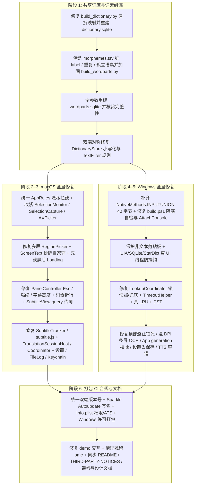

# 设计文档：双端与词库全量缺陷修复方案

- 日期：2026-11-22
- 状态：草稿

## 1. 需求理解

基于 2026-11-22 对仓库 `HEAD`（`860cd8a`）的实机复测与双端全量代码/数据审计，本次需要一次性修复共享词库与词素数据污染、macOS 客户端、Windows 客户端及打包/CI/合规/文档中的所有已确认缺陷（5 项 P0、24 项 P1 及关键 P2 与文档漂移）。
预期行为变化：双端不再把 806 个常用词查成错词（如 `founded → find`、`roses → rise`、`wounds → wind`）；Windows 剪贴板降级取词与 `build.ps1` 自检真正生效；macOS 停止普通拖拽误发 `⌘C` 与后台密码器悬停泄露；双端多屏框选、截屏防自遮挡、面板交互、字幕链路、设置持久化与打包版本号全部收敛一致。
关键约束：不修改随包 `dictionary.sqlite`、`wordparts.sqlite` 及用户库 `user.sqlite` 的表结构；不接入商业化授权（M8）；不新增 Windows 悬停与字幕功能；仅在用户主动启用联网翻译且本地不可用时才外发请求；禁止使用 mock 替代真实环境验收。

### 关键假设与待确认事项

1. **假设（macOS 被动划词策略，待确认）**：默认按 `SelectionCapture.swift` 原注释契约，被动鼠标划词回归纯只读 Accessibility，不再在任意鼠标拖拽（>6px）时注入模拟 `⌘C`（Electron/画布应用改由显式热键 `⌥D`/`⌥T` 触发安全模拟复制）。若你强依赖“Chrome/Electron 只拖选不按热键也自动弹窗”，需另行确认是否改为“限定浏览器白名单 + 异步 `TransientType` 剪贴板锁”。
2. **假设（Windows CI 打包形态，待确认）**：默认保持框架依赖发布以控制包体，并在包内附带运行环境说明（需 .NET 8 Desktop Runtime）；如需免装运行时，可在实施前确认为 `.github/workflows/package.yml` 增加 `-SelfContained`（体积增加约 60–70MB）。
3. **假设（统一发布版本号，待确认）**：默认以 `macos-starter/Resources/Info.plist` 为唯一默认版本源，全修完成后双端统一推进至 `0.5.2`；如需改为其他 `X.Y.Z` 版本号，实施前确认即可。
4. **环境约束（已知待验证边界）**：本机为 macOS 且未安装 `.NET SDK` 与付费 API 密钥，Windows 编译、单元测试与 `build.ps1` 自检须通过 GitHub Actions `windows-latest` 或 Windows 实机验收；联网翻译真实调用、双屏与真实视频站字幕须在具备相应条件后实机补验。

### 文档与代码差异

1. **README 与随包第三方许可中的词库/词素规模及示例过时**
   - 冲突位置：`README.md`（§1 第 54–55 行、§4 第 150–151/157/161 行、§6 第 195 行、§2 第 89–114 行）、`macos-starter/Sources/Englishwords/Resources/THIRD-PARTY-NOTICES.md`（§2 第 49/55 行） vs `macos-starter/Sources/Englishwords/Resources/{dictionary.sqlite,wordparts.sqlite}`、`macos-starter/scripts/build_wordparts.py`
   - 具体差异：两份文档仍写词素库为 `170 个语素 / 147 个词`、词库为 `43,330 词条 / 29,519 屈折形式`、`README.md` 仍称覆盖 `M0—M5` 且重建命令缺少 `--coverage-db/--simplex/--extra`、硬编码 `.build/out/Products/Debug/Englishwords` 并以 `abandoned → abandon` 举例屈折还原；实际随包库为 `4,626 语素 / 7,757 拆分词` 与 `43,329 词条 / 29,520 屈折形式`，`abandoned` 位于 `words` 表而不在 `forms` 表，且 M5.5—M7 及 Windows MVP 均已合入。
   - 来源提交：`e7be9ca`（作者 `shenziggy0`，2026-11-18，摘要 `0.1.0`）扩充了 `wordparts.sqlite`（36,864 → 1,089,536 字节）、更新了 `dictionary.sqlite` 并合入 M5.5—M7 功能，但在同次提交更新 `README.md` 与 `THIRD-PARTY-NOTICES.md` 时未同步规模数字与覆盖范围；后续 `c6e3da4`（2026-11-18，`windows版本完善`）与 `860cd8a`（2026-11-18，`chore: 清理公开前敏感追踪文件、补充 LICENSE 并更新 README`）亦未修正；`abandoned → abandon` 举例自初始提交 `2bb78d3`（作者 `shenziggy0`，2026-11-03，摘要 `初始提交：Notchword（刘海查词 + 翻译）macOS 应用`）起即存在。
   - 类型：文档过期（`abandoned → abandon` 举例自初始提交即不符，属类型待确认）。

2. **架构文档 §14 里程碑清单未随 M5.5—M7 落地更新**
   - 冲突位置：`docs/ARCHITECTURE.md`（§14 第 858–926 行） vs `macos-starter/Sources/Englishwords/{Capture,Subtitle,Notebook,Onboarding,Dictionary/StarDictStore.swift,Translate/AnthropicProvider.swift}`
   - 具体差异：文档 §14 仍将 M5.5、M6、M7 全部标为 `⬜` 并写词素 `147 词覆盖`；实际代码中相关模块均已落地且词素库已达 7,757 拆分词。
   - 来源提交：`e7be9ca`（作者 `shenziggy0`，2026-11-18，摘要 `0.1.0`）合入了 M5.5—M7 全部源码和扩充后的 `wordparts.sqlite`，未同步改动 `docs/ARCHITECTURE.md`（该文档最后修改为 `77ed81f`，2026-11-04）。
   - 类型：文档过期。

3. **版本号在 `Info.plist`、Git tag、CI 工作流与 Windows 构建脚本间冲突**
   - 冲突位置：`macos-starter/Resources/Info.plist`（第 21–24/34 行）、`.github/workflows/package.yml`（第 8/30–36/107–116 行）、`windows-starter/build.ps1`（第 2/21–25 行）、`windows-starter/Directory.Build.props` 与 `Englishwords.Win.csproj`
   - 具体差异：`Info.plist` 为 `0.5.1`（版权文本 `0.5`），`package.yml` Windows 兜底与 `build.ps1` 默认为 `0.5.2`，Windows exe 未传 `-p:Version` 内部版本恒为 `1.0.0.0`，而 Git tag 为 `v0.1.0` / `v0.1.1`，导致 CI 留空触发时将 `Info.plist` 倒退覆写为 `0.1.1`。
   - 来源提交：`ddb4abd`（作者 `shenziggy0`，2026-11-18，摘要 `chore: 添加 GitHub Actions 手动打包工作流与安装说明`）新增 `package.yml` 时引入“优先取 `v*` tag、否则读 `Info.plist`”，但同日标签 `v0.1.0`/`v0.1.1` 小于 `0.5.1`；`c6e3da4`（作者 `shenziggy0`，2026-11-18，摘要 `windows版本完善`）新增 Windows job 与 `build.ps1` 时写入默认 `0.5.2` 且未传递 `-p:Version`。
   - 类型：文档过期（版本声明与打包配置漂移）。

4. **RFC 0006 字幕视口坐标设计与草稿状态与实现不一致**
   - 冲突位置：`docs/design/0006-完整功能收尾与缺陷修复方案.md`（第 4/134/144 行） vs `macos-starter/Sources/Englishwords/Resources/subtitle.js`（第 105–108 行）、`Subtitle/SubtitleTracker.swift`（第 171–177 行）
   - 具体差异：`0006` 要求 `subtitle.js` 返回视频区域视口坐标并换算为屏幕坐标供 OCR 使用，且头标仍写 `状态：草稿，待实施`；实际 `subtitle.js` 未返回坐标，屏幕 OCR 依赖手动框选字幕区域，且同文档 §6 已勾选多数条目。
   - 来源提交：`e7be9ca`（作者 `shenziggy0`，2026-11-18，摘要 `0.1.0`）同时提交了 `0006`、`subtitle.js` 与 `SubtitleTracker.swift`，入库时即存在该差异。
   - 类型：待实施设计（视口坐标自动换算未落地）与文档过期（文档头草稿状态未随 §6 勾选更新）。

5. **RFC 0007 验收命令缺必选参数与 200 条抽查表空白**
   - 冲突位置：`docs/design/0007-词素终审落盘与实机验收收尾方案.md`（第 46/117–118 行）、`docs/review/wordparts-sample-200.md`（第 5/7–208 行） vs `macos-starter/scripts/build_wordparts.py`（第 302–304 行）、`macos-starter/data/morphemes.tsv`
   - 具体差异：`0007` 所写命令 `python3 scripts/build_wordparts.py --coverage-db Sources/Englishwords/Resources/dictionary.sqlite` 缺少脚本强制要求的 `--simplex` 与 `--extra` 参数，直接运行会非零失败；`wordparts-sample-200.md` 宣称 200 条审核 0 ERROR，但表格第 5–6 列全部为空且所抽样本中实际引用了 12 处中文 `label`。
   - 来源提交：`e7be9ca`（作者 `shenziggy0`，2026-11-18，摘要 `0.1.0`）同时新增了 `0007` 与 `wordparts-sample-200.md`，入库时即存在该差异。
   - 类型：类型待确认（记录提交时即不完整/参数有笔误）。

6. **RFC 0008 工作流描述与 Windows 诊断导出项与实现不一致**
   - 冲突位置：`docs/design/0008-Windows版本MVP实施方案.md`（第 4/26/148/171–179 行） vs `.github/workflows/package.yml`（第 87–131 行）、`windows-starter/src/Englishwords.Win/Views/SettingsWindow.xaml`（第 31 行）
   - 具体差异：`0008` 头标仍为 `草稿`、§1.2 第 26 行写 `package.yml` 仅含 `build-macos-universal`、§5.1 第 148 行写 `SettingsWindow` 含“诊断导出”；实际 `package.yml` 已合入 `build-windows-x64`，而 `SettingsWindow.xaml` 仅提供“打开运行日志目录”按钮。
   - 来源提交：`c6e3da4`（作者 `shenziggy0`，2026-11-18，摘要 `windows版本完善`）在同次提交中新增 `0008`、扩展 `package.yml` 并落地 `SettingsWindow.xaml`。
   - 类型：文档过期（工作流现状与草稿状态未同步）与待实施设计（Windows 诊断导出按钮尚未实现）。

## 2. 接口改动

本期无外部 HTTP 服务端新增，全部改动为现有脚本 CLI、内部 Swift/C# 接口的复用与最小化扩展；无破坏性存储格式变更。

### 2.1 共享数据脚本与双端领域核心

| 路径与接口 | 改动方式 | 入参 / 出参 | 错误处理与兼容性 |
|---|---|---|---|
| `macos-starter/scripts/build_dictionary.py`：`parse_exchange(exchange, word)`、`build(rows, output)` | 修改 | 入参不变；输出 `(native_forms, base_lemma)`，当 `row["word"]` 在 `words` 表内时自有屈折固定指向 `row["word"]` | 校验失败在 `finally` 中删除 `temp_path`；保持 CLI 参数与 `dictionary.sqlite` schema 不变 |
| `macos-starter/scripts/build_wordparts.py`：`validate_morphemes`、`build`、`main` | 最小扩展 | 复用现有 CLI 参数；新增 `--version`（默认当天日期）与相对脚本路径定位 `data/` | 拒绝含中文/纯语言码/下划线 key 的 `parts.label`、孤立语素、重复语素与 `wordparts`/`simplex` 交集；失败删除 `temp_path` |
| `macos-starter/Sources/Englishwords/Dictionary/DictionaryStore.swift` & `Support/SQLite.swift`；`windows-starter/src/Englishwords.Core/Dictionary/DictionaryStore.cs` | 修改 | `lookup`/`morphology`/`lemma` 入口统一小写化；macOS 同步方法经内部 `queue` 串行执行 | `SQLite.querySingle` / `queryWord` 区分 `SQLITE_DONE`（返回 `nil`）与非零错误码（抛 `.query`）；Windows `GetMorphology` 捕获 SQLite 异常返回 `null` 不阻断主释义 |
| `macos-starter/Sources/Englishwords/Lookup/TextFilter.swift` & `windows-starter/src/Englishwords.Core/Lookup/TextFilter.cs` | 修改 | `classify(_:)`、`isSingleWord(_:)` 入出参不变 | 仅剥离首尾常见标点（不再用 `wordScalars.inverted` 裁数字/符号）；`containsUnsupportedScript` 避开 `U+3000..U+303F`；代码正则放行 `(s)`/`(es)`；允许 NFD 组合变音符 |
| `macos-starter/Sources/Englishwords/Dictionary/StarDictStore.swift` & `windows-starter/src/Englishwords.Core/Dictionary/StarDictStore.cs` | 修改 | 接口签名不变；Windows `ImportDictionaryAsync`/`LookupAsync`/`RemoveAsync` 改经 `Task.Run` 离 UI 线程 | 双端 `.ifo` 解析剥离 UTF-8 BOM；macOS 增强 XDXF 块标签换行与实体解码、避免导入双份常驻内存并释放已禁用词典缓存 |

### 2.2 macOS 客户端内部接口

| 路径与接口 | 改动方式 | 入参 / 出参 | 错误处理与兼容性 |
|---|---|---|---|
| `Support/Permissions.swift`：`AppRules.isExcluded(_ bundleID: String) -> Bool` | 扩展可见性 | `private` 提升为 `internal`，`isFrontmostExcluded` 与 `AXPicker.element(at:)` 统一复用 | 内置密码器与 `apprules.userExcluded` 对悬停、划词、模拟复制全链路一致拦截 |
| `Lookup/SelectionMonitor.swift` & `Lookup/SelectionCapture.swift` | 修改 | `SelectionCapture.readAsync() async -> Result`（或仅由显式 `⌥D`/`⌥T` 异步调用）；`SelectionMonitor` 仅走只读 AX | 消除主线程 `usleep(320ms)`；`PasteboardSnapshot.restore` 加 `org.nspasteboard.TransientType` 且仅在剪贴板仍等于刚复制文本时还原；同步记录 `dragStart` 且校验 `pressedMouseButtons == 0` |
| `Lookup/AXPicker.swift` & `Lookup/HoverMonitor.swift` | 修改 | 签名不变 | `element(at:)` 按 `pid` 解析 `bundleIdentifier` 并调 `AppRules.isExcluded`；`characterIndex` 增行末水平容差与零矩形保护；`textBearingElement` 优先下钻文本子节点；`HoverMonitor` 排除按键按下态 |
| `Capture/RegionPicker.swift`、`Capture/ScreenText.swift`、`App/AppDelegate.swift` | 修改 | `ScreenText.recognize(rect:on:)` 主线程提取 `displayID`/`sourceRect`/`backingScaleFactor` 后进后台截屏 | `RegionWindow` 改 `origin: .zero` + `screen: screen`、非激活首击 + Esc 监听、`RegionOverlay` 坐标钳位；`SCContentFilter` 排除 `pid == getpid()` 所有窗口且先截屏再显示 Loading；`regionPicker` 与 `subtitlePicker` 互斥并统一取消；`showAlert`/`menuDiagnose` 先激活应用 |
| `Notch/PanelController.swift`、`Notch/ResultView.swift`、`Notch/SubtitleView.swift`、`PreviewRenderer.swift` | 修改 | `PreviewRenderer.render(to:demo:) -> Bool`；`SubtitleView` 改用 `notchword-subtitle://lookup?word=...` | `PanelController` 补 local Esc 监听、`show()` 保持已展开态不塌缩、字幕态豁免自动隐藏并按内容测高 + 顶部直角、`deinit` 清理 observer；`ResultView` 词素改折行布局、`Speaker` 比对当前 `utterance`；`main.swift` 预览失败返回非零退出码 |
| `Subtitle/{SubtitleTracker,BrowserBridge,SentenceMerger}.swift`、`Resources/subtitle.js` | 修改 | 签名不变 | `subtitle.js` 删除不可达 Netflix/Prime 死选择器、先滤已播再 `.slice(-80)`、滤 `Infinity`、扩展语言标签、追踪 DOM 起止时间；`SubtitleTracker` 暂停加防重入状态机、`reset()` 清 `pausedByApp`、`move(by:)` 置 `presenting = true`、`ScreenArea` 按 `displayID` 定位并带 generation、错误指数退避；`BrowserBridge` 支持取消终止子进程并处理 `missing value` |
| `Translate/{TranslationSessionHost,TranslationCoordinator,OpenAICompatProvider,AnthropicProvider}.swift`、`Lookup/LookupCoordinator.swift` | 修改 | 签名不变 | `TranslationSessionHost` `serve` 退出 `defer` 重置状态、窗设 `canHide = false` + `.canJoinAllSpaces`、超时可恢复；`LookupCoordinator` 仅对 `Task.isCancelled` 静默；`listModels()` 不要求 `model` 非空；空白输入不降级联网；改进引号清洗与网关错误体解析 |
| `Settings/{SettingsWindow,HotKeyRecorder}.swift`、`Support/{FileLog,SecretStore,Diagnostics,HotKey}.swift`、`Notebook/NotebookWindow.swift`、`Onboarding/OnboardingWindow.swift` | 修改 | `HotKeyCenter.setPaused(_:)`（最小扩展，录制期暂停已注册热键） | `FileLog` 改 throwing I/O 全进串行队列；`HotKeyRecorder` 失焦/切页取消；`SecretStore.hasSecret` 查属性不读密文、迁移不覆写新密钥；窗口关闭判断含 `!isMiniaturized`；打破 `OnboardingWindow` 引用环；语言包/登录项/测试连接/删词典状态同步修复 |

### 2.3 Windows 客户端内部接口与打包脚本

| 路径与接口 | 改动方式 | 入参 / 出参 | 错误处理与兼容性 |
|---|---|---|---|
| `Interop/NativeMethods.cs`：`INPUTUNION`、`AttachConsole`、`GetDpiForMonitor`、`GetAsyncKeyState`、`MOD_NOREPEAT` | 扩展 | `INPUTUNION` 补齐 `MOUSEINPUT mi` 与 `HARDWAREINPUT hi` | 保证 x64 下 `Marshal.SizeOf<INPUT>() == 40`、x86 下 `== 28`，解除 `SendInput` 100% `ERROR_INVALID_PARAMETER` |
| `Interop/{SelectionCapture,SelectionMonitor,GlobalHotKeyManager,WindowsOcrEngine,SpeechSynthesizerService,DpapiSecretStore}.cs` | 修改 | `SelectionCapture` 内部增 `SemaphoreSlim` 与后台 STA UIA 读取 | 非文本剪贴板不调用 `Clipboard.Clear()`；`SendCtrlC` 仅释放按下修饰键；`WH_MOUSE_LL` 先判按键再封送并排除自身进程/面板；热键加 `MOD_NOREPEAT`、按需消费 `Esc`；OCR 后台 `CopyFromScreen`（`BitmapAlphaMode.Ignore` + `MaxImageDimension`）且 `IsEnglishOcrAvailable` 容错；TTS 无声卡容错降级并优先英文语音；DPAPI 原子写 |
| `Englishwords.Core/{Lookup/LookupCoordinator,Translate/TranslationTypes,Translate/TranslationCoordinator,Translate/OpenAICompatProvider,Notebook/NotebookStore,Config/Preferences}.cs` | 修改 | `LookupCoordinator.StateChanged` 附带/内部校验 `generation`；`NotebookStore.PerformAsync` 改经 `Task.Run` 离 UI 线程 | 锁内快照 `DictionarySources`、兜底 `catch` 转 `Failure`、锁外调 `Cancel`；`TimeoutHelper` 观察孤儿任务且不提前释放发送中的 `HttpRequestMessage`；区分用户取消与超时；真 LRU；DST 安全日期桶；`Preferences.Load` 空值兜底与原子保存 |
| `App.xaml.cs`、`Views/{NotchPanelWindow,RegionPickerWindow,SettingsWindow,NotebookWindow}.xaml(.cs)` | 修改 | CLI 模式调 `AttachConsole`；`RegionPickerWindow` 按屏创建独立遮罩 | 单实例锁改 `Local\`；`StateChanged` 跨异步记笔记校验 generation；`StartRegionOcrAsync` 加重入锁并先截屏后弹 Loading；`HandleHotKey` 加 `try/catch`；顶部避让排除同屏面板 X 范围、混 DPI 精确居中；设置页词典开关即时写新值、文本框 `LostKeyboardFocus` + `Closing` 保存、日志目录加引号、失败回滚；笔记本总次数亮色前景；托盘恢复最小化窗口 |
| `.github/workflows/package.yml`、`windows-starter/build.ps1`、`macos-starter/{build.sh,release.sh,test.sh,Resources/Info.plist}`、`windows-starter/{Directory.Build.props,src/Englishwords.Win/Englishwords.Win.csproj}` | 修改 | `build.ps1` 传 `-p:Version=$Version`，用 `Start-Process -Wait -PassThru` 校验 `--check-word` 退出码与词素输出 | 统一版本号从 `Info.plist` 读取；`build.sh` 增签 `Sparkle.framework/Versions/B/Autoupdate`；`Info.plist` 补录屏/局域网与 ATS；`release.sh` 修 `.sha256` 相对路径与正式说明；`test.sh` 按 `xcode-select -p` 判断 CLT 路径；Windows 打包引入 `LICENSE` 与 `THIRD-PARTY-NOTICES.md` |

## 3. 数据库改动

**表结构、字段、索引与版本号均无改动**（`dictionary.sqlite` 保持 `words`/`forms` WITHOUT ROWID 结构；`wordparts.sqlite` 保持 `meta`/`parts`/`words` 与 `schema_version = 1`；双端 `user.sqlite` 保持 `lookups`/`favorites` 与 `PRAGMA user_version = 1`）。

本次仅涉及构建期生成的**随包只读数据内容修复**：

1. **`macos-starter/Sources/Englishwords/Resources/dictionary.sqlite`**：用修复后的 `scripts/build_dictionary.py` 重新生成，修复 `forms` 表中 806 条错指的屈折映射（如 `founded → found`、`roses → rose`、`wounds → wound`、`grounds → grind`、`saws → saw`、`doves → dove`、`bits → bit`、`settings → setting`、`meetings → meeting` 等）。
2. **`macos-starter/Sources/Englishwords/Resources/wordparts.sqlite`**：清洗 `macos-starter/data/{morphemes.tsv,wordparts.tsv,simplex.txt}`（修正 440 条脏 `parts.label`、合并 48 组重复语素、清理 34 条孤立语素、更新 `meta.version`）后，使用全量参数（`--coverage-db`、`--simplex`、`--extra`）重新生成，校验 `PRAGMA integrity_check`、`coverage_target = 11444` 零缺口及所有片段可拼回原词。
3. **本机用户库 `user.sqlite`**：无结构与迁移变更，无需执行任何用户库数据迁移。
4. **回滚 DDL**：无 DDL 变更；随包只读库回滚通过 Git 恢复上一版本 `macos-starter/data/` 与 `macos-starter/Sources/Englishwords/Resources/{dictionary.sqlite,wordparts.sqlite}` 即可（用户库如需手动清空测试数据，沿用 RFC 0006 §3.2 的 `DROP TABLE` 脚本，默认不自动执行）。

## 4. 流程图

## 5. 范围边界

### 5.1 本次做

1. **共享数据与脚本**：修复 `build_dictionary.py` 806 条错映射并重建 `dictionary.sqlite`；清洗 `morphemes.tsv`/`wordparts.tsv` 中 440 条脏 `label`、48 组重复语素、34 条孤立语素并加固 `build_wordparts.py`、`extract_wiktionary.py`、`sample_wordparts.py` 与 Python 测试，重建 `wordparts.sqlite`。
2. **macOS 全量缺陷修复**：覆盖全部已确认的 P0、P1 及主要 P2（取词与隐私、多屏区域框选与截屏、面板状态与 5 段词素折行、字幕采集/合并/点词/互顶卡死、本地与联网翻译宿主及协调器、设置/热键录制/钥匙串/StarDict/窗口最小化/日志稳定性、`PreviewRenderer` 退出码）。
3. **Windows 全量缺陷修复**：覆盖全部已确认的 P0、P1 及主要 P2（`SendInput` 结构体、`build.ps1` 阻塞自检与 `AttachConsole`、剪贴板非文本保护、钩子防 UI 阻塞摘除、顶部避让锁死、多屏混 DPI 与 OCR 时序、Core 并发/超时/LRU/DST、设置持久化、笔记本可读性、单实例锁与无声卡容错）。
4. **打包、CI、Demo 与文档同步**：统一版本号与 CI 校验、补签 Sparkle `Autoupdate`、补 `Info.plist` 声明、修 `release.sh`/`test.sh`、为 Windows 打包开源许可、修 `demo/notch-demo.html`、清理 `Sources/Englishwords/.omc` 等未追踪残留，并同步过时文档与差异项。

### 5.2 明确不做

- 不实现 M8 商业化授权、付费墙或激活功能。
- 不为 Windows 端新增鼠标悬停取词或浏览器视频字幕功能。
- 不改变任何 SQLite 数据库表结构或版本号。
- 不引入第三方重型框架、不编造付费 API 密钥、不自动推送远端仓库或对外发版。

### 5.3 设计与开发原则约束

后续实施必须严格遵守以下五项原则：

1. **优先复用**：动手前先检索现有代码。已有接口、数据模型、工具函数或模块能够满足需求时，一律复用或做最小化扩展，禁止重复造轮子或另起平行实现；确需新增时，必须说明现有实现不可复用的具体原因。
2. **保持整洁**：接口定义、代码结构、数据库设计和实现代码必须整洁、一致、可读，命名清晰、职责单一，不引入或遗留冗余字段、死代码和临时补丁。
3. **架构清晰、拒绝过度设计**：采用满足当前需求的最简单直接方案，不引入不必要的抽象层、设计模式、预留扩展点，也不为假想的未来需求增加复杂度。
4. **测试克制**：测试只覆盖核心业务逻辑和关键路径，以最少的用例证明行为正确；不堆砌防御性安全检查、异常探测、预警类断言，也不为极端边界情况编写冗余用例。
5. **调研有据**：代码调研必须同时核对仓库内相关文档和实际代码，不凭记忆或假设下结论；文档与代码不一致时以代码为准，并明确指出差异。

## 6. 验收标准

- [ ] **共享词库与词素数据校验通过**：运行 Python 单元测试（无 `ResourceWarning`）及全参数重建 `dictionary.sqlite` 与 `wordparts.sqlite` 退出码为 `0`；对 `founded / roses / wounds / grounds / saws / doves / bits / settings / meetings / abandoning / UNBELIEVABLE` 执行 `--check-word` 均命中正确原形词条；查询 `wordparts.sqlite` 确认中文/语言码/下划线脏 `label` 为 `0`、孤立语素为 `0`、重复语素组为 `0`、`coverage_target = 11444` 零缺口。
- [ ] **双端核心单元测试通过（克制增量用例）**：`macos-starter/test.sh` 与 Windows `dotnet test` 均退出码为 `0`，覆盖新增的关键回归用例：`"50% off"` 判短句、`"「serendipity」"` 与 `"item(s)"` 判单词、带 UTF-8 BOM 的 StarDict `.ifo` 导入、外部取消或后台词典变更不导致面板卡死 Loading、Windows `Marshal.SizeOf<NativeMethods.INPUT>()` 在 x64 下等于 `40`。
- [ ] **macOS 构建、签名与无界面实机自检通过**：`macos-starter/build.sh` 与 `EW_ENABLE_SPARKLE=1 ./build.sh` 退出码为 `0`；`lipo -archs` 含 `arm64 x86_64`；`codesign -dv` 确认 `Sparkle.framework/Versions/B/Autoupdate` 与主程序签名身份一致；`--translate` 返回真实 Apple 本地中文译文；5 种 `--render-preview` 正常出图且写入非法路径返回非零退出码；`Sources/Englishwords/` 下无 `.omc` 残留。
- [ ] **macOS 实机关键交互验收（需本机权限/条件）**：授权辅助功能与录屏后实机确认——后台密码管理器窗口悬停不取词、非文本拖拽 >6px 不发 `⌘C` 不改剪贴板、副屏 `⌥R` 框选顶部区域不截进自家黑框、笔记本查词按 `Esc` 立即关闭、展开 Loading 等待结果不塌缩、字幕点词 `don’t`/`café` 不乱码、连按 `⌥S` 不反转播放；受外部条件限制未覆盖项（如付费联网 API、真实视频站）如实记录为待实机补验。
- [ ] **Windows CI 打包、自检与实机核心验收**：GitHub Actions `windows-latest`（或 Windows 实机）运行 `./windows-starter/build.ps1` 退出码为 `0` 且真实阻塞验证 `--check-word unbelievable` 输出释义与词素（人为移走词库时脚本必非零失败）；产出包版本与 `Info.plist` 一致且内含 `LICENSE` 与同步后的 `THIRD-PARTY-NOTICES.md`；Windows 实机确认 Chrome 剪贴板降级取词不清空原图片、最大化浏览器顶栏可悬停展开面板、多屏 OCR 坐标准确、修改词典勾选与模型名直接关闭窗口重启不丢失、无音频设备可正常启动。
- [ ] **文档与仓库状态一致**：`README.md`、`THIRD-PARTY-NOTICES.md`、`data/SOURCES.md`、`docs/ARCHITECTURE.md`、`docs/design/0006`、`0007`、`0008` 与 `docs/review/wordparts-sample-200.md` 均与当前代码和数据库统计保持一致。

## 7. 影响面

- **共享随包词库（双端共同受影响）**：重建 `dictionary.sqlite` 与 `wordparts.sqlite` 同时改变 macOS `.app` 与 Windows `win-x64` 输出目录内的查词和词素结果；806 个此前错查词将恢复正确释义，语素库条数因去重与清孤立项将小幅收敛（拆分词集合与 11,444 考纲覆盖率保持不变）。
- **macOS 客户端行为变化**：被动鼠标划词收敛为纯只读 AX 后，非文本拖拽不再卡顿或污染剪贴板，但不暴露 AX 选区的应用（部分 Electron/画布）将依赖用户主动按 `⌥D`/`⌥T` 取词；字幕脚本移除不可达 Netflix/Prime 选择器后，受 DRM 保护视频行为保持如实提示不变。
- **Windows 客户端行为与性能**：`SendInput` 修复后剪贴板降级从 0% 恢复可用；StarDict/Notebook 真正离 UI 线程并减少低级鼠标钩子封送后，大幅降低 UI 卡顿及 Windows 静默摘钩风险；单实例互斥改 `Local\` 后支持多用户并发会话；每屏独立遮罩略增框选期间窗口对象数（仅框选瞬时存在，结束后即释放）。
- **安全与隐私**：悬停按光标下窗口 `pid` 拦截与 `isFrontmostExcluded` 纳入用户排除名单后，消除密码管理器后台泄露与显式复制越界；`FileLog` 与 `SecretStore` 修复消除日志闪退与旧密钥覆盖风险；`Info.plist` 补全隐私声明和本地网络 ATS，使局域网自建翻译端点在 macOS 15+ 上合规可用。
- **CI 与发布链路**：`.github/workflows/package.yml` 与 `build.ps1` 版本解析统一后，留空触发不再倒退到 `v0.1.1`；Sparkle `Autoupdate` 补签保障后续正式证书发布满足 Gatekeeper 与更新验签。

## 8. 回滚方案

- **触发条件**：
  1. 重建词库/词素库后 `test.sh`、Python 单测、`dotnet test` 或随包 `--check-word` 出现回归失败。
  2. macOS 或 Windows 端取词、框选 OCR、面板交互或低级钩子在实机验证中出现阻塞性故障或焦点异常。
  3. `.github/workflows/package.yml` 或 `build.sh`/`build.ps1` 变更导致双端打包失败。
- **代码与数据回滚方式**：
  1. **数据独立回滚**：执行 `git checkout <修复前SHA> -- macos-starter/data/ macos-starter/Sources/Englishwords/Resources/dictionary.sqlite macos-starter/Sources/Englishwords/Resources/wordparts.sqlite` 可单独回退随包词库，不影响客户端代码。
  2. **分端独立回滚**：`macos-starter/` 与 `windows-starter/` 除只读 SQLite 链接外完全解耦，可按目录分别 `git revert` 对应提交；打包工作流可单独回退 `.github/workflows/package.yml`。
  3. **运行时降级开关**：用户可在设置/菜单中独立关闭悬停取词、划词取词、区域取词、视频字幕与联网翻译，或在 Windows 端切换“鼠标旁悬浮窗”以绕过顶部模拟刘海。
  4. **本文档回滚**：直接删除 `docs/design/0009-双端与词库全量缺陷修复方案.md` 即可，不影响任何代码或数据。
