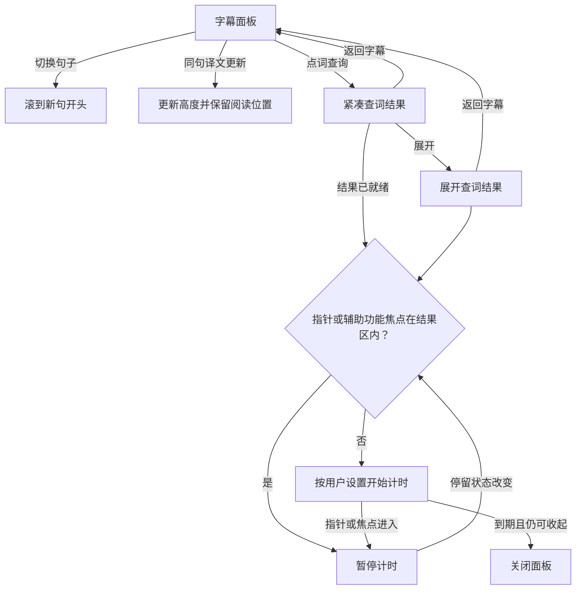

# 设计文档：界面改版六项问题修复方案

- 日期：2026-11-24
- 状态：草稿，待评审

## 1. 需求理解

1. 首要目标是让 GitHub Actions 打出的 macOS 安装包在支持的系统上使用原生 Liquid Glass，同时继续支持 macOS 15、Apple Silicon 和 Intel。
2. Mac 查词与字幕要能在切句时回到句首，在辅助功能展开后按阅读状态计时，并能从紧凑结果一步返回字幕。
3. Windows 设置页应显示翻译服务的名称。网页演示展开刘海时，应用名和使用说明都应完整可见。
4. **关键假设**是保留当前未提交的界面改版，只修审查列出的六项问题。仓库基线为 `main` 的 `1d69ee2` 加工作区改动。
5. **待确认**的是 Windows 真机上选中项的实际文字，以及修复后正式构建产物的表现。上轮已用 Mac 原生窗口和 ego-lite 复现其余四项交互问题。

### 文档与代码差异

- **README 第 6 节与发布工具链，类型待确认。** README 第 226 行按运行系统说明玻璃材质。`ControlGlass.body` 还要求编译器达到 Swift 6.2，而 `build-macos-universal` 沿用 `macos-15` 镜像的默认 Xcode 16.4。`ddb4abd`（shenziggy0，2026-11-18，`chore: 添加 GitHub Actions 手动打包工作流与安装说明`）引入了该镜像和打包脚本调用。新 README 措辞与编译条件均在未提交的改版中，**这处差异的来源提交未查到**。它直接影响正式包，需修发布配置。[README](../../README.md#6-已知边界与未验证项) · [构建任务](../../.github/workflows/package.yml#L71) · [材质实现](../../macos-starter/Sources/Englishwords/Support/LexiconStyle.swift#L62) · [镜像引入提交](https://github.com/shenziggy0/notchword/commit/ddb4abd8f9a44430521779835ebf6688d33f7ec6)
- **RFC 0006 第 2.3 节与辅助功能展开，属于新入口待实施的设计。** 原设计要求结果展示后根据指针位置管理计时。新增紧凑按钮可在鼠标位于窗外时触发 `expand()`，该方法取消计时后只重新绘制。`e7be9ca`（shenziggy0，2026-11-18，`0.1.0`）写入计时规则。`2bb78d3`（shenziggy0，2026-11-03，`初始提交：Notchword（刘海查词 + 翻译）macOS 应用`）引入展开时取消计时的逻辑。将辅助功能按钮接入该逻辑的改动尚未提交，**新入口的来源提交未查到**。[既有计时设计](0006-完整功能收尾与缺陷修复方案.md#23-面板与区域-ocrf3f7) · [展开入口](../../macos-starter/Sources/Englishwords/Notch/ResultView.swift#L101) · [计时实现](../../macos-starter/Sources/Englishwords/Notch/PanelController.swift#L177)

## 2. 接口改动

外部 API、命令行参数、偏好键、翻译协议和错误码均无改动。以下改动限于发布任务、客户端内部呈现逻辑及演示页。

### P1 · macOS 发布工具链

在 `.github/workflows/package.yml` 的 `build-macos-universal` 作业级设置 `DEVELOPER_DIR=/Applications/Xcode_26.3.app/Contents/Developer`，让测试和打包使用同一套工具。该镜像同时预装 Xcode 16.4 和 26.3，后者提供 Swift 6.2.3 和 macOS 26.2 SDK。测试前记录 `xcodebuild -version`、`swift --version` 和 `xcrun --sdk macosx --show-sdk-version`。路径缺失或实际工具链低于 Swift 6.2、macOS SDK 26 时，该作业以非零状态退出并输出实际版本。[GitHub 镜像清单](https://github.com/actions/runner-images/blob/main/images/macos/macos-15-arm64-Readme.md) · [Apple 工具链与 SDK 对照](https://developer.apple.com/xcode/system-requirements)

继续调用 `macos-starter/test.sh` 和 `macos-starter/build.sh`。后者已检查签名、双架构和随包词库。构建后、封装 DMG/PKG 前，从实际 `.app` 的两个架构分别读取对 `SwiftUI.View.glassEffect` 的链接引用。可用 `xcrun nm -arch arm64 -u` 或 `-arch x86_64` 读取主程序，再用 `xcrun swift-demangle` 解码。任一分片缺少该引用即停止封装，避免只有兼容材质的安装包进入发行流程。运行时继续由 `ControlGlass` 处理系统版本、增强对比度和减少透明度。[打包脚本](../../macos-starter/build.sh) · [部署目标](../../macos-starter/Package.swift#L16)

### P2 · 字幕切句时重置滚动位置

上轮在 312 点高的字幕面板读到第一句底部，切到下一长句后仍向下偏移 218 点。当前 `.id(subtitle.tracker.current?.start)` 取值于 AppKit 控制器的 `content(...)`。连续两句都达到高度上限时，窗口无需重绘，这个标识也不会更新。[控制器的高度判断](../../macos-starter/Sources/Englishwords/Notch/PanelController.swift#L253) · [当前滚动容器](../../macos-starter/Sources/Englishwords/Notch/ResultView.swift#L55)

移除控制器外层的 `.id(...)`。在字幕专用的私有 SwiftUI 视图中用 `@ObservedObject` 观察 `SubtitleTracker`，复用 `NotchViewport`，用 `ScrollViewReader` 包住实际滚动区，并给顶部内容一个固定锚点。跟踪器拟新增只读内部计算属性 `currentCueID: CueID?`。`CueID` 是可比较的值，由现有来源标识与 `current.start` 组成。有网页视频时取 `target` 的浏览器和视频 ID，无视频标识的屏幕字幕取现有 `ocrGeneration`。空句返回 `nil`。这是为了区分两段视频中同样从零开始的字幕。句子身份改变时滚至顶部，保留控件和读屏焦点。同句补译、结束时间更新只重测高度，原偏移保留在有效范围内。`layoutRevision` 继续过滤过期的高度回调。[字幕视图](../../macos-starter/Sources/Englishwords/Notch/SubtitleView.swift) · [句子更新与重置](../../macos-starter/Sources/Englishwords/Subtitle/SubtitleTracker.swift#L217)

### P2 · 辅助功能展开后的自动收起

复用 `PanelController.restartHideTimer()` 和唯一的 `hideWorkItem`。`expand()` 完成布局后按当前指针位置和面板内辅助功能焦点重新判断。结果、未收录及失败态在两者都位于窗外时，从完整的 `preferences.autoHideInterval` 开始计时。指针或辅助功能焦点进入时取消计时，最后一项离开后重启。加载和字幕沿用现有免计时规则，Esc 和显式收起仍可随时关闭。[面板控制器](../../macos-starter/Sources/Englishwords/Notch/PanelController.swift#L346)

现有轮询只能感知鼠标。给 `ResultView` 加一个默认空的内部回调 `onAccessibilityFocusChanged: ((Bool) -> Void)?`，由真实宿主接收。用 `@AccessibilityFocusState` 观察正文与按钮的辅助功能焦点，仅在焦点进出整个结果区时通知。面板内换控件继续暂停计时，指针移出时也应保留读屏正在使用的展开控件。关闭或切换内容时清理旧焦点，忽略离屏测量和旧视图的迟到通知。单次 `AXPress` 本身不代表焦点一直留在面板内。[Apple 辅助功能焦点](https://developer.apple.com/documentation/swiftui/accessibilityfocusstate)

### P3 · 紧凑查词结果一步返回字幕

在 `ResultView` 的紧凑行中，将词条摘要的「展开」和「返回字幕」放成两个同级按钮。仅在现有 `onBackToSubtitle` 有值时显示返回操作，为它预留固定点击区和读屏名称，长词优先截断摘要。展开态沿用同一回调。`AppDelegate` 已将它接到 `showSubtitle(peek: false)`，复用当前跟踪位置和视频暂停状态。验证一次点击只执行所选动作，特别留意宿主 `mouseDown` 的展开兜底。[结果视图](../../macos-starter/Sources/Englishwords/Notch/ResultView.swift#L99) · [返回回调](../../macos-starter/Sources/Englishwords/App/AppDelegate.swift#L144)

### P3 · Windows 服务预设的选中名称

先在 Windows 的「设置 → 翻译服务」记录改前的下拉列表、收起后的文字和选中值。`PresetCombo` 用 `DisplayMemberPath="Name"` 显示名称，用 `SelectedValuePath="Value"` 保存枚举。当前公共 `ComboBox` 模板只传递 `SelectionBoxItem` 和 `SelectionBoxItemTemplate`。方案是在选中项的 `ContentPresenter` 补齐 `ContentTemplateSelector="{TemplateBinding ItemTemplateSelector}"` 和 `ContentStringFormat="{TemplateBinding SelectionBoxItemStringFormat}"`。继续使用现有预设对象与保存处理。在 Mac 上可以修改和交叉编译，界面显示由 Windows 实机核实。若改前的名称和保存值均正确，则记录版本和对照结果，避免无效修改。[公共模板](../../windows-starter/src/Englishwords.Win/App.xaml#L242) · [预设绑定](../../windows-starter/src/Englishwords.Win/Views/SettingsWindow.xaml.cs#L70) · [微软 .NET 8 默认模板](https://github.com/dotnet/wpf/blob/v8.0.0/src/Microsoft.DotNet.Wpf/src/Themes/XAML/ComboBox.xaml#L1143-L1147)

### P3 · 网页演示的中等宽度标题栏

三列布局要容纳最大宽度 `31.5rem` 的刘海、两侧文字和页边距。现有 `750px` 断点还同时改变页面滚动和底部工具栏。把 `.workspace-top`、`.notch-layer`、`.brand`、`.help` 的两行排列单独提前到 `56em`（默认字体下约 896 CSS 像素），第一行居中放刘海，第二行分放应用名与使用说明。原 `750px` 断点继续负责页面滚动和工具栏。沿用同一组 HTML 控件、焦点顺序及 H/Esc 处理。[演示页布局](../../demo/notch-demo.html#L101) · [现有窄屏规则](../../demo/notch-demo.html#L293)

## 3. 数据库改动

无改动。六项修复只涉及构建和呈现状态。词典、词素库、收藏与历史的 `favorites`、`lookups` 表均沿用原结构。迁移及回滚 DDL 均无。

## 4. 流程图

Mac 的两个独立判断分别是「换句是否归顶」和「查词结果何时收起」。返回字幕复用原播放会话。

## 5. 范围边界

- 优先修发布工具链。三项 Mac 面板变更按切句、计时、返回入口分别验收。Windows 与网页可独立推进。
- 范围外包括取词与翻译策略、字幕采集与对齐、视频播放控制协议、密钥处理、签名发行身份和发布触发方式。
- 实施前先核对相关文档与实际入口。沿用现有方法、数据模型和定时器，新增状态限于句子切换和辅助功能焦点所需的信息。命名与职责跟随所在模块，测试集中在下面六条用户路径。

## 6. 验收标准

- [ ] **正式构建。** 带本次修复的 `build-macos-universal` 日志列出 Xcode 26.3、Swift ≥ 6.2 和 macOS SDK ≥ 26。CI 产物的 `arm64`、`x86_64` 两个分片均引用 `SwiftUI.View.glassEffect`，最低部署版本为 15.0，签名与随包查词自检成功。取同一份产物在 macOS 26 或更新系统打开真实窗口核对原生玻璃和「减少透明度」实色效果，在 macOS 15 核对兼容材质与正常启动。区分构建证据与两种系统的运行结果。
- [ ] **字幕切句。** 用 Safari 或 Chrome 播放带双语字幕轨的本地视频页面，关闭「查看字幕时暂停视频」，使连续两句都需要滚动。将第一句滚到底，自动切到第二句后首行可见，纵向偏移在 0–1 点。手动切回也从头开始。另用英文轨与本地语言包观察同句译文到达，在原偏移仍有效的前提下，偏移变化不超过 1 点。短句恢复按内容高度显示。
- [ ] **辅助功能计时。** 设置 2 秒自动收起，将指针留在窗外，通过真实辅助功能按下操作展开结果。焦点在窗外时，展开后 1.8 秒仍可读，3 秒时已关窗。另用 VoiceOver 将焦点停在正文超过 3 秒，面板仍可读。焦点离开且指针在外后，从离开时重新计算相同时间。鼠标停留仍暂停计时，Esc 可关闭。
- [ ] **返回字幕。** 关闭悬停展开，开启「查看字幕时暂停视频」，停在某个已知字幕句上点词。紧凑态一次点击或一次 `AXPress` 即可返回该句，不经过展开态。展开态返回同样有效，返回动作保持视频原有暂停状态。普通快捷键查词的紧凑行只提供展开操作。
- [ ] **Windows 预设。** Windows 真机上依次选择「自定义」和「DeepSeek」，分别核对列表、收起后的显示及重新打开设置时的保存值。界面显示各自的 `Name`，保存值为对应的 `ProviderPreset`。再核对共用模板的「面板位置」能正确显示两种普通文本项。该项只需本地设置交互。
- [ ] **网页标题栏。** 在 ego-lite 打开 `demo/notch-demo.html?open=1`，检查 750、751、790、812、1024 CSS 像素及新断点两侧。展开时标题文字、刘海、使用说明的可见矩形互不重叠，文字末端点击命中正确元素，页面无横向溢出。1024 像素下刘海居中，H/Esc 可反复开合。在中等宽度增加浏览器缩放再核对一次。

## 7. 影响面

| 模块 | 实施时需保住的行为 |
| --- | --- |
| macOS 构建与发布 | 固定工具链只影响 Mac 作业。镜像移除所选 Xcode 时应给出可定位的失败信息。最低系统版本、Universal 产物、Windows 作业和按 tag 打包继续沿用现有配置。 |
| Mac 面板 | 采集轮询和同句译文更新可多次到达。滚动由切句驱动，系统窗口只按尺寸变化调整。保留非激活窗口、Esc、减少动态效果及过期回调保护。 |
| Windows 设置 | 公共模板同时供翻译服务和面板位置使用。预设的地址、模型与现有保存逻辑由原事件处理。 |
| 网页演示 | 只调整标题栏的换行宽度。底部工具栏、正文滚动和窄屏触摸区域继续使用原规则。 |

## 8. 回滚方案

- **发布工具链。** 若新工具链破坏 Universal 构建或 macOS 15 启动，可单独撤回工具链选择及配套检查，恢复上一可用构建流程。该流程生成的兼容材质包须按实际能力标注，原生玻璃发布验收仍为待完成。
- **Mac 面板。** 若出现字幕跳位、读屏被提前关闭或返回时触发额外播放动作，只撤回对应的滚动观察、焦点计时或紧凑行布局变更。保留既有面板动画修复以及其他已通过的功能。
- **Windows 与网页。** 下拉显示或标题布局出现回归时，分别撤回对应模板绑定或标题栏媒体规则。各端回滚后复跑第 6 节对应路径。用户数据、偏好和词库均无需回滚。
