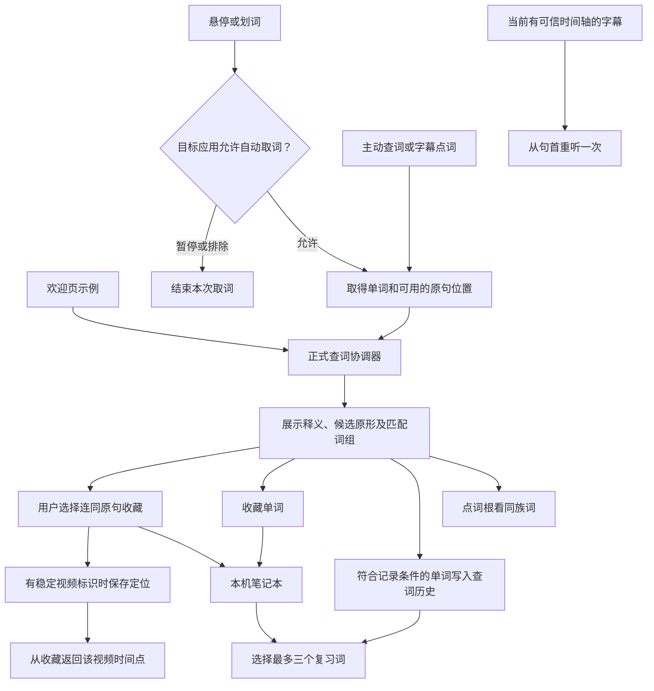

# 设计文档：查词准确性与原句复习

- 编号：RFC 0011
- 日期：2026-11-24
- 状态：已实施，部分实机验收待补
- 基线：Englishwords `main`，`6dd4875` 及当前工作区。远端未提供 `develop` 分支。

## 1. 需求理解

1. 用户在原句里查 `foiled`，需要同时看到常用动词义“挫败”和独立形容词义。用错词义会读反整句话，优先级高于增加学习功能。
2. 首次打开就能点出第一个词；打开翻译设置就能判断本机能做什么。读到词组时可以按整组理解，读到词根时可以找到同族词。
3. 收藏保留用户当时选中的意思和原句；后来可以拿原句复习，或在可定位的视频里重听。同一应用的自动取词可以暂停半小时。
4. **关键假设**：共用词库和学习功能覆盖两端。Mac 使用既有的 Apple 翻译和字幕链路，Windows 使用现有托盘、划词和联网翻译。样句取自[交互演示](../../demo/notch-demo.html)，功能覆盖依据 [README](../../README.md) 和 [Windows MVP](0008-Windows版本MVP实施方案.md)。
5. **待确认**：第一批人工校对的短语清单，以及能在真机上从收藏重新定位的站点。验收至少包含 `walk someone through` 和一个有稳定视频标识的站点；其他站点按实测能力开放。

### 文档与代码差异

**一处文档过期。** [架构说明 §14.1](../ARCHITECTURE.md#141-功能清单与归属) 第 912 行仍写“面板未提供星标，收藏在笔记本窗口内完成”。现行 [ResultView.header](../../macos-starter/Sources/Englishwords/Notch/ResultView.swift) 已展示书签，[NotebookStar](../../macos-starter/Sources/Englishwords/Notebook/NotebookWindow.swift) 会实际写入收藏。本次扩展这个入口。经提交差异核对，来源如下。

| 提交 | 作者、日期与摘要 | 与这条记录的关系 |
|---|---|---|
| `77ed81f` | shenziggy0，2026-11-04，《把 M5.5 的标识迁移、热键、词素和区域取词放到临时分支，供 Mac 编译验证。》 | 表格记载“M5 已隐藏占位按钮”，与当时面板一致。 |
| `e7be9ca` | shenziggy0，2026-11-18，《0.1.0》 | 将笔记本模型传入面板，新增可点击的 `NotebookStar` 并接通收藏写入，原状态从此过期。 |
| `f810faf` | shenziggy0，2026-11-22，《fix: 完成双端全量缺陷修复、词库词素纠偏与 0。5。2 打包同步》 | 把表格改为现在的“面板未提供星标”，该提交的面板仍保有可用书签。 |
| `6dd4875` | shenziggy0，2026-11-24，《重做双端界面并修复发布与交互问题》 | 调整书签位置并接入辅助功能焦点，保留原有收藏动作。 |

## 2. 接口改动

本次均为本机接口。下表中的新增数据和操作是拟议契约，现有调用方可继续只传单词。沿用两端已有的查询失败、翻译失败与笔记本错误通道，无新增 HTTP 接口或错误码。

| 功能与入口 | 输入、输出与失败行为 |
|---|---|
| **词形与释义**。[词库生成](../../macos-starter/scripts/build_dictionary.py)、[Swift DictionaryStore](../../macos-starter/Sources/Englishwords/Dictionary/DictionaryStore.swift)、[C# DictionaryStore](../../windows-starter/src/Englishwords.Core/Dictionary/DictionaryStore.cs) | 当前构建在变形本身也是词头时跳过映射，`forms` 也只能存一个原形。保留既有单结果查询，在正式查询结果里补充候选读法，每条带原形、词形类别和释义。由原形自身的屈折字段构建关系，保留一词多源，不沿 `0:` 链递归改写。相同原形的过去式和过去分词合并展示。对 `foiled` 这类独立词条掩盖常用动词义的情况，在紧凑态给出经校对的“`foil` 的过去式／过去分词，挫败、阻止”，展开可看双方完整词条。无上下文时明示“也可能是”，保留用户的词典顺序。 |
| **首次查词**。[Mac 引导](../../macos-starter/Sources/Englishwords/Onboarding/OnboardingWindow.swift)、[Mac 入口](../../macos-starter/Sources/Englishwords/App/AppDelegate.swift)、[Windows 入口](../../windows-starter/src/Englishwords.Win/App.xaml.cs) | 在欢迎页展示含 `abduct` 的英文句子。点击后用专门的示例触发来源调用现有查询协调器，读取随包词库，在正式面板显示释义。用户随后可继续授权、跳过或从菜单重开。Windows 在托盘初始化后仅为首次使用者展示轻量欢迎窗，已有用户可从托盘打开。示例缺资源时就地报错，可重试；示例不触发联网或写查词历史。 |
| **翻译设置**。[Mac 设置](../../macos-starter/Sources/Englishwords/Settings/SettingsWindow.swift)、[AppleTranslate](../../macos-starter/Sources/Englishwords/Translate/AppleTranslate.swift)、[Windows 设置](../../windows-starter/src/Englishwords.Win/Views/SettingsWindow.xaml) | Mac 由语言包状态决定主操作：已安装时“试译一句”直接调用本地 `translate`；缺包时“准备语言包”；不支持或失败时显示实际原因。两端关闭联网时收起服务地址、模型、密钥和连接测试，重新开启后展示已存配置。Windows 明示离线查词和整句翻译各需什么。保留现有“测试当前服务”作为独立的联网操作。 |
| **取词上下文、词组和收藏**。[Swift 查询模型](../../macos-starter/Sources/Englishwords/Lookup/LookupTypes.swift)、[C# 查询模型](../../windows-starter/src/Englishwords.Core/Lookup/LookupTypes.cs)、[Mac 选词](../../macos-starter/Sources/Englishwords/Lookup/AXPicker.swift)、[Windows 选词](../../windows-starter/src/Englishwords.Win/Interop/SelectionCapture.cs)、[字幕点词](../../macos-starter/Sources/Englishwords/Notch/SubtitleView.swift) | 给 `LookupRequest` 增加可选的“当前句、被点词起点与长度”。偏移统一按原句 UTF-16 计，指向实际点击的那次出现。字幕直接传当前句；系统选区只在原应用可可靠取得句界与位置时附带。剪贴板单词、只有文字没有位置的 OCR、失效选区均降级为普通查词。结果面板按词边界匹配包含点击位置的短语，优先最长匹配；`walk someone through` 的空位只接受词表指定的人称代词。书签保留单击收藏，另加“连同原句收藏”，写入前展示原句和可选读法。 |
| **笔记本与三词复习**。[Mac Store](../../macos-starter/Sources/Englishwords/Notebook/NotebookStore.swift)、[Mac 笔记本](../../macos-starter/Sources/Englishwords/Notebook/NotebookWindow.swift)、[Windows Store](../../windows-starter/src/Englishwords.Core/Notebook/NotebookStore.cs)、[Windows 笔记本](../../windows-starter/src/Englishwords.Win/Views/NotebookWindow.xaml.cs) | 原 `setFavorite` 普通开关继续可用，新增“保存当前例句”和“读复习词，最多 3 个”。收藏列表显示词、释义和最近保存的例句，同词其他例句在详情展开。保留现有规范化词头作收藏和统计键；原句按表面拼写高亮，释义按实际选择保存。复习从近 7 个本地自然日的主动查询中选词，先按查询过的不同日期数、再按次数和最近时间排序，至少出现两天。排除悬停、自动划词、欢迎示例及笔记本内重查。用已保存原句挖空，有词无句时改用释义卡；不足三词按实际数量，零词时显示原因。翻面、揭晓均不记作查词。 |
| **词根联想**。[词素构建](../../macos-starter/scripts/build_wordparts.py)、[拆词数据](../../macos-starter/data/wordparts.tsv)、[Mac 结果面板](../../macos-starter/Sources/Englishwords/Notch/ResultView.swift)、[Windows 结果面板](../../windows-starter/src/Englishwords.Win/Views/NotchPanelWindow.xaml.cs) | 解码 `segments` 时将已有的词素 ID 带到面板。点击词根，查询同一 ID 的其他单词，按随包词库词频优先、拼写稳定排序，取最多 3 个有释义的结果。点击可进入已有查词入口并返回原词。无其他词时不显示展开操作；仅有相似字母的单词不会进入结果。 |
| **字幕重听与收藏跳转，仅 Mac**。[SubtitleTracker](../../macos-starter/Sources/Englishwords/Subtitle/SubtitleTracker.swift)、[字幕浏览器脚本](../../macos-starter/Sources/Englishwords/Resources/subtitle.js) | 在已有 `state / pause / play` 旁新增重听操作，传本页视频标识和当前句起止秒数，返回成功或不可定位。仅在字幕有可信媒体时间且区间可跳转时展示。触发后从句首播放一遍；原先暂停则句末暂停，原先播放则继续。换视频、手动暂停或拖动后撤销本次控制，沿用已有广告和受保护视频检查。收藏跳回另用可重建的站点视频标识和时间；首选在 YouTube 普通单视频页验证，从收藏点开后核对视频身份。页面内临时 ID、带签名的媒体地址及 OCR 采集时间均不能用作长期定位。 |
| **当前应用暂停半小时**。[Mac 应用规则](../../macos-starter/Sources/Englishwords/Support/Permissions.swift)、[Mac 悬停](../../macos-starter/Sources/Englishwords/Lookup/HoverMonitor.swift)、[Windows 划词](../../windows-starter/src/Englishwords.Win/Interop/SelectionMonitor.cs) | 菜单打开前锁定外部应用身份，显示“在〈应用名〉暂停自动取词 30 分钟”及“提前恢复”。复用偏好设置保存应用标识和截止时间，过期即失效，重启后继续按截止时间判断。仅在被动采集和提交前检查，取消已排队的该应用取词。Mac 悬停以光标实际所属应用复核，Windows 划词以选区所属进程复核。其他应用及原本允许的主动快捷键照常；永久排除和密码框保护优先。 |

## 3. 数据库改动

下列表和列均为拟新增。两个只读资源库由同一套脚本生成，Windows 项目已[直接引用这两份资源](../../windows-starter/src/Englishwords.Win/Englishwords.Win.csproj)。用户库由两端各自迁移。

| 库 | 结构与兼容策略 |
|---|---|
| `dictionary.sqlite` | 保留现有 `words`、`forms` 和默认查询行为。新增 `form_readings(form, lemma, kind, short_gloss)`，以 `(form, lemma, kind)` 为主键，记录既有映射表达不了的独立词条／多原形读法。仅需校对摘要时填 `short_gloss`，其余复用原形释义。新增 `phrases(pattern, gloss)`，以规范化词组模式为主键，由随仓库维护的小型词表生成；同一份数据供两端使用。新客户端读旧库时按表存在情况退回单词查询。 |
| `wordparts.sqlite` | 在现有构建解析阶段生成 `part_words(part_id, word)`，以两列为联合主键。同一个词根 ID 与词头只写一次，可按 `part_id` 直接取词族。现有 `parts`、`words.segments` 和旧客户端的拆词读取均兼容。 |
| `user.sqlite` | 从 v1 迁至 v2，只新增下表，保留 `favorites`、`lookups` 和原有统计索引。旧收藏即时可读，原句只能由用户后续补存。复习题从现有历史查询生成，无新增答题记录表。暂停截止时间使用各端偏好设置。 |

**用户库升级 DDL。** 每个写连接先启用外键，取得写事务后重读 `user_version`。仅在 v1 执行建表，建表与版本号同事务提交；全新库经现有建库逻辑进入同一迁移。失败回滚并显示可重试错误，词典仍可查询。

```sql
PRAGMA foreign_keys = ON;
BEGIN IMMEDIATE;
CREATE TABLE favorite_examples (
    word          TEXT NOT NULL REFERENCES favorites(word) ON DELETE CASCADE,
    sentence      TEXT NOT NULL,
    word_start    INTEGER NOT NULL CHECK (word_start >= 0),
    word_length   INTEGER NOT NULL CHECK (word_length > 0),
    meaning       TEXT NOT NULL,
    saved_at      INTEGER NOT NULL,
    video_ref     TEXT,
    video_seconds REAL,
    PRIMARY KEY (word, sentence, word_start),
    CHECK ((video_ref IS NULL AND video_seconds IS NULL) OR
           (video_ref IS NOT NULL AND video_seconds IS NOT NULL AND video_seconds >= 0))
) WITHOUT ROWID;
PRAGMA user_version = 2;
COMMIT;
```

应用层在写入前校验 UTF-16 范围与所选词吻合；`video_ref` 只存站点和稳定视频标识。`saved_at` 沿用 Unix 秒。父收藏与例句放在一个事务里写入；重复保存同一位置更新所选释义，来自纯文本的重试不能擦掉已有视频定位。主动取消收藏时明确提示会同时移除该词例句。升级后执行外键检查；两个客户端共用同一份迁移契约。

**回滚 DDL。** 下面仅针对已备份 v2 用户库的副本生成 v1 兼容库。保留完整 v2 原件和新增例句，普通回退不自动执行删表。只读资源随应用包整体替换；重建旧格式资源时，可在各自的构建副本中执行相应删表语句。

```sql
-- user.sqlite 的 v2 副本
BEGIN IMMEDIATE;
DROP TABLE favorite_examples;
PRAGMA user_version = 1;
COMMIT;
```

```sql
-- dictionary.sqlite 的构建副本
DROP TABLE IF EXISTS form_readings;
DROP TABLE IF EXISTS phrases;
-- 以下语句单独在 wordparts.sqlite 的构建副本执行
DROP TABLE IF EXISTS part_words;
```

## 4. 流程图



## 5. 范围边界

| 交付批次 | 交付内容 |
|---|---|
| 第一批，首次查词 | 双端词形修复、首次点词、按平台简化翻译设置。可在后两批之前单独发布。 |
| 第二批，带原句的查词 | 先打通原句与点词位置，再交付词组提示、主动保存例句、笔记本显示和 v2 迁移。 |
| 第三批，回访与控制 | 同族词、Mac 字幕重听和收藏跳回、当前应用暂停、三词复习。暂停和词根查询可独立交付。 |

本次边界为本地英文查词和基于用户材料的轻量复习。云同步、通用语境模型、长篇原文归档、音视频下载、Windows 字幕引擎及完整背词课程均在范围外。[RFC 0006](0006-完整功能收尾与缺陷修复方案.md) 对自动历史的隐私约束继续适用；[RFC 0009](0009-双端与词库全量缺陷修复方案.md) 的三库冻结属于当时的修复范围，本 RFC 将新增结构和迁移作为独立交付项。

## 6. 验收标准

- [ ] **两端正式词库**：查 `foiled`，紧凑态有 `foil` 与“挫败／阻止”，展开仍能找到独立形容词义；换查 `founded / roses / abandoning`，默认词头分别为 `found / rose / abandon`。
- [ ] **第一次打开**：两端用新配置、断网、无密钥、无取词授权打开欢迎页，点 `abduct` 在正式面板看见释义，能跳过和重开；该词未进入个人历史。Mac 已装包时能本地试译，缺包显示准备入口；Windows 联网关闭时仍可查词。两端开关联网设置后已保存配置仍可用。
- [ ] **词组和词根**：在 `Let me walk you through what actually happened.` 点 `walk` 或 `through`，均可见词组义；`I walk to school.` 只展示普通词义。由 `abduct` 点 `duct`，能进入真实同词素词条并返回。用 [词素源表](../../macos-starter/data/wordparts.tsv) 的 `conduct`、`deduct` 核对同族关系。
- [ ] **迁移与收藏**：在原有 v1 数据的副本上升级，两端原收藏、历史条数一致。普通查词和单词收藏均不持久化原句；同一例句连存两次只有一条，同词另存一句后有两条。在含两次相同拼写的句子中只高亮点击的那处，重启后仍正确。迁移失败可重试，v1 记录不丢失；按第 8 节生成的副本可由旧版打开。
- [ ] **三词复习**：使用真实结构的本机历史，准备至少三个跨日主动查过的词和一个只被动触发的词。验证按规则选前三个、挖空位置正确、没有原句时出现释义卡；只有零至两个合格词时数量符合实际。复习前后的查词次数相等。
- [ ] **Mac 视频实机**：在一个有真实字幕轨的可定位视频中重听，同一句从句首播放一次；执行中换视频或手动拖动不会被旧指令拉回。关闭原标签后从收藏重新打开，定位到同一视频同一句。另用纯 OCR 字幕验证可以收藏文字且无重听按钮。真实站点验证单独记录浏览器、站点与结果。
- [ ] **双端实机暂停**：在 A 暂停后，A 的被动取词停止而 B 正常；菜单写对应用名称。提前恢复、重新启动后到期恢复均生效。主动快捷键遵守原有权限，永久排除应用仍受保护。Mac 覆盖悬停和划词，Windows 覆盖划词。

### 复测记录

- 2026-11-25。词库生成脚本 11 项、macOS 33 项、Windows 核心 17 项测试通过。Windows 客户端交叉编译通过。两端测试均使用正式词库与 SQLite 文件，覆盖 `foiled`、句末词组、v1 升级、例句去重与跨日复习。
- Mac 原生欢迎页点 `abduct` 显示释义且不写历史。翻译设置显示本地可用，点“试译一句”返回 Apple 本地译文。
- Chromium 使用真实语音媒体和 WebVTT 复测。重听从 0 秒开始，句末为 3.900 秒，实测在 3.923 秒暂停。重复启动及旧视频标识被拒绝，手动拖动仍然生效。
- 待补验收为 Windows 桌面交互、两端跨应用暂停实机，以及 Mac 浏览器桥接与 YouTube 从收藏跳回。试播的 YouTube 页面未向浏览器提供可用的字幕时间轨。

## 7. 影响面

- **界面与交互。** 原查询面板、笔记本和设置为主要入口。紧凑态优先释义；短语、词族及附加例句按需展开。欢迎页示例、按钮、挖空揭晓和恢复入口需支持键盘及现有读屏标签。
- **性能与数据。** 候选读法和词族按有索引的键查询；只对当前句匹配小型校对词表。笔记本原句按词加载，复习用现有日期索引查询七天记录。词库、词素库与应用一起打包，两端发布前核对资源一致性。
- **隐私与兼容。** 上下文读取沿用原有应用和密码框拦截。临时原句随本次请求释放，不进日志、自动历史或联网翻译请求；已有用户主动选择的整句翻译按原设置工作。稳定视频定位随主动收藏保存在本机。旧版客户端会拒读 v2 用户库，回退需走下节的兼容副本流程。
- **开发约束。** 动手前同时复核相关文档和实际调用方，优先扩展既有接口，沿用现有词头、词素 ID 和触发来源。每个存储字段只承担一个职责，移除临时兼容补丁；新增层或表须能解释现有实现缺少哪项能力。用真实输入、正式随包资源和实际实现覆盖上述关键路径，避免为同一行为堆重复测试。

## 8. 回滚方案

1. **触发条件。** 常用词默认原形退化、升级遗失收藏或历史、普通查询意外保存原句、视频操作了另一个播放目标时，停止发布对应批次。视频故障可单独撤回重听与跳回入口，保留字幕阅读。
2. **程序和只读资源。** 第一批与第三批可按功能撤回。词形或词族数据有误时，回退到上一套已配对的应用与资源库；能识别缺表的新客户端仍可用原单词和拆词查询。暂停功能回退时忽略新增的到期偏好，已有永久排除规则继续有效。
3. **个人数据。** 升级前对 v1 做一致性备份。若已开始写 v2，先关闭两端相关写连接，保留完整、可恢复的最新 v2 备份；只在副本执行第 3 节的回滚 DDL，校验 `integrity_check`、收藏与历史条数和词头一致后，用该副本启动旧版。这样保留升级后新增的普通收藏和历史，v2 原句可从完整备份找回。若降级期间继续学习，重升级时先迁移当前 v1，仅对仍保留的父收藏按复合主键合并备份例句，避免覆盖新记录或恢复已取消的收藏。校验失败则停止切换，保留两份数据。
