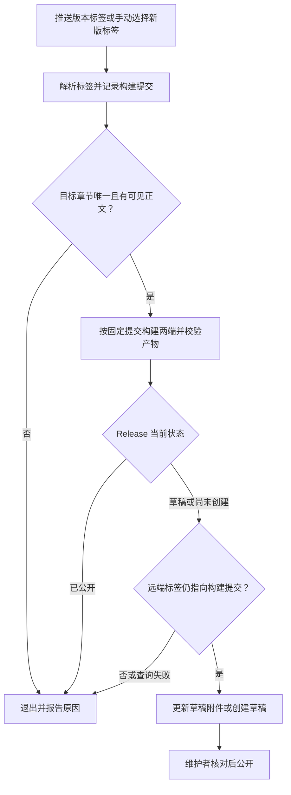

# 设计文档：发布标签校验与发布说明提取

- 日期：2026-11-25
- 状态：草稿
- 核对基线：`main@78f800e`

## 1. 需求理解

维护者需要知道哪些旧版本补跑会覆盖公开安装包，也需要能核对草稿里的安装包来自哪个提交。
打包任务已经固定构建提交。上传时还应核对远端标签，防止打包期间标签被移走后把旧产物挂到新提交名下。
发布说明应完整保留版本章节里的代码示例、链接和修复条目。只有占位注释的章节应在启动双端构建前报错。

- **关键假设**　公开版本的修订使用新标签。历史标签保留原提交，README 负责告知维护者旧工作流的实际行为。
- **待确认事项**　首次携带本 RFC 修复的版本号由维护者发版时确定。README 中的 `0.5.4` 只是示例，判断适用范围以标签实际包含的工作流为准。

### 文档与代码差异

[README「发版」](../../README.md#发版) 第 126 行说明如何按标签补跑，未交代历史版本的适用边界。当前工作流第 308–314 行检查草稿状态，而 `v0.5.2`、`v0.5.3` 所带工作流分别在第 237、277 行对已存在的 Release 执行 `upload --clobber`，公开附件也可能被替换。

- `f0b7132`，Cursor Agent，2026-11-21，《ci: 按 tag 版本把安装包挂到 GitHub Release》。该提交引入按名称覆盖已有附件的分支，两个旧标签都保留了这段逻辑。
- `78f800e`，shenziggy0，2026-11-25，《优化界面、新增&&修复bug》。该提交同时加入 README 补跑说明和对已公开 Release 的拒绝逻辑。**类型待确认（版本适用范围缺注）**。说明写成时与同提交工作流一致，差异出现在读者选择旧标签时。

## 2. 接口改动

**维护者入口。** 在 README 的补跑步骤旁列出 `v0.5.2`、`v0.5.3`。明确这两个标签会运行各自保存的工作流，已公开的版本应另建修订版本。保留现有推送标签和手动选择标签两个入口。

**上传前的提交核对。** 在 [package.yml](../../.github/workflows/package.yml) 的 `draft-release` 内复用 `needs.resolve-version.outputs.commit` 作为期望提交。现有草稿更新和新建草稿两条路径，在各自的第一条写命令前执行同一项检查。使用当前作业已有的 `gh`、仓库名和令牌：

1. 通过 `GET /repos/{owner}/{repo}/git/ref/tags/{tag}` 读取精确标签引用。轻量标签直接取 commit SHA。遇到 tag 对象时按其 SHA 调用 `GET /repos/{owner}/{repo}/git/tags/{sha}`，直到解析到 commit。
2. 只有远端提交等于期望提交时才执行上传或创建。标签缺失、查询失败、对象类型无效或提交不符均以非零状态退出。日志给出标签、期望提交及实际提交或查询错误，便于决定是否重新发版。
3. 保留已有草稿正文和已公开版本的拒绝逻辑。创建草稿时继续使用 `--verify-tag` 检查标签存在性。

**发布说明脚本。** 保留 [release-notes.sh](../../.github/scripts/release-notes.sh) 的调用约定：`bash .github/scripts/release-notes.sh <版本号> <Git 引用>`。继续读取指定提交中的 `CHANGELOG.md`。成功时将正文写入标准输出并返回 0，校验失败时将原因写入标准错误并返回 1。本地预检与 Actions 共用这一实现。

- 在现有逐行提取逻辑中记录围栏和 HTML 注释状态。仅在普通正文中识别二级标题，整份文件应恰有一个目标版本标题。反引号或波浪号围栏内的标题、链接定义和注释标记均作为示例原文保留，闭合围栏需与开启符号匹配。
- 正文一直取到下一个真正的二级标题或文件末尾。章节内的普通链接定义和后续段落一起保留。对于最后一个章节，仅剥离文件末尾连续的项目版本比较链接定义（`[Unreleased]` 和版本号），沿用当前 CHANGELOG 的页尾格式。
- 输出正文与判断正文是否可见分别处理。正文校验忽略围栏外的单行或跨行 HTML 注释、空白、纯小标题及仅定义链接的行；同行注释前后的可见文字仍有效。沿用现有 CRLF 输入兼容和首尾空行处理。

## 3. 数据库改动

无。核对使用 Git 引用和 Release 元数据，应用词库、用户数据与表结构均无迁移。

## 4. 流程图

## 5. 范围边界

实施范围为 README 的发版步骤、现有 Package 工作流和现有说明提取脚本。后续开发先核对实际调用方，复用已有命令、作业输出和 artifact；将标签核对、正文提取各保留一处，命名与现有文件一致。验收聚焦第 6 节的实际输入。

历史 Release、标签指向、仓库规则和客户端代码均在范围外。上传前复核能发现查询时已经发生的标签移动。GitHub 的引用读取与附件写入是两个操作，二者之间仍有短暂窗口，本方案不提供原子锁定。

## 6. 验收标准

- [x] 对照两个旧标签保存的工作流，README 在补跑入口点名两个版本、覆盖公开附件的后果及使用新版本的做法；维护者无需实际重跑旧版本即可核实。
- [x] 在独立测试仓库使用真实轻量标签与附注标签，分别走新建草稿和更新已有草稿。标签指向构建提交时两条路径都能上传，已有草稿正文保持原值。
- [x] 在构建提交确定后移动测试标签。对新建和更新路径各验证一次，任务须在首次写入前失败；分别核实没有新草稿、已有草稿的附件 ID 与摘要保持原值。删除测试标签后同样应在写入前停止。
- [x] 对真实提交运行发布说明脚本，在同一版本章节依次放入含二级标题的围栏示例、链接定义和末尾修复条目。逐行对照预期输出，三部分应齐全，下一版本及文件末尾的版本比较链接应排除。
- [x] 只有单行或跨行占位注释的章节应返回 1，标准输出为空；在注释外加一条可见修复说明后应返回 0。保留缺少版本、重复版本原有的失败行为。

2026-11-25 验收。私有测试仓库运行相同的附件校验与上传脚本，以小型测试附件覆盖 6 个端到端场景，全部通过。本地的 14 个真实 Git 提交用例全部通过。 [GitHub Actions 验收记录](https://github.com/shenziggy0/englishwords-rfc0012-e2e-ophtst62c/actions/runs/45536294823)

## 7. 影响面

维护者会在原有入口看到旧标签的适用边界。本地 README 命令与 CI 会采用同一正文判定，空说明可在双端构建前发现。上传作业对轻量标签增加一次只读 API 查询，附注标签每层多一次查询，沿用既有权限。用户侧影响限于今后发布的草稿说明和安装包归属。

## 8. 回滚方案

如果有效章节被拒绝或截断，先用同一提交和版本在本地重跑提取脚本，再单独回退解析改动，保留旧标签提示。若远端标签查询持续失败，暂停写入并保留该次运行的构建产物，核查标签指向和查询错误。确认同一提交仍有效后可补跑含修复的工作流；若需修改已打标签的工作流，在主分支修正并使用新版本标签发版。

本方案无数据回滚。回退主分支代码不会改变已有标签携带的工作流，也不会恢复已经替换的附件。疑似错配的草稿应暂停公开并核对提交与产物摘要，已公开版本通过新的修订版本纠正。
